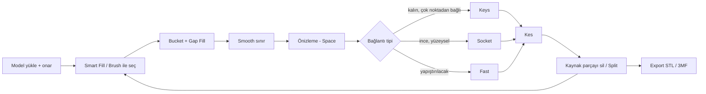

# Renk Ayırma ve Bağlantı Aracı — Proje Dokümanı

Sep 25, 2026 · @Yunus Korkmaz

## Amaç ve kapsam

Audja'nın **Color Painter + Separate by Color** akışını tarayıcıda çalışan, kendi kontrolümüzdeki bir araçla yeniden yapıyoruz. Hedef, boyanmış bölgeleri ayrı basılabilir parçalara bölüp Socket veya Keys bağlantısıyla geri birleştirilebilir hale getirmek. Böylece AMS olmadan çok renkli baskı mümkün oluyor.

- **Referans:** "How to Split 3D Model Into Multicolor Parts Without AMS | Audja #Part2" videosundaki tüm yetenekler.
- **Platform:** Web uygulaması. Tüm işlemler yerel olarak tarayıcıda yapılıyor, dosyalar sunucuya gitmiyor. Gerekirse ileride Tauri ile masaüstüne paketlenir.
- **Geliştirme:** Kodu Claude Code yazıyor. Test, görsel kontrol ve baskı denemesi bizde.
- **Çıktı:** Her parça kapalı, manifold ve slicer'a (OrcaSlicer, Bambu Studio, PrusaSlicer) hazır STL veya çok nesneli 3MF olarak.

## İş akışı

Kesim büyükten küçüğe ilerliyor: önce büyük bloklar (kafa, gövde, kollar, bacaklar), sonra bu blokların içindeki detaylar (göz, burun, diş, zırh). Her bölge için aynı döngü tekrarlanıyor.

Her kesimden sonra eski parça sarı "kaynak" rozetiyle işaretleniyor, yeni parçalar mavi görünüyor. Sonraki kesimler yeni parçalar üzerinden yapılıyor.

## Özellik listesi

Toplam 32 özellik var. Faz sütunu hangi sürümde geleceğini gösteriyor: **1** = MVP, **2** = kullanılabilir sürüm, **3** = cila ve ek özellikler.

### A. Model ve dosya

| # | Özellik | Ne yapar | Faz | Zorluk |
| --- | --- | --- | --- | --- |
| A1 | İçe aktarma | STL, OBJ, 3MF (boyalı 3MF dahil) yükleme | 1 | Kolay |
| A2 | Otomatik onarım | Delik, ters normal, non-manifold kenar düzeltme | 1 | Orta |
| A3 | Dışa aktarma | Parça başına STL, tüm parçalar çok nesneli 3MF veya ZIP | 1 | Kolay |
| A4 | Proje kaydetme | Boyama ve parça durumunu dosyaya kaydedip geri açma | 2 | Kolay |

### B. Seçim ve boyama (Color Painter)

| # | Özellik | Ne yapar | Faz | Zorluk |
| --- | --- | --- | --- | --- |
| B1 | Renk slotları | Her bölgeye ayrı slot/renk; slot listesi | 1 | Kolay |
| B2 | Smart Fill | Tıklanan yerden yüzey açısı eşiğine göre yayılır; eşik kaydırıcı + Shift+sağ tık sürükleme ile canlı ayar | 1 | Kolay–orta |
| B3 | Brush | Daire fırça, ayarlanabilir yarıçap; Shift ile silme | 1 | Kolay |
| B4 | Bucket Fill | Kapalı sınırın içini tek tıkla doldurur | 1 | Kolay |
| B5 | Gap Fill | Bölge içinde kalan küçük boşlukları eşik alanına göre kapatır | 1 | Kolay |
| B6 | Smooth sınır | Tırtıklı bölge sınırını yumuşatır; üçgenleri yeni sınır boyunca yeniden keser | 2 | **Zor** |
| B7 | Arka yüz boyama / X-ray | İçi boş ya da görünmeyen yüzleri boyama | 3 | Orta |
| B8 | Mirror boyama | Simetri ekseni boyunca aynı anda boyama | 3 | Orta |
| B9 | Auto-paint | Açılışta geometriye göre ilk bölge önerisi | 3 | Orta–zor |

### C. Kesim yöntemleri (Separate by Color)

| # | Özellik | Ne yapar | Faz | Zorluk |
| --- | --- | --- | --- | --- |
| C1 | Önizleme (Space) | Kesimden önce tapa, derinlik ve pimleri gösterir | 1 | Orta |
| C2 | Fast | Bölgeyi temiz kapalı kapakla keser (yapıştırmalık) | 1 | Orta |
| C3 | Socket: Depth | Bölgeyi içeri doğru belirli derinlikte uzatıp tapa, gövdede yuva üretir | 1 | **En zor** |
| C4 | Socket: gizmo yönü | Tapa uzama yönünü gizmo ile ayarlama | 2 | Orta |
| C5 | Socket: Squeeze | Tapayı içe doğru daraltarak yandan taşmayı önler | 2 | Zor |
| C6 | Socket: Ring Selection | Sağ tıkla halka seçip tapa kesitini yerel olarak şekillendirme | 3 | Zor |
| C7 | Socket: full surface | Tapanın tüm yüzeyi mi yoksa sadece iç kısmı mı kullanacağı seçeneği | 3 | Orta |
| C8 | Keys: pim yerleştirme | Tıklanan yere pim (mavi) ve yuva (sarı) koyar; S/E/R ve gizmo ile ölçek, taşıma, döndürme | 1 | Orta |
| C9 | Keys: clearance | Yazıcıya göre boşluk kaydırıcısı (ör. 0,1–0,4 mm) | 1 | Kolay |
| C10 | Keys: çoklu pim | Bir kesime birden fazla pim ("Add Key") | 2 | Kolay |
| C11 | Keys: şekiller | Silindir, küp, sekizgen ve yapıştırıcısız **snap** pim | 2 | Orta |
| C12 | Link all | Kapalıyken her alt parçanın derinlik/ayarı bağımsız | 2 | Orta |

### D. Parça yönetimi

| # | Özellik | Ne yapar | Faz | Zorluk |
| --- | --- | --- | --- | --- |
| D1 | Parça listesi | Tüm parçalar, görünürlük, renk, seçim | 1 | Kolay |
| D2 | Kaynak/yeni rozetleri | Kesimden sonra eski parça sarı "kaynak", yeni parçalar mavi; kaynak elle silinir | 1 | Kolay |
| D3 | Split Operation | Tek mesh içindeki kopuk parçaları ayrı nesnelere böler | 1 | Kolay |
| D4 | Undo/redo | Boyama ve kesim adımlarını geri alma | 2 | Orta |
| D5 | Hata bildirimi | Kesim başarısız olursa anlaşılır uyarı + geri dönüş | 2 | Kolay |

### E. Kullanım rahatlığı

| # | Özellik | Ne yapar | Faz | Zorluk |
| --- | --- | --- | --- | --- |
| E1 | Kamera modları | Orbit; mesh üzerindeyken Alt ile döndürme; Blender tarzı; ters zoom | 1 | Kolay |
| E2 | Kısayollar | Tüm araçlar için özelleştirilebilir kısayollar | 3 | Kolay |

## Teknik mimari

Tamamen istemci tarafında çalışan bir TypeScript web uygulaması. Ağır geometri işleri arayüzü dondurmasın diye Web Worker'da çalışıyor.

| Katman | Seçim | Görevi |
| --- | --- | --- |
| Arayüz | React + TypeScript + Vite | Paneller, slot listesi, parça ağacı, ayarlar |
| 3D görüntüleme | Three.js | Sahne, kamera, renkli mesh çizimi |
| Seçim ve fırça | three-mesh-bvh | Hızlı ray casting, fırça altındaki üçgenleri bulma |
| Gizmo | Three.js TransformControls | Pim ve socket taşıma, döndürme, ölçekleme |
| Boolean ve onarım | manifold-3d (WASM) | Kesim, pim ekleme/çıkarma, kapalı parça garantisi |
| Mesh yapısı | Yarım kenar (half-edge) veya komşuluk tablosu | Flood fill, sınır bulma, smooth |
| Durum yönetimi | Zustand + komut yığını | Undo/redo, proje kaydetme |
| Dosya | three.js loader'ları + kendi 3MF yazıcımız (JSZip) | İçe/dışa aktarma |
| Ağır işler | Web Worker (Comlink) | Boolean, smooth, onarım |
| Test | Vitest + Playwright (ekran görüntüsü) | Geometri birim testleri, görsel smoke test |

**Veri modeli:** Her üçgen bir slot kimliği taşıyor (`Uint16Array`). Bölgeler bu etiketlerden türetiliyor. Kesimde her parça yeni bir mesh oluyor ve "kaynak" parçaya bağlanıyor.

**İleride:** Tauri ile masaüstü paketi. Bununla "slicer'da aç" ve dosya ilişkilendirme özellikleri gelir; gerekirse ağır geometri Rust tarafına taşınabilir.

## Algoritma notları

Projenin riski üç yerde toplanıyor: Socket hacmi üretmek, sınırı yumuşatmak ve boolean işlemlerini bozuk girdide ayakta tutmak.

**Smart Fill (B2).** Tıklanan üçgenden BFS başlıyor. Komşu üçgene geçiş, iki normal arasındaki açı eşik değerin altındaysa yapılıyor. Eşik kaydırıcıyla değişince sonuç canlı yeniden hesaplanıyor; 1M üçgende 100 ms altı hedef.

**Gap Fill (B5).** Her bağlı renk adası için alan hesaplanıyor. Eşiğin altındaki adalar en uzun ortak sınırı paylaştıkları komşu rengi alıyor.

**Smooth sınır (B6).** Önce sınır kenarları bir polyline olarak çıkarılıyor. Polyline Laplacian ile yüzey üzerinde yumuşatılıyor ve yüzeye geri projekte ediliyor. Sonra mesh bu eğri boyunca kesilip üçgenler yeniden etiketleniyor. Daha kolay bir ilk sürüm: sınır bandını subdivide edip etiketleri çoğunluk oylamasıyla yumuşatmak.

**Fast kesim (C2).** Bölge yüzeyi normal yönünün tersine küçük bir derinlikte (ör. 1,5 mm) offsetleniyor ve kenarları dikilerek kapalı hacim `V` oluşturuluyor. Sonra `parça = model ∩ V` ve `gövde = model − V` hesaplanıyor.

**Socket (C3–C7).** Fast ile aynı mantık, tek fark `V` içeri doğru **Depth** kadar uzatılıyor. Squeeze, iç kapağı merkeze doğru ölçekleyerek tapayı konikleştiriyor. Gövdedeki yuva `V`'nin tolerans kadar büyütülmüş hâli ile açılıyor. Ring Selection, tapa kesitindeki bir halkayı taşıyıp komşularını ağırlıklı olarak takip ettiren yerel bir deformasyon. En kırılgan kısım offsetin kendini kesmesi; manifold-3d ile birleştirme veya voxel/SDF tabanlı yedek yöntem planlanmalı.

**Keys (C8–C11).** Pim tıklanan yüzey noktasına, yüzey normaline göre hizalanarak konuyor. Kesim yüzeyi bölge sınırından türetiliyor. `parça = (model ∩ V) ∪ pim` ve `gövde = (model − V) − büyütülmüş(pim, clearance)` hesaplanıyor. Pim gövdenin yeterince içinde değilse boolean anlamsız çıktı veriyor; bu yüzden yerleştirmede otomatik uyarı gerekiyor.

**Onarım (A2).** Yüklemede manifold-3d'ye veriliyor; manifold olmayan girdi için önce köşe kaynaştırma, delik kapama ve normal düzeltme yapılıyor.

**Performans.** Boyama ana thread'de ve etiket dizisi üzerinden çalışıyor. Kesim, smooth ve onarım Worker'da. Hedef, 1–2M üçgenlik modellerde akıcı boyama.

## Yol haritası ve süre

Videodaki kapsamın tamamı için toplam süre yarı zamanlı çalışıp Claude Code ile **yaklaşık 2–3 ay**. Tam zamanlı çalışılırsa bu süre kabaca yarıya iner. Süreler takvim süresi; kodun yazılması kısa sürüyor, zamanı asıl test ve düzeltme döngüsü alıyor.

| Faz | İçerik | Süre (yarı zamanlı) | Geçiş kriteri |
| --- | --- | --- | --- |
| 0. Socket testi | Elle boyanmış bir bölgeden Depth ile tapa ve yuva, 3MF çıktı, Orca'da dilimleme | 1 hafta sonu – 1 hafta | Tapa ve yuva basılıp birbirine oturuyor |
| 1. MVP | A1–A3, B1–B5, C1–C3, C8–C9, D1–D3, E1 | 3–4 hafta | Videodaki kafa ve kol kesimleri yapılabiliyor |
| 2. Kullanılabilir sürüm | A4, B6, C4–C5, C10–C12, D4–D5 | 4–6 hafta | Videodaki 20 parçalı model baştan sona çıkarılabiliyor |
| 3. Cila | B7–B9, C6–C7, E2, performans | 2–4 hafta | 1–2M üçgende akıcı çalışıyor |

**Faz 0 neden önce?** Socket projenin en riskli parçası. Çalışmazsa mimari (ör. voxel/SDF yaklaşımına geçiş) baştan değişir. O yüzden arayüzden önce çözülmesi gerekiyor.

**Her fazın sonunda:** Birkaç test modeli (AI üretimi bir figür, internetten indirilmiş bozuk bir STL, low-poly bir model) ile kesim yapıp gerçekten baskı almak.

## Riskler ve açık kararlar

| Risk | Etki | Önlem |
| --- | --- | --- |
| Socket offsetinin kendini kesmesi | Kesim patlar veya parça kapanmaz | manifold-3d ile birleştirme, gerekirse voxel/SDF yedek yöntem, Faz 0'da test |
| Bozuk girdi mesh'leri | Boolean hataları | Yüklemede zorunlu onarım, anlaşılır hata mesajı |
| Smooth sınırın zorluğu | Faz 2 uzar | Önce subdivide + çoğunluk oylaması ile basit sürüm |
| Tarayıcı bellek sınırı | Çok büyük modellerde çökme | Worker, tipli diziler; gerekirse Tauri |
| Pim ince duvara denk gelmesi | Basılı parça kırılır | Yerleştirmede kalınlık kontrolü ve uyarı |

**Kapsam dışı:** Sculpt, AI ile model üretimi, doku uygulama, kalıp, hollow, destek, render ve video, AR, Chroma katman boyama.

**Açık kararlar**

- [ ] Proje ve uygulama adı
- [ ] Sadece kendi kullanımımız için mi, yoksa ileride ürün olarak mı yayınlanacak?
- [ ] Varsayılan clearance ve derinlik değerleri (yazıcı ve filament testiyle belirlenecek)

## Kaynaklar

- [Audja #Part2 videosu (MTR CGSTUDIO)](https://www.youtube.com/watch?v=8_-bnoTIyAY): tüm özelliklerin referansı
- [Audja](https://audja.com/)
- [Audja Workflow](https://audja.com/workflow)
- [PlainMesh Fill & Split](https://www.plainmesh.com/tools/fill-and-split): web'de benzer bir referans uygulama
- [manifold-3d](https://github.com/elalish/manifold)
- [three-mesh-bvh](https://github.com/gkjohnson/three-mesh-bvh)
