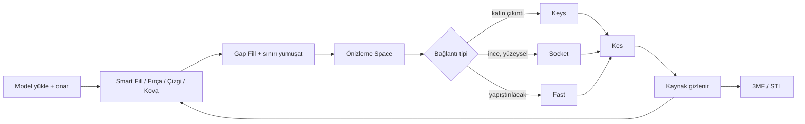

# Renk Ayırma ve Bağlantı Aracı — Proje Dokümanı

Sep 25, 2026 · @Yunus Korkmaz

**Durum (18 Ekim 2026):** Amaç aynı. Tablodaki A1–E2 ve yol haritasındaki X1–X52 kodda. Kesim ve boyama yolunun ayrıntısı `docs/ARCHITECTURE.md`. İş durumu `docs/ROADMAP.md`; sıradaki numara X53. Bu dosya amaç, kapsam ve özellik kimlikleri içindir.

## Amaç ve kapsam

Audja'nın **Color Painter + Separate by Color** akışını tarayıcıda çalışan, kendi kontrolümüzdeki bir araçla yeniden yapıyoruz. Hedef, boyanmış bölgeleri ayrı basılabilir parçalara bölüp Socket veya Keys bağlantısıyla geri birleştirilebilir hale getirmek. Böylece AMS olmadan çok renkli baskı mümkün oluyor.

- **Referans:** "How to Split 3D Model Into Multicolor Parts Without AMS | Audja #Part2" videosundaki tüm yetenekler.
- **Platform:** Web uygulaması. Tüm işlemler yerel olarak tarayıcıda yapılıyor, dosyalar sunucuya gitmiyor. Gerekirse ileride Tauri ile masaüstüne paketlenir.
- **Geliştirme:** Kodu Claude Code yazıyor. Test, görsel kontrol ve baskı denemesi bizde.
- **Çıktı:** Her parça kapalı, manifold ve slicer'a (OrcaSlicer, Bambu Studio, PrusaSlicer) hazır STL veya çok nesneli 3MF olarak.

## İş akışı

Kesim büyükten küçüğe ilerliyor: önce büyük bloklar (kafa, gövde, kollar, bacaklar), sonra bu blokların içindeki detaylar (göz, burun, diş, zırh). Her bölge için aynı döngü tekrarlanıyor.

Her kesimden sonra eski parça sarı "kaynak" rozetiyle gizleniyor, yeni parçalar mavi "yeni" rozeti alıyor. Sonraki kesimler yeni parçalar üzerinden yapılıyor. Kopuk parçaları ayırmak ayrı bir işlem (D3).

## Özellik listesi

Toplam 32 özellik var; hepsi uygulandı. Faz sütunu ilk plandaki sıradır: **1** = MVP, **2** = kullanılabilir sürüm, **3** = cila. Tablodaki "Ne yapar" sütunu bugünkü davranıştır. Algoritma `docs/ARCHITECTURE.md` ile aynıdır.

### A. Model ve dosya

| # | Özellik | Ne yapar | Faz | Zorluk |
| --- | --- | --- | --- | --- |
| A1 | İçe aktarma | STL, OBJ, 3MF (boyalı 3MF dahil) yükleme | 1 | Kolay |
| A2 | Otomatik onarım | Delik, ters normal, non-manifold kenar düzeltme | 1 | Orta |
| A3 | Dışa aktarma | Parça başına STL, tüm parçalar çok nesneli 3MF veya ZIP | 1 | Kolay |
| A4 | Proje kaydetme | Boyama ve parça durumunu dosyaya kaydedip geri açma | 2 | Kolay |

### B. Seçim ve boyama (Color Painter)

| # | Özellik | Ne yapar | Faz | Zorluk |
| --- | --- | --- | --- | --- |
| B1 | Renk slotları | Her bölgeye ayrı slot/renk; slot listesi | 1 | Kolay |
| B2 | Smart Fill | Tıklanan yerden yüzey açısı eşiğine göre yayılır; eşik kaydırıcı + Shift+sağ tık sürükleme ile canlı ayar | 1 | Kolay–orta |
| B3 | Brush | Daire fırça, ayarlanabilir yarıçap; Shift ile silme | 1 | Kolay |
| B4 | Bucket Fill | Kapalı sınırın içini tek tıkla doldurur | 1 | Kolay |
| B5 | Gap Fill | Bölge içinde kalan küçük boşlukları eşik alanına göre kapatır | 1 | Kolay |
| B6 | Smooth sınır | Sınırı Gauss eğrisi ve alan dengesiyle yumuşatır. "Üçgenleri böl" açıkken eğri üçgenlerin içinden geçer | 2 | **Zor** |
| B7 | Arka yüz boyama / X-ray | İçi boş ya da görünmeyen yüzleri boyama | 3 | Orta |
| B8 | Mirror boyama | Simetri ekseni boyunca aynı anda boyama | 3 | Orta |
| B9 | Auto-paint | Açılışta geometriye göre ilk bölge önerisi | 3 | Orta–zor |

### C. Kesim yöntemleri (Separate by Color)

| # | Özellik | Ne yapar | Faz | Zorluk |
| --- | --- | --- | --- | --- |
| C1 | Önizleme (Space) | Kesimden önce tapa, derinlik ve pimleri gösterir | 1 | Orta |
| C2 | Fast | Bölgeyi temiz kapalı kapakla keser (yapıştırmalık) | 1 | Orta |
| C3 | Socket: Depth | Bölgeyi içeri doğru belirli derinlikte uzatıp tapa, gövdede yuva üretir | 1 | **En zor** |
| C4 | Socket: gizmo yönü | Tapa uzama yönünü gizmo ile ayarlama | 2 | Orta |
| C5 | Socket: Squeeze | Tapayı içe doğru daraltarak yandan taşmayı önler | 2 | Zor |
| C6 | Socket: kesit şekli | Tapa alt halkasının 8 yönlü radyal profili; önizlemede tutamaçlarla | 3 | Zor |
| C7 | Socket: ayak payı | 0 tam yüzey; artınca gövdeye giren ayak kenardan içeri çekilir, yuva çevresinde basamak kalır | 3 | Orta |
| C8 | Keys: pim yerleştirme | Tıklanan yere pim koyar. Pim aracında seç, W ile taşı, R ile döndür, Shift+tık ile sil | 1 | Orta |
| C9 | Keys: tolerans | Parça–yuva boşluğu: sıkı 0,1 / normal 0,2 / gevşek 0,3 mm. Keys'te ayrıca boy boşluğu | 1 | Kolay |
| C10 | Keys: çoklu pim | Bir kesime birden fazla pim ("Add Key") | 2 | Kolay |
| C11 | Keys: şekiller | Silindir, küp, sekizgen ve yapıştırıcısız **snap** pim | 2 | Orta |
| C12 | Link all | Kapalıyken Socket'te her adanın derinliği ayrı; diğer ayarlar ortak | 2 | Orta |

### D. Parça yönetimi

| # | Özellik | Ne yapar | Faz | Zorluk |
| --- | --- | --- | --- | --- |
| D1 | Parça listesi | Tüm parçalar, görünürlük, renk, seçim | 1 | Kolay |
| D2 | Kaynak/yeni rozetleri | Eski parça sarı "kaynak" rozetiyle gizlenir, yeni parçalar mavi "yeni" rozeti alır. Kaynak listeden silinebilir | 1 | Kolay |
| D3 | Split Operation | Tek mesh içindeki kopuk parçaları ayrı nesnelere böler | 1 | Kolay |
| D4 | Undo/redo | Boyama ve kesim adımlarını geri alma | 2 | Orta |
| D5 | Hata bildirimi | Kesim başarısız olursa anlaşılır uyarı + geri dönüş | 2 | Kolay |

### E. Kullanım rahatlığı

| # | Özellik | Ne yapar | Faz | Zorluk |
| --- | --- | --- | --- | --- |
| E1 | Kamera modları | Orbit; mesh üzerindeyken Alt ile döndürme; Blender tarzı; ters zoom | 1 | Kolay |
| E2 | Kısayollar | Tüm araçlar için özelleştirilebilir kısayollar | 3 | Kolay |

## Teknik mimari

Tamamen istemci tarafında çalışan bir TypeScript web uygulaması. Ağır geometri işleri arayüzü dondurmasın diye Web Worker'da çalışıyor. Katmanların ve dosyaların ayrıntısı `docs/ARCHITECTURE.md`.

| Katman | Seçim | Görevi |
| --- | --- | --- |
| Arayüz | React + TypeScript + Vite | Paneller, slot listesi, parça ağacı, ayarlar |
| 3D görüntüleme | Three.js | Sahne, kamera, renkli mesh çizimi |
| Seçim ve fırça | three-mesh-bvh | Hızlı ray casting, fırça altındaki üçgenleri bulma |
| Gizmo | TransformControls; pimde W/R tutamaçları | Socket yönü, pim taşıma ve döndürme |
| Boolean ve onarım | manifold-3d (WASM) | Socket hacmi, pim deliği, kapalı parça kontrolü. Fast/Keys ayrımı kapakla |
| Mesh yapısı | Komşuluk tablosu (`src/core/topology.ts`) | Flood fill, sınır bulma, smooth |
| Durum yönetimi | Zustand + komut yığını | Undo/redo, proje kaydetme |
| Dosya | three.js STL/OBJ + kendi 3MF okuyucu/yazıcı (fflate) | İçe/dışa aktarma, `.3dsplit` |
| Ağır işler | Web Worker (Comlink) | Kesim, smooth, onarım. Boyama ana thread'de |
| Test | Vitest + Playwright | Geometri birim testleri, arayüz smoke testi |

**Veri modeli:** Her üçgen bir slot kimliği taşıyor (`Uint16Array`). Slot 0 taban. Bölgeler bu etiketlerden türetiliyor. Kesimde her parça yeni bir mesh oluyor; eski parça `source` rozetiyle gizleniyor.

**İleride:** Tauri ile masaüstü paketi. Bununla "slicer'da aç" ve dosya ilişkilendirme özellikleri gelir; gerekirse ağır geometri Rust tarafına taşınabilir.

## Uygulanan yol

Ayrıntı ve kenar durumlar `docs/ARCHITECTURE.md` içinde. Özet:

**Smart Fill (B2).** Tohum üçgenden BFS. Adayın normali, yolda ölçek kadar gerideki atayla karşılaştırılır. "Çukurda dur" modunda tümsekten geçilir, çukur kenarda durulur. Ölçek otomatik seçilebilir. Sonuç vadiye oturtulabilir. Eşik Shift+sağ sürükle ile değişir.

**Gap Fill (B5).** Eşiğin altındaki aynı etiketli adalar, en uzun ortak sınırını paylaştığı komşu etikete geçer.

**Smooth (B6).** Sınır halkası Gauss çekirdeğiyle düzleşir, alan dengesi büzülmeyi geri alır. "Üçgenleri böl" kapalıyken sınır köşeleri eğriye kayar; açıkken sıfır çizgisi üçgenlerin içinden geçer. Yumuşatma fırçası (S) aynı işi yerel yapar.

**Çizgi (X36).** Yüzeye tıklanan noktalar arasında en kısa yüzey yolu. Halka kapanınca içi boyanır.

**Fast (C2) ve Keys ayrımı.** Sınır halkası düzleme izdüşürülüp kapatılır. Parça = ada + kapak, gövde = geri kalan + ters kapak. Bu adımda boolean yok. Kapak üretilemezse veya "Düzlemle kes" açıksa halkanın Newell düzlemiyle kesilir.

**Socket (C3–C7).** Üç yoldan biri: düz yamada süpürme (`tapa = model ∩ V`), çıkıntıda kapak prizması, oyukta yedek prizma. Yuva, `V`'nin tolerans kadar büyütülmüş halidir. Squeeze tabanı daraltır, kesit şekli 8 yönlü radyal profil, ayak payı ayağı kenardan içeri çeker. Voxel kesim yedeği yok.

**Keys (C8–C11).** Pim kapak normalinde, kapak yüzeyi üzerinde durur. Varsayılan: pim kesilen parçaya eklenir, delik gövdeden çıkar. Delik yarıçapta tolerans, boyda ayrıca boy boşluğu kadar büyüktür. Uçta pah vardır. Boyut kesitten otomatik gelebilir.

**Onarım (A2).** Köşe kaynaştırma, dejenere ve tekrar silme, yönelim, delik kapama. Kapanmazsa voxel onarım. O da olmazsa parça `!` rozeti alır. Voxel yolu kesim yedeği değildir.

**Performans.** Boyama ana thread'de, etiket dizisi üzerinde. Kesim, smooth ve onarım Worker'da. 1–2M üçgenlik modellerde boyama akıcı olacak şekilde ölçüldü (`docs/ROADMAP.md`, X7).

## Tablonun dışında, kodda olanlar

Seçim: silgi (E), yumuşatma fırçası (S), çizgi aracı (L), vadiye oturtma, otomatik Smart Fill ölçeği, mesh inceltme, ayna.

Kesim: mod önerisi, düzlemle kesme, ince duvar uyarısı (önizlemede kırmızı), pim pahı, yarıçap ve boy boşluğu ayrı, otomatik pim boyutu, uzun kesitte birden fazla otomatik pim, pim gövde payı, kalıcı önizleme.

Parça ve dosya: ayrık görünüm, yalnız bunu göster, geçmiş zaman çizelgesi, seçimi temizle, boyalı Bambu/Orca 3MF, tolerans deneme parçası, plakaya dizme, yardım paneli, özelleştirilebilir kısayollar.

## Yol haritası

İlk plan (Eylül 2026) faz 0–3 için yarı zamanlı yaklaşık 2–3 aydı. Bu fazlar ve sonraki X1–X52 işleri bitti. Günlük ve madde madde durum `docs/ROADMAP.md` içindedir. Yeni istek X53 ile oraya yazılır.

Baskı kontrolü hâlâ geçerli: AI üretimi bir figür, bozuk bir STL ve low-poly bir modelle kesip gerçekten basmak.

## Riskler ve kararlar

| Risk | Etki | Şimdiki karşılık |
| --- | --- | --- |
| Socket hacminin kendini kesmesi | Kesim patlar veya parça kapanmaz | Üç yol: süpürme, kapak prizması, yedek prizma. Voxel kesim yedeği yok |
| Bozuk girdi mesh'leri | Boolean hataları | Yüklemede onarım, olmazsa voxel onarım, olmazsa `!` rozeti |
| Sınırın tırtıklı kalması | Kesim kenarı kötü | Gauss + alan dengesi; isteğe bağlı üçgen bölme |
| Tarayıcı bellek sınırı | Büyük modelde çökme | Worker, tipli diziler, yerinde geri alma |
| Pim ince duvara denk gelmesi | Basılı parça kırılır | Önizlemede ince duvar kırmızı |

**Kapsam dışı:** Sculpt, AI ile model üretimi, doku uygulama, kalıp, hollow, destek, render ve video, AR, Chroma katman boyama.

**Kararlar**

- [x] Ad: 3dsplit
- [x] Varsayılan tolerans: sıkı 0,1 / normal 0,2 / gevşek 0,3 mm. Socket derinliği 3 mm. Sayılar `src/state/store.ts` başlangıcında
- [ ] Yalnızca kendi kullanımımız için mi, yoksa ürün olarak mı yayınlanacak? Canlı demo var; ürün kararı verilmedi

## Kaynaklar

- [Audja #Part2 videosu (MTR CGSTUDIO)](https://www.youtube.com/watch?v=8_-bnoTIyAY): tüm özelliklerin referansı
- [Audja](https://audja.com/)
- [Audja Workflow](https://audja.com/workflow)
- [PlainMesh Fill & Split](https://www.plainmesh.com/tools/fill-and-split): web'de benzer bir referans uygulama
- [manifold-3d](https://github.com/elalish/manifold)
- [three-mesh-bvh](https://github.com/gkjohnson/three-mesh-bvh)
