# 00 — Ürün review'u: birleştirme ve doğrulama

26 Ekim 2026. Aşama 5 / 5. Girdiler: [01-yolculuk.md](01-yolculuk.md), [02-ux-audit.md](02-ux-audit.md), [03-arayuz.md](03-arayuz.md), [04-pazar.md](04-pazar.md) ve `img/` altındaki görseller. Yeni kanıt görselleri `img/00-*.png`. Doğrulama betikleri: `/private/tmp/claude-501/-Users-yunuskorkmaz-Projects-3dsplit/3b196ea1-5eea-459e-a40e-7aaa8e9d15e4/scratchpad/s5/` (`v1.mjs`–`v6.mjs`).

## Yönetici özeti

1. Ana iş yapılabiliyor: boyalı 3MF'ten göz Tapa ile, düz STL'den kol Pimli kes ile ayrılıp slicer'a hazır 3MF alınıyor. Parçalar kapalı. Olmazsa olmaz 6 özelliğin hepsi var (04: %100). Bu çalışmanın daha sıkı ölçüsüyle %83.
2. İki Kritik bulgu var. Geri al dosya açmayı da geri alıyor ve otomatik kayıt boş sahneyi yazıyor, yani bütün oturum kaybolabiliyor. Set değişince eski öneri 11 s kadar geçerli kalıyor ve o arada basılan Kes yanlış modla, pimsiz kesiyor.
3. Yüksek bulguların ortak noktası şu: sistem ne yaptığını söylemiyor. Hazır kurulmuş 8 parçalık istenmeyen kesim, kaybolan nesne renkleri, kesilmemiş renklerin dışa aktarmada düşmesi, "16 üçgen boyandı" deyip hiçbir şey boyamayan Çizgi bunun örnekleri. Bunların çoğu 2–3 bağımsız aşamada ayrı ayrı görüldü.
4. Ürünün pazardaki farkı olan deneme parçası (F1) var, ama bulunması, ayrı indirilmesi ve sonucunun ayara kalıcı geri dönmesi zor. En sık şikâyet olan T1'in (tolerans) cevabı bu akışta yarım kalıyor.
5. Emek dağılımı: ilk 10 bulgunun 6'sı S. En hızlı kazanımlar şunlar: geri alma tabanı, bayat öneri, açılışta aktif set, yardım CSS'i, Dikiş paneli ve dışa aktarma uyarısı.

## Yöntem

- **Doğrulama:** Kritik ve Yüksek adayı olan her bulgu Google Chrome 155'te (Playwright `channel: 'chrome'`, headless, 1440×900, `http://localhost:5173`) yeniden üretildi. Her denemede yeni bir tarayıcı örneği açıldı. Düğmelere rol/metinle, tuvale `page.mouse` ile basıldı. Durum `window.app.store` ile okundu. İndirilen 3MF'ler açılıp `model_settings.config` ve üçgen öznitelikleri sayıldı. Orta ve Düşük bulgularda kaynak aşamanın görselleri açılıp bulguyu gösterip göstermediğine bakıldı; bir kısmı ayrıca yeniden üretildi (aşağıda "yeniden üretildi" diye işaretli).
- **Birleştirme:** Kök nedeni aynı olan bulgular tek maddede toplandı. Her maddede kaynak aşama yazılı. Birden fazla bağımsız aşamada görülen bulgu daha güvenilir sayıldı.
- **Önem:** Kritik = ana görevi engelliyor, iş kaybettiriyor ya da fark edilmeden yanlış fiziksel parça üretiyor. Yüksek = ciddi emek, güven ya da baskı kaybı. Orta = geçici çözümü olan sürtünme. Düşük = kozmetik.
- **Emek:** S = bir iki dosyada, gün içinde; M = birkaç dosya ve test; L = yeni çekirdek fonksiyon ya da akış.

### Aşamalar arası çelişkiler ve bu aşamanın ölçümü

| Konu | 01 | 02 | 03 | Bu aşama (00) | Karar |
| --- | --- | --- | --- | --- | --- |
| Bluey göz Tapa kesim süresi | 3,2 s / 11,5 s | 13,9 s / 3,8 s (iptalden sonra) | 17,8 s (gözbebeği, 3 bölge) | 10,7 s ve 10,7 s (iki ayrı yeni sekmede) | Tipik süre ~11 s. 3–4 s'lik ölçümler aynı sekmede tekrarlanan kesimde görülüyor, büyük olasılıkla önbellekten. 17,8 s üç bölgeli farklı bir seçim için ölçüldü. |
| Set değişince öneri kartının bayat kalma süresi | — | en az 3,5 s | 2–4 s | 11,0 s (Filament 4'e tıktan sonra öneri 11.006 ms'de değişti) | Süre worker yüküne göre değişiyor. Bluey'de 11 s'ye kadar çıkıyor. 02 ve 03'teki alt sınırlar doğru ama kısa. |
| Açılışta doğrudan Kes | Pimli kes, 9 gövde, 20,3 s | Kes'in açık olduğu gösterildi, basılmadı | denenmedi | 20,7 s, 8 yeni gövde, **Tapa** ile | Mod, öneri gelmeden önce mi sonra mı basıldığına bağlı (açılıştan 2,4 s sonra basınca Tapa). Sonuç ikisinde de aynı: bütün beyaz bölgeler istenmeden kesiliyor. |
| Bluey açılış | 3,1–3,3 s | 2,4 s | 2,1 s | 2,4 s | 2–3 s. |
| Grogu açılış | 6,8 s (dosya penceresiyle) | 4,1 s | — | 4,1 s | ~4 s, dosya penceresi hariç. |

---

## Bulgular

Kısa liste. Ayrıntı aşağıda.

| # | Önem | Başlık | Kaynak | Emek |
| --- | --- | --- | --- | --- |
| 1 | Kritik | Geri al dosya açmayı geri alıyor; otomatik kayıt boş sahneyi yazıyor, oturum kayboluyor | 02 | M |
| 2 | Kritik | Set değişince eski öneri ~11 s geçerli; o arada Kes yanlış modla, pimsiz kesiyor ve ekran başka mod gösteriyor | 02, 03 | S |
| 3 | Yüksek | Boyalı 3MF açılınca 179 bin üçgenlik set kesime hazır: tek tık 20 s'de 8 istenmeyen parça | 01, 02 | S |
| 4 | Yüksek | 3MF'teki nesne başına filament okunmuyor; çıktıda bütün parçalar Filament 1 | 01, 02 | M |
| 5 | Yüksek | Çizgi ile kol seçimi: başarı iletisiyle boş sonuç ve nedeni söylemeyen uyarı | 01, 02 | M |
| 6 | Yüksek | Dışa aktarma kesilmemiş renkleri sessizce düşürüyor; filament eşlemesi okunmuyor | 01, 02, 03 | S |
| 7 | Yüksek | Set adları ve otomatik renkler anlamsız; beyaz göz tapası turuncu filamente gidiyor | 01, 02, 03 | S |
| 8 | Yüksek | Deneme parçası akışı yarım: bulunmuyor, modele karışıyor, seçilen tolerans kalıcı değil | 01, 02, 03, 04 | M |
| 9 | Yüksek | Dikiş seçiliyken panel başlığı, şerit ve içerik farklı mod söylüyor; Çizgi/Dikiş farkı yok | 01, 02, 03 | S |
| 10 | Yüksek | Yardım'ın "İş akışı" sekmesi okunamıyor | 01, 03 | S |
| 11 | Orta | Bozuk dosyada ham İngilizce istisna metni | 02, 03 | S |
| 12 | Orta | Kesimin olmayacağı bilinirken Kes açık; hata ve uyarılar tekrar ediyor, çözüm söylemiyor | 01, 02, 03 | S |
| 13 | Orta | Kontrast: Kes düğmesi 2,51:1; set rengiyle yazılan rozet ve durum 1,11–1,21:1 | 03 | S |
| 14 | Orta | Klavye: odaklanan tolerans düğmeleri yapışkan alt bölümün altında; yardım odağı tutmuyor; kesimden sonra odak kayboluyor | 03 | M |
| 15 | Orta | Görünüş küpünden arka ve alt görünüşe geçilemiyor | 01, 03 | S |
| 16 | Orta | Sahne birikiyor: ikinci "Aç" mevcut sahneye ekliyor, çok plakalı 3MF tek sahneye yığılıyor | 01 | M |
| 17 | Orta | Bölge içindeki başka renk "boyanmamış delik" diye tapaya katılıyor | 01, 02 | M |
| 18 | Orta | Delete, ipucunda "seçili pimi sil" yazarken bütün seti siliyor | 02 | S |
| 19 | Orta | Basılamayacak kadar küçük seçimden sessizce 2,6 mm tapa | 02 | S |
| 20 | Orta | Jargon ve aynı kavrama farklı adlar (slot, Smart Fill, Keys, Mesh, Uç pahı…) | 01, 03 | M |
| 21 | Orta | Kesimden sonra parça görünmüyor; geri alınca eski "kesildi" iletisi kalıyor, iletiler yığılıyor | 01, 03 | S |
| 22 | Orta | Zaten parçalara bölünmüş model için yönlendirme yok | 01, 02 | S |
| 23 | Orta | Aynı anda iki "İptal", anlamları farklı | 03 | S |
| 24 | Düşük | Çizgi ilk noktaya yakın tıkta kendiliğinden kapanıyor | 02 | S |
| 25 | Düşük | Çizgi noktaları modelin arkasından da görünüyor | 02 | S |
| 26 | Düşük | Model yokken araçlar ve ayarlar açık; Space yanlış ileti veriyor | 02, 03 | S |
| 27 | Düşük | Dışa aktarılan dosya adı kaynak dosyanın adı değil | 01, 02, 03 | S |
| 28 | Düşük | Uzun kesimde yüzde ya da kalan süre yok | 01, 03 | M |
| 29 | Düşük | Ondalık ayırıcı ve sayı biçimi karışık; dar alanda adlar kesiliyor | 03 | S |
| 30 | Düşük | "Desteklenmeyen dosya türü" desteklenenleri saymıyor | 03 | S |
| 31 | Düşük | 1,89 M üçgenli modelde fırça sürüklerken takılma (%95'lik kare 148 ms) | 03 | L |

### Kritik

#### 1. Geri al dosya açmayı geri alıyor; otomatik kayıt boş sahneyi yazıyor, oturum kayboluyor

- **Kaynak:** 02 (K1). Bu aşamada yeniden üretildi.
- **Ne oluyor:** Geçmişin ilk adımı "Aç: figure". Çok parçalı dosyada her parça ayrı bir "Aç" adımı (Grogu'da 12 adım, [01-a10](img/01-a10-grogu-yuklendi.png) geçmiş şeridi). Çizgi aracında son noktayı silmek için Cmd+Z'ye basmak (doğru tuş Backspace) modeli kaldırıyor; noktalar boş sahnede kalıyor. Kesimden sonra Cmd+Z'ye 4 kez basınca sahne boşalıyor. Otomatik kayıt 1,5 s sonra boş durumu yazıyor (kayıt siliniyor). Sayfa yenilenince "Kaldığın yer · Devam et" kartı çıkmıyor. İleri aynı sekmede kurtarıyor; sekme kapandıysa ya da yenilendiyse kurtarılamıyor.
- **Kanıt:** `v1.mjs` çıktısı: yarım çizgide `undo:["Aç: figure"], parts:1` → Cmd+Z → `undo:[], parts:0, line:2`. Kesimden sonra hepsi geri alınıp 3,5 s beklendi ve yenilendi: `Kaldığın? false, parts 0`.   Ayrıca 02: [02-b-halfline-undo](img/02-b-halfline-undo.png), [02-b-reload-after-undo-open](img/02-b-reload-after-undo-open.png).
- **İhlal edilen ilke:** Nielsen #3 Kullanıcı denetimi ve özgürlük (geri al, verinin kendisini kaldırmamalı), #5 Hata önleme.
- **Etki:** Kesim, boya ve ayarlarla birlikte bütün oturum gidiyor. Kayıp şu durumda oluyor: kullanıcı en başa kadar geri alıyor, sonra İleri'ye basmadan sayfayı yeniliyor ya da kapatıyor. Çizgi aracında Cmd+Z'ye basmak buraya tek tuşla götürüyor.
- **Önerilen yön:** Dosya açmak geçmişin tabanı olsun, geri alınamasın. Boş sahne mevcut oturum kaydını silmesin. Çizgi/Dikiş açıkken Cmd+Z son noktayı silsin.
- **Emek:** M. Yer: `src/state/actionsFile.ts:128` (açılış geçmişe adım olarak giriyor), `src/state/actionsSession.ts:52-54` (parça yoksa `clearSession()`).

#### 2. Set değişince eski öneri ~11 s geçerli; o arada Kes yanlış modla, pimsiz kesiyor

- **Kaynak:** 03 (H1-1, Kritik), 02 (O1, Orta). İki bağımsız aşamada görüldü. Bu aşamada yeniden üretildi; süre ikisinin ölçtüğünden uzun çıktı.
- **Ne oluyor:** Bluey açılınca beyaz "Seçim 1" için öneri "Pimli kes — kalın çıkıntı ~17,5 mm" geliyor. Ağaçta "Filament 4"e (gözbebekleri) tıklayınca kart aynı öneriyi ✓ ile göstermeye devam ediyor ve mod Pimli kes kalıyor. Doğru öneri ("Tapa", kalınlık 2,07 mm) 11,0 s sonra geliyor. Bu arada basılan Kes, Pimli kes ile kesiyor: "3 bölgede kesit pin için çok ince; pin konmadı". Kesim bitince şerit ve panel başlığı "TAPA — FİLAMENT 4" gösteriyor, yani ekran yapılan kesimin modunu değil sonradan gelen öneriyi söylüyor.
- **Kanıt:** `v2b.mjs`: tıktan 318 ms sonra `mode:keys, th:17.47`, 11.006 ms'de `mode:socket, th:2.07`. `v2.mjs` (Kes tıktan 700 ms sonra): "Kes 1: Gövde 1, Gövde 2, Gövde 3 ayrıldı (Pimli kes · Filament 4)", kesimden sonra `mode: socket`. 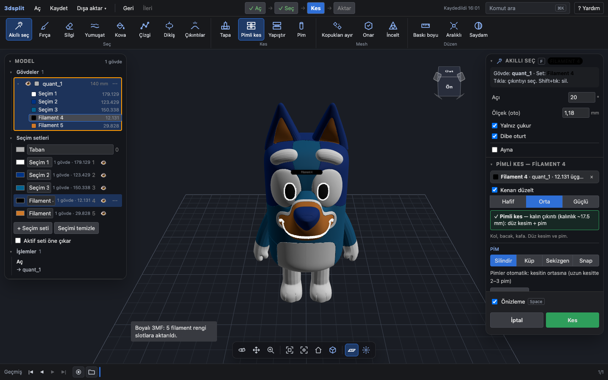 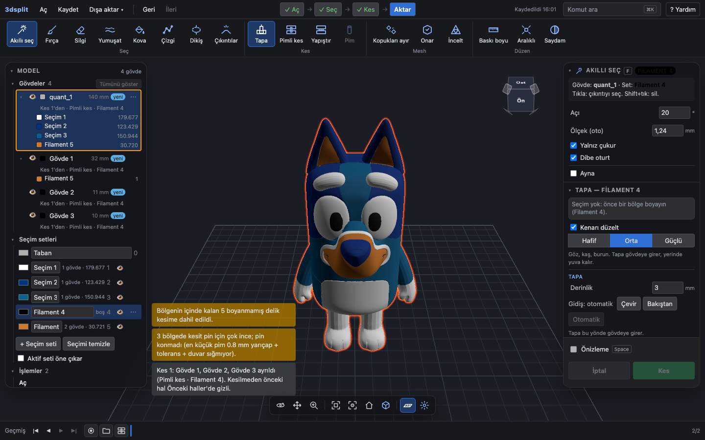 Ayrıca [03-a-tapa-preview](img/03-a-tapa-preview.png), [02-a-eye-smart](img/02-a-eye-smart.png).
- **İhlal edilen ilke:** Nielsen #1 Sistem durumunun görünürlüğü (bayat durum), #5 Hata önleme.
- **Etki:** Göz ve gözbebeği gibi Tapa ile ayrılması gereken detaylar düz kesiliyor ve pimsiz kalıyor. Ekran Tapa dediği için kullanıcı bunu fark etmeden baskıya gönderebilir. Kayıp bir baskı süresi ve filament. Ctrl+Z ile geri alınabiliyor, ama ancak fark edilirse.
- **Önerilen yön:** Set ya da boya değişince eski öneriyi hemen kaldır, "Öneri hesaplanıyor" göster ve bu sürede Kes'i kapat. Kesim iletisindeki mod ile şerit her zaman aynı olsun.
- **Emek:** S. Yer: `src/state/actionsCut.ts:118-150` (`scheduleSuggestion`: set değişince `suggestion` temizlenmiyor; 400 ms gecikme, sonra worker).

### Yüksek

#### 3. Boyalı 3MF açılınca 179 bin üçgenlik set kesime hazır; tek tık 8 istenmeyen parça

- **Kaynak:** 01 (a1 sürtünme 1, a16), 02 (O2, Orta). 03 bunu "doğrulanamadı" listesine koymuştu. Bu aşamada yeniden üretildi.
- **Ne oluyor:** Bluey açılınca aktif set "Seçim 1" (beyaz: göz akları, kaşlar, ağız, karın, ayaklar; 179.129 / 500.000 üçgen). Kes yeşil ve açık, adım şeridi doğrudan "Kes"te. Kullanıcı hiçbir şey seçmeden ilk yeşil düğmeye basarsa bütün beyaz bölgeler kesiliyor.
- **Kanıt:** `v2.mjs`: açılıştan sonra `activeSlot:1, count:179129, Kes enabled true`. Kes: 20.681 ms, 9 görünür gövde, "Kes 1: Gövde 1 … Gövde 8 ayrıldı (Tapa · Seçim 1)". 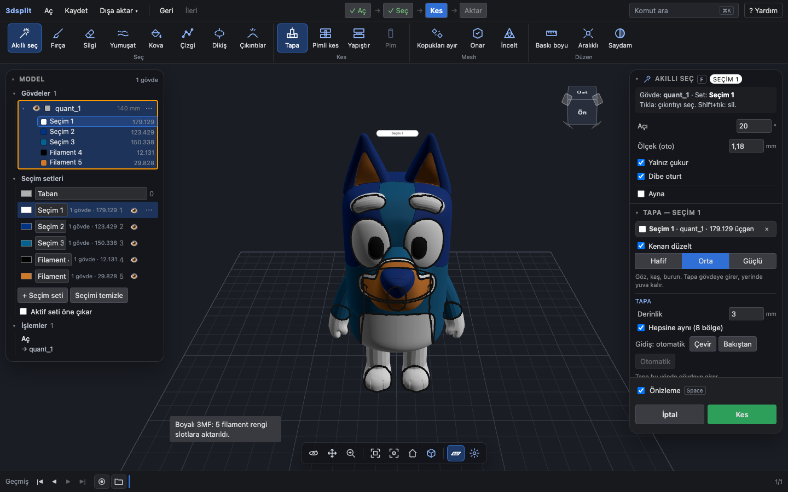 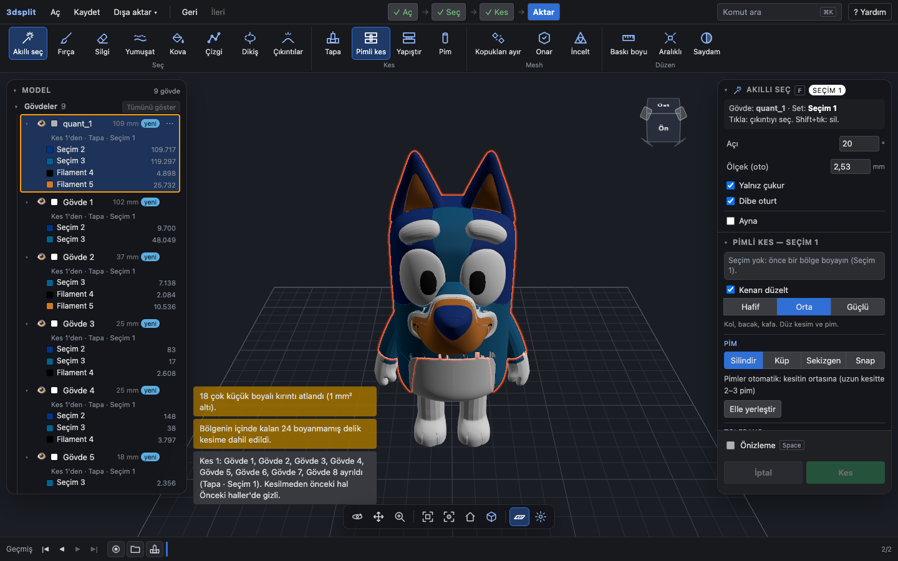 Ayrıca [01-a16](img/01-a16-bluey-dogrudan-kes.png), [02-a-bluey-loaded](img/02-a-bluey-loaded.png).
- **İhlal edilen ilke:** Nielsen #5 Hata önleme (yanlış varsayılan). 3MF'ten gelen filament setleri kullanıcının seçimi değil.
- **Etki:** İlk kullanımda boyalı 3MF ile gelen kullanıcı, ekranın "hazır" dediği tek tıkla 20 s bekleyip istemediği 8 parça alıyor. Geri alması gerekiyor. 01 bunu ilk kullanımın belirleyici anı olarak işaretledi.
- **Önerilen yön:** 3MF ile açılışta aktif set Taban olsun, Kes kapalı kalsın, adım şeridi "Seç"te dursun. İstenirse "Hangi rengi ayıracaksın?" sorusu sorulsun.
- **Emek:** S. Yer: `src/state/store.ts:239` (`activeSlot: 1` varsayılanı açılışta sıfırlanmıyor), `src/state/actionsFile.ts:179-194` (`ensurePaintSlots`).

#### 4. 3MF'teki nesne başına filament okunmuyor; çıktıda bütün parçalar Filament 1

- **Kaynak:** 01 (a2, O7), 02 (Y1). İki bağımsız aşamada görüldü. Bu aşamada yeniden üretildi.
- **Ne oluyor:** `Grogu_Bambu_Colour.3mf` 12 nesneden oluşuyor ve renkler nesne başına atanmış. Uygulama bütün parçaları gri gösteriyor ve renklerin aktarılamadığını söylemiyor. Hiçbir şey değiştirmeden 3MF — Bambu alınınca 12 nesnenin hepsi `extruder="1"` oluyor. İleti: "Filament 1: Taban".
- **Kanıt:** `v3.mjs`. Kaynakta `extruder` 3 (2 nesne), 6 (3), 7 (7). Çıktıda (`head_v1.0.3mf`) 24 satırın 24'ü `value="1"`. 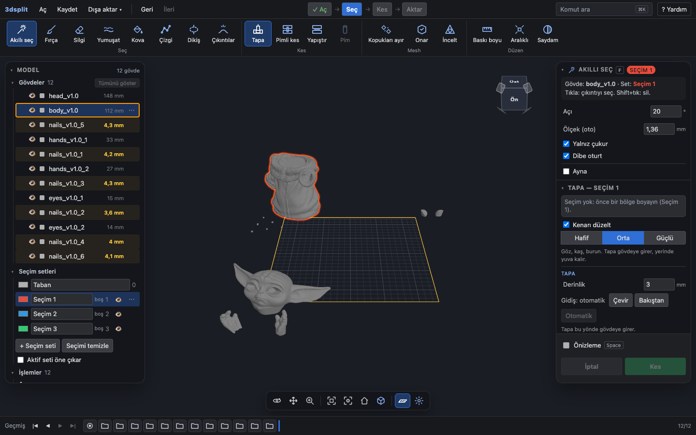 Ayrıca [01-a10](img/01-a10-grogu-yuklendi.png), [02-a-grogu-loaded](img/02-a-grogu-loaded.png).
- **İhlal edilen ilke:** Nielsen #1 (renk kaybolurken söylenmiyor). Pazardaki T2 şikâyetiyle ("Loosing colors when splitting…", 04) aynı kayıp.
- **Etki:** Kullanıcı slicer'da 12 parçaya yeniden elle renk atıyor. Açıp kaydetmek, dosyadaki renk bilgisini siliyor. Bambu/Orca'dan gelen renkli dosya, 04'ün önerdiği ana giriş yolu.
- **Önerilen yön:** Nesne başına extruder bilgisini gövde rengi olarak al ve dışa aktarmada koru. Okuyamadığında açılışta bunu söyle.
- **Emek:** M. Yer: `src/io/threeMf.ts:61-67` (`model_settings.config`'ten yalnız ad okunuyor), `src/state/actionsFile.ts:196-205` (`exportObjects` gövde rengini `colorSlot`'tan alıyor).

#### 5. Çizgi ile kol seçimi: başarı iletisiyle boş sonuç ve nedeni söylemeyen uyarı

- **Kaynak:** 02 (Y3), 01 (b sürtünme 1). İkisi aynı aracın iki farklı başarısızlığı; iki aşamada ayrı ayrı görüldü. Bu aşamada ikisi de yeniden üretildi.
- **Ne oluyor:**
  - (a) Kolu saran 4 noktalı halka "Çizgi kapatıldı: 16 üçgen boyandı" diyor, ama modelde boyalı üçgen 0 ve Kes kapalı. Halka kendine değince 16 üçgenlik bir cep seçiliyor, sonra yumuşatma bu cebi siliyor.
  - (b) Yalnız ön yüze çizilen halka bir yama boyuyor (bu aşamada 256 üçgen, 01'de 708). Pimli kes "kesit pin için çok ince; pin konmadı" diyor. Uyarı, halkanın kolun etrafından geçmesi gerektiğini söylemiyor.
- **Kanıt:** `v4.mjs`: (a) ileti "16 üçgen boyandı", `figure:0/28280`, `Kes enabled false`. (b) "180 üçgen boyandı", `figure:256/28440`, panelde "Öneri: Tapa — yüzeysel bölge (yükseklik ~0.1 mm)" ve "kesit pin için çok ince". 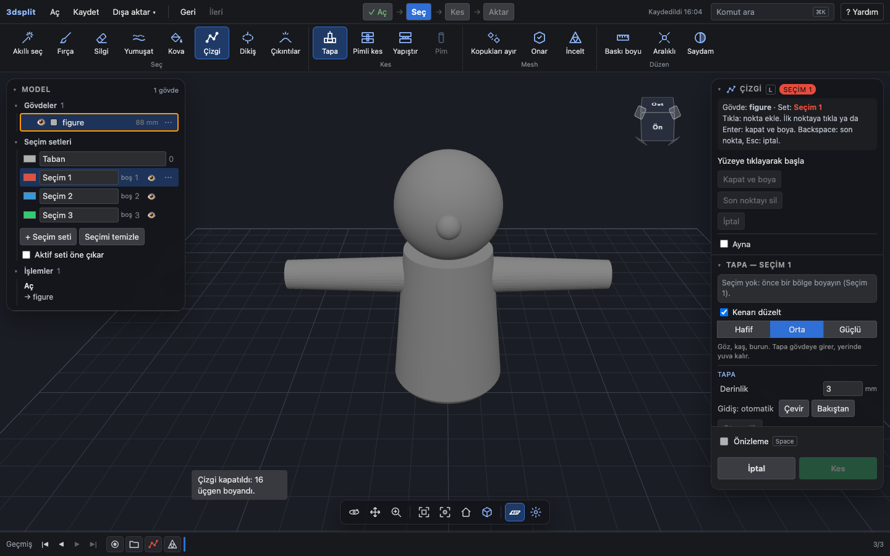 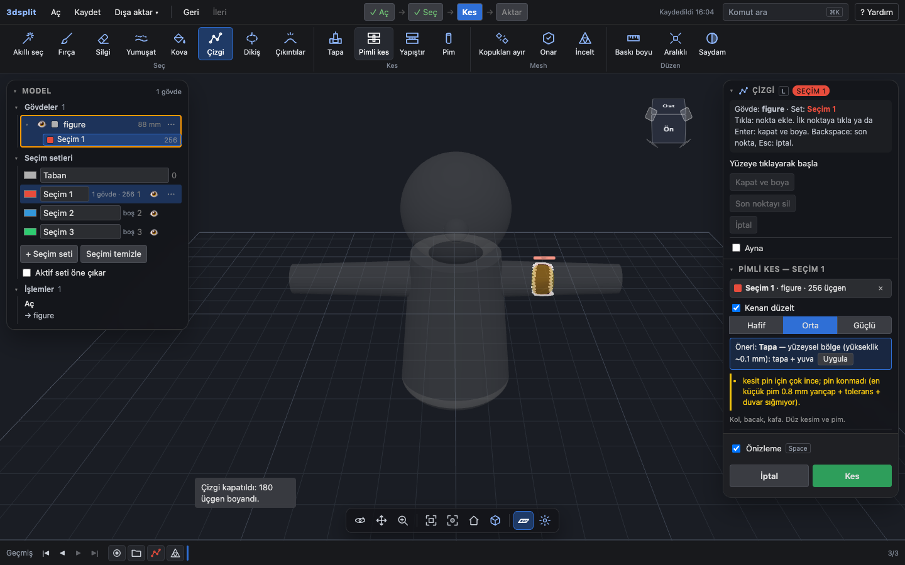 Ayrıca [02-b-line-closed](img/02-b-line-closed.png), [01-b05](img/01-b05-pimli-on.png).
- **İhlal edilen ilke:** Nielsen #1 ve #9 Hataları tanıma ve düzeltme (sessiz başarısızlık; başarı iletisi yanlış).
- **Etki:** 01'de kolu seçmek 2 dk 33 s takılma ve 9 boşa eylem (~37 s) sürdü. Kullanıcı neyin yanlış gittiğini arayüzden öğrenemiyor. 6 noktalı doğru halkayla aynı kol 2.630 üçgen boyuyor ve kesim çalışıyor.
- **Önerilen yön:** Boyanan alan sıfırsa ya da yumuşatmadan sonra kalmadıysa başarı iletisi verme, nedenini söyle ("halka kendine değiyor"). Halka yalnız bir yüzü sardıysa ve mod Pimli kes ise, kolun etrafından geçmeyi ya da Dikiş'i öner.
- **Emek:** M. Yer: `src/core/lasso.ts:92-102` (halkaya değen en küçük bileşen), `src/state/actionsLine.ts:178-189` (yumuşatma sonrası ileti).

#### 6. Dışa aktarma kesilmemiş renkleri sessizce düşürüyor; filament eşlemesi okunmuyor

- **Kaynak:** 02 (Y2), 01 (O1, O7, a1 adım 10), 03 (W7). Üç aşamada görüldü. Bu aşamada yeniden üretildi.
- **Ne oluyor:** Bluey'de göz Tapa ile kesildikten sonra kalan gövde ekranda 5 renkli (Seçim 1: 179.566, Seçim 2: 123.429, Seçim 3: 150.622, Filament 4: 8.994, Filament 5: 29.828 üçgen). 3MF'te gövde tek nesne, `extruder=1` ve üçgenlerde boya özniteliği yok (`paint_color`/`mmu_segmentation` sayısı 0). İleti: "Filament 1: Taban, Filament 2: Seçim 6". Kaybolan renkler için ne öncesinde ne sonrasında uyarı var. 03'te ileti "Filament 2: Filament 4" diye çıktı.
- **Kanıt:** `v3.mjs` çıktısı (extruder 1 ×2, 2 ×2; boya özniteliği 0). 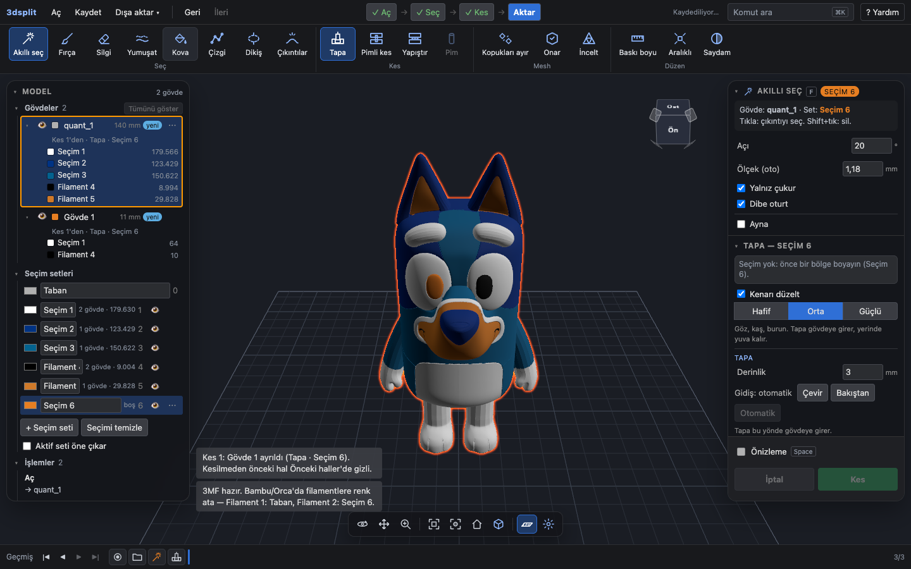 Ayrıca [02-a-export-msg](img/02-a-export-msg.png), [01-a08](img/01-a08-bluey-indir.png).
- **İhlal edilen ilke:** Nielsen #1, #2 Sistem ile gerçek dünyanın eşleşmesi (ekranda görülen dosyada yok).
- **Etki:** AMS'siz kullanıcı için gövdenin tek filament olması doğru. Sorun şu: kesmeyi unuttuğu renkler (siyah gözbebeği, turuncu lekeler) baskıda sessizce kayboluyor ve bu ancak baskıdan sonra fark ediliyor. Kayıp bir baskı süresi. İletideki "Taban" ve "Seçim 6", slicer'da hangi filamentin hangi parça olduğunu söylemiyor.
- **Önerilen yön:** Dışa aktarmadan önce kesilmemiş renk sayısını söyle ("gövdede kesilmemiş 4 renk var; dosyada tek renk olacak"). Filament eşlemesinde parça adı ve renk adı kullan.
- **Emek:** S. Yer: `src/state/actionsFile.ts:207-232` (`export3mf` ve eşleme iletisi).

#### 7. Set adları ve otomatik renkler anlamsız; beyaz göz tapası turuncu filamente gidiyor

- **Kaynak:** 01 (O1, a1 sürtünme 2), 02 (O4), 03 (H2-2, W5, W6). Üç aşamada ayrı ayrı görüldü.
- **Ne oluyor:** Boyalı 3MF'te setler "Seçim 1, Seçim 2, Seçim 3, Filament 4, Filament 5" diye iki ayrı adlandırmayla geliyor. Açılış iletisi "slotlara aktarıldı" diyor. "+ Seçim seti" yeni sete `#e67e22` veriyor; dosyadaki turuncu `#cf7929`. Beyaz gözden seçilen bölge ekranda turuncu görünüyor. Kesimden sonra (X98) set rengi gövde rengi oluyor; beyaz göz tapası turuncu çıkıyor ve 3MF'te "Filament 2: Seçim 6" olarak atanıyor.
- **Kanıt:**   Ayrıca [01-a04](img/01-a04-bluey-goz-tik.png), [03-bluey-loaded](img/03-bluey-loaded.png). Görseller incelendi; bulguyu gösteriyorlar.
- **İhlal edilen ilke:** Nielsen #2 ve #4 Tutarlılık. Set rengi baskı rengi anlamına geliyor, ama otomatik verilen renk modeldeki renklerden ayırt edilemiyor.
- **Etki:** Kullanıcı gözü adına bakarak değil renk karesine bakarak buluyor (03: 5 satır taranıyor). Uygulamanın gösterdiği renge güvenen kullanıcı beyaz gözü turuncu basabilir.
- **Önerilen yön:** Boyalı bölgeden seçilen setin rengi o bölgenin rengi olsun. Yeni set modelde olmayan bir renk alsın. Bütün setler tek biçimde adlandırılsın; "slot" sözcüğü arayüzden çıksın.
- **Emek:** S. Yer: `src/state/actionsFile.ts:188` (yalnız yeni id'lere "Filament N" adı), `src/state/actionsPaint.ts:450` ve `src/state/store.ts:356-359` (`nextSlotColor` paletten sırayla renk veriyor).

#### 8. Deneme parçası akışı yarım: bulunmuyor, modele karışıyor, seçilen tolerans kalıcı değil

- **Kaynak:** 01 (c, üç sürtünme), 02 (O7, O8, O9), 03 (H1-3, H6-1, K5, W9, W11, excise tablosu), 04 (fırsat 1, "açık iş"). Dört aşamada da görüldü. Kalıcılık ve palet bu aşamada yeniden üretildi.
- **Ne oluyor:**
  - **Bulmak:** Komut aramada "deneme" ve "tolerans" sonuç vermiyor. Düğme yalnız model açıkken, kesim panelinde, 1440×900'de kaydırma altında.
  - **Üretmek:** Plaka ve 3 pim mevcut sahneye 4 ayrı gövde olarak ekleniyor, bir kısmı sağ panelin arkasında. Adım şeridi kesim yapılmadan "✓ Kes → Aktar"a geçiyor. İşlemler'de 4 ayrı "Aç" satırı oluşuyor.
  - **Dışa aktarmak:** Dosya adı modelin adını alıyor (`figure.3mf`). Diğer gövdeler gizlenmezse onlar da dosyaya giriyor (02: STL ZIP'te 5 dosya).
  - **Sonucu kullanmak:** Düğmeler "Sıkı / Normal / Gevşek" diyor ve mm ya da çentik sayısı yazmıyor. Gevşek (0,3) seçilip sayfa yenilenince yeni modelde değer 0,2'ye dönüyor.
- **Kanıt:** `v5.mjs`: `palette deneme → Komut bulunamadı`, `clearance after Gevşek 0.3`, `after reload 0.2`. 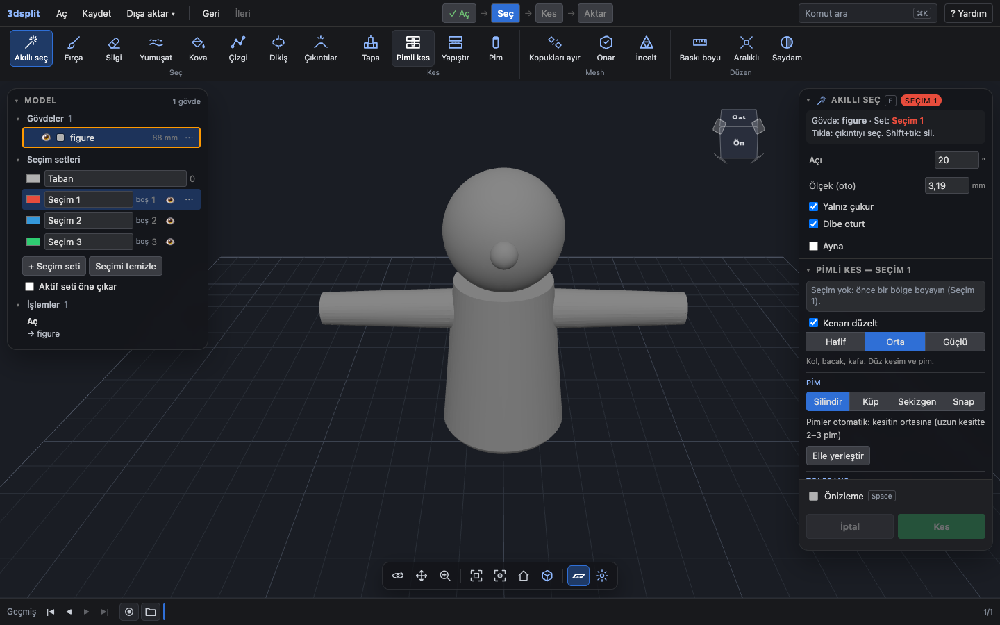  Ayrıca [01-c10](img/01-c10-komut-deneme.png), [01-c01](img/01-c01-deneme-uret.png), [03-c-result](img/03-c-result.png).
- **İhlal edilen ilke:** Nielsen #6 Hatırlamak yerine tanıma, #1 (yanlış adım), #5 (yanlış dosyayı göndermeyi önlemiyor).
- **Etki:** 01'de bulmak 6 boşa eylem sürdü. Yalnız deneme parçasını almak, her diğer gövde için bir gizleme tıkı gerektiriyor (Grogu'da 12). Deneme baskısının sonucu (bir baskı süresi ve filament) bir sonraki oturuma taşınmıyor. Bu akış ürünün pazardaki farkı (F1) ve en sık şikâyete (T1) cevap veriyor; 04'e göre hiçbir rakip bağlantıya bağlı deneme parçası üretmiyor.
- **Önerilen yön:** Deneme parçasına model olmadan ve komut aramadan ulaşılsın. Üretilen parça doğrudan ya da ayrı sahnede indirilsin ve adım şeridini etkilemesin. Tolerans seçimi tarayıcıda kalıcı olsun (Tabla ayarı gibi). Düğmelerde mm ve çentik sayısı görünsün.
- **Emek:** M. Yer: `src/state/actionsCut.ts:537-600` (`makeToleranceCoupon`), `src/state/store.ts:255` (`clearance: 0.2` kalıcı değil), `src/ui/CommandPalette.tsx:88-160` (komut listesi).

#### 9. Dikiş seçiliyken panel başlığı, şerit ve içerik farklı mod söylüyor; Çizgi ile Dikiş'in farkı söylenmiyor

- **Kaynak:** 03 (H4-1, H10-2, W14, W15), 02 (D5), 01 (b sürtünme 3). Üç aşamada görüldü. Bu aşamada yeniden üretildi.
- **Ne oluyor:** Dikiş seçilince şeritte hem Dikiş hem Tapa vurgulu. Kesim paneli başlığı "YAPIŞTIR — DİKİŞ", altında Tapa açıklaması ("Göz, kaş, burun. Tapa gövdeye girer…") ve Tapa "Derinlik" alanı var. Yardım, halka düz değilse "kesim durur ve halka kırmızı çizilir" diyor. Gerçekte ileti "Çizgi düz değil; Kes, çizilen halkayı izler" ve kesim yapılıyor. Şerit ipuçları Çizgi ile Dikiş'in hangi iş için olduğunu söylemiyor. "Kol ve bacak için" bilgisi yalnız Yardım'da var.
- **Kanıt:** `v5.mjs`: `ribbon active ['Dikiş','Tapa']`, panel metni "YAPIŞTIR — DİKİŞ … Göz, kaş, burun…". 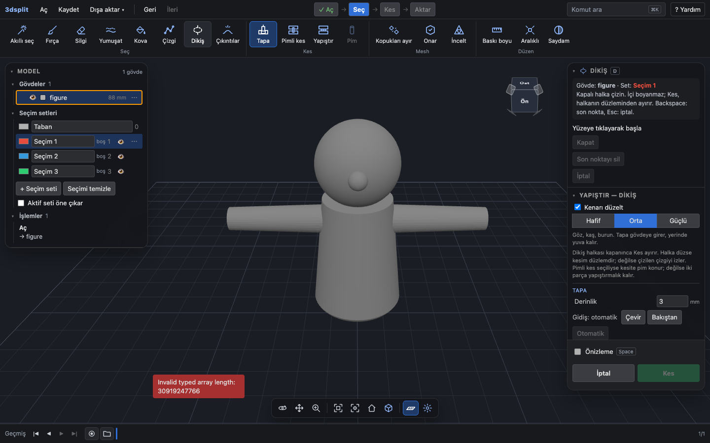 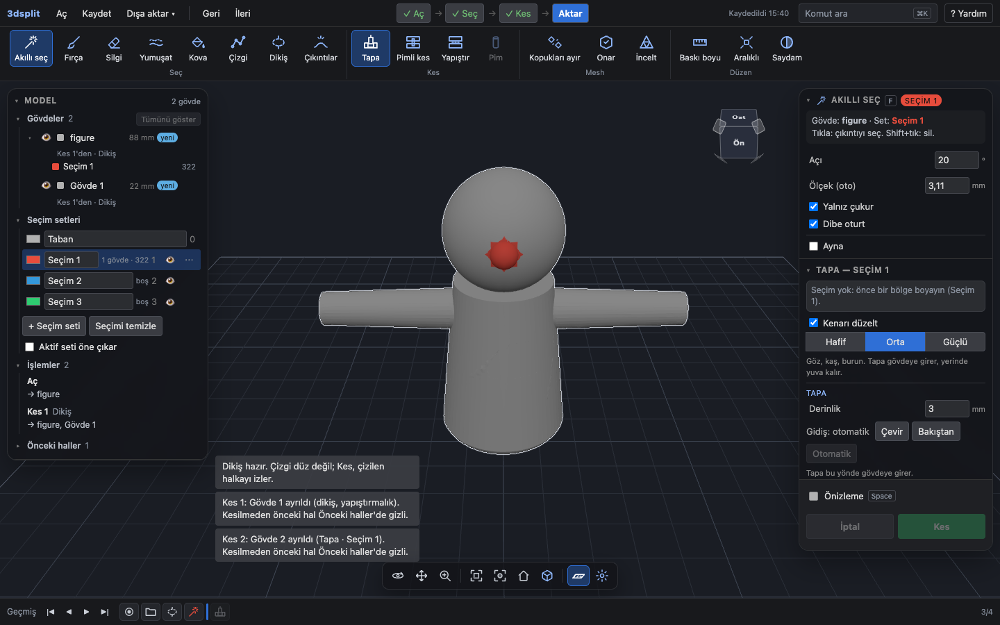 Yardım metni: `src/ui/HelpDialog.tsx:27`.
- **İhlal edilen ilke:** Nielsen #4 Tutarlılık, #10 Yardım ve belgeleme; Hick yasası (iki benzer araç, ayırt edici bilgi yok).
- **Etki:** HEDEF.md'ye göre kol için önerilen araç Dikiş. Kol ayırmak isteyen kullanıcı hangi aracı ve hangi modu seçeceğini panelden çıkaramıyor. 01'de bu karar, kol görevindeki 2 dk 33 s'lik takılmanın bir parçasıydı.
- **Önerilen yön:** Dikiş açıkken panel yalnız Dikiş'in gerçek modunu ve ilgili ayarları göstersin. Yardım davranışla aynı şeyi söylesin. Araç ipuçlarına hangi iş için oldukları eklensin.
- **Emek:** S. Yer: `src/ui/Panels.tsx:167-186` (`seamGlue` başlığı; `modeHint` ve alanlar `cut.mode`'a göre), `src/ui/HelpDialog.tsx:27`, `src/ui/Toolbar.tsx:48-61`.

#### 10. Yardım'ın "İş akışı" sekmesi okunamıyor

- **Kaynak:** 01 (O6), 03 (H10-1). İki aşamada aynı kök neden bulundu. Bu aşamada yeniden üretildi.
- **Ne oluyor:** 8 adımlık liste yan yana 8 dar sütuna bölünüyor (genişlikler 53–113 px). Adım numaraları metnin üstüne biniyor ("Seçim set2. Bölgeyi seç.").
- **Kanıt:** `v5.mjs`: `ol.steps` → `display: flex`, 8 öğe, genişlikler `[80,74,113,53,62,101,87,75]`.  Ayrıca [01-c12](img/01-c12-yardim.png), [03-help-empty](img/03-help-empty.png).
- **İhlal edilen ilke:** Nielsen #10 Yardım ve belgeleme; WCAG 2.2 SC 1.4.10 Yeniden akış ile ilgili okunabilirlik.
- **Etki:** Uygulamadaki tek iş akışı belgesi kullanılamıyor. Takılan kullanıcının (01: kol, deneme parçası) başvuracağı yer boş.
- **Önerilen yön:** Yardım listesinin sınıf adını üst adım şeridinden ayır.
- **Emek:** S. Yer: `src/ui/styles.css:370` (`.steps { display: flex }`), `src/ui/HelpDialog.tsx:69` (`<ol className="steps">`).

### Orta

#### 11. Bozuk dosyada ham İngilizce istisna metni

- **Kaynak:** 02 (O11), 03 (H9-1, W1, W2). Bu aşamada yeniden üretildi.
- **Ne oluyor:** Rastgele baytlı `.stl`: "Invalid typed array length: 30919247766". Zip olmayan `.3mf`: "THREE.ThreeMFLoader: Cannot find relationship file `rels`…". Uygulama çökmüyor, boş ekrana dönüyor.
- **Kanıt:** 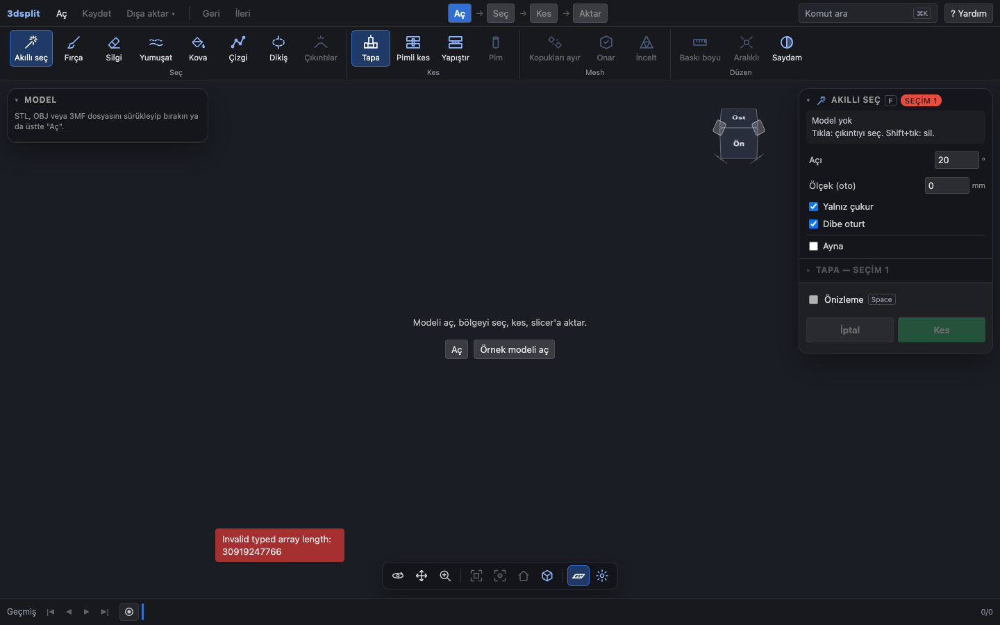, [02-file-garbage](img/02-file-garbage.png), [03-err-garbage-3mf](img/03-err-garbage-3mf.png).
- **İhlal edilen ilke:** Nielsen #9 (hata mesajı kullanıcının dilinde olmalı, çözüm önermeli).
- **Etki:** Kullanıcı dosyanın bozuk olduğunu ve ne yapacağını öğrenemiyor. Sık değil, ama olduğunda çıkış yolu yok.
- **Önerilen yön:** Türkçe, eylemli metin ("Dosya okunamadı; slicer'da açıp yeniden kaydedin"). Teknik ayrıntı katlanır alanda kalsın.
- **Emek:** S. Yer: `src/state/actionsHooks.ts:52`.

#### 12. Kesimin olmayacağı bilinirken Kes açık; hata ve uyarılar tekrar ediyor, çözüm söylemiyor

- **Kaynak:** 02 (O6), 03 (H5-1, H9-2, W12), 01 (O5). Üç aşamada görüldü.
- **Ne oluyor:** Kova ile bütün model boyanınca önizleme "Bölge parçanın tamamını kaplıyor; kesilecek sınır yok" diyor (iki kez). Kes yine açık; basınca aynı hata üçüncü kez geliyor. Grogu'da ince duvar uyarısı iki kez çıkıyor. "18 çok küçük boyalı kırıntı atlandı" ve "kesit pin için çok ince" ne yapılacağını söylemiyor.
- **Kanıt:** [02-err-huge-keys-cut](img/02-err-huge-keys-cut.png) (üç aynı kırmızı ileti, Kes açık; görsel incelendi), [01-a13](img/01-a13-grogu-goz-tik.png), [01-a02](img/01-a02-bluey-tapa.png).
- **İhlal edilen ilke:** Nielsen #5, #9; #8 (gereksiz tekrar).
- **Etki:** Kullanıcı boşa bir kesim deniyor ve sorunu çözecek bilgiyi alamıyor. Yığılan iletiler modelin altını kapatıyor.
- **Önerilen yön:** Önizleme hata verince Kes'i kapat ve nedeni seçim satırında yaz. Aynı iletiyi tekrarlama. Her uyarıya bir sonraki adımı ekle.
- **Emek:** S. Yer: `src/ui/Panels.tsx:59` (Kes yalnız boya varlığına bakıyor), `src/state/actionsCut.ts:242`.

#### 13. Kontrast: Kes düğmesi 2,51:1; set rengiyle yazılan rozet ve durum satırı 1,11–1,21:1

- **Kaynak:** 03 (C1–C13, U1–U4). Yalnız 03 ölçtü. Bu aşamada Kes renkleri (`#dddddd` / `#2e9e5b`, hesap 2,52:1) yeniden okundu. Siyah set rozetinin okunmadığı `00-h11-stale-500ms.png`'de görülüyor.
- **Ne oluyor:** Birincil Kes metni 2,51:1. Aktif set siyahken sağ üstteki "FİLAMENT 4" rozeti 1,11:1, durum satırı 1,21:1. Bunun yanında 20 renk çifti daha eşik altında (03).
- **İhlal edilen ilke:** WCAG 2.2 SC 1.4.3 (4,5:1), 1.4.11 (3:1).
- **Etki:** Ana düğme ve aktif setin adı düşük görüşte okunmuyor. Set rengi metin rengi olduğu için koyu filamentli her 3MF'te tekrar ediyor.
- **Önerilen yön:** Set rengini metin rengi olarak değil yalnız renk karesi olarak kullan. Birincil düğme metnini koyulaştır ya da beyaz yap.
- **Emek:** S. Yer: `src/ui/styles.css` (birincil düğme ve rozet kuralları).

#### 14. Klavye: odaklanan öğeler yapışkan alt bölümün altında; yardım odağı tutmuyor; kesimden sonra odak kayboluyor

- **Kaynak:** 03 (K3–K7). Odak gizlenmesi bu aşamada yeniden üretildi (`v5.mjs`: "Normal" düğmesine odaklanınca ortasındaki üst öğe `field preview-toggle`).
- **Ne oluyor:** Tolerans düğmeleri ve "Deneme parçası üret" odak aldığında kaydırma olmuyor; Önizleme/İptal/Kes alanının arkasında kalıyorlar. Yardım penceresi odağı içine almıyor (`aria-modal` yok). Kes'ten sonra odak `body`'ye düşüyor. Görev (a) klavyeyle 242 tuş sürdü.
- **Kanıt:** [00-focus-obscured](img/00-focus-obscured.png), [03-kb-focus-obscured](img/03-kb-focus-obscured.png), [03-kb-help](img/03-kb-help.png).
- **İhlal edilen ilke:** WCAG 2.2 SC 2.4.11 (AA), 2.4.3 (A), 2.4.1 (A).
- **Etki:** Klavye kullanıcısı tolerans ayarını göremiyor. Kesimden sonra her seferinde baştan Tab'lamak gerekiyor.
- **Önerilen yön:** Kaydırma alanına alt boşluk ver ya da odakta görünüme kaydır. Pencereleri modal yap. Kesimden sonra odağı anlamlı bir öğeye taşı.
- **Emek:** M. Yer: `src/ui/HelpDialog.tsx:38`, `src/ui/Panels.tsx:61` (`cut-actions`).

#### 15. Görünüş küpünden arka ve alt görünüşe geçilemiyor

- **Kaynak:** 01 (b sürtünme 2), 03 (H7-1, K4). İki aşamada görüldü.
- **Ne oluyor:** Üstten bakınca küpte yalnız "Üst" yüzü görünüyor; kenara tıklamak bir şey yapmıyor. Önden bakınca küpün "Arka" yüzü tıklanamıyor (Playwright: "Üst intercepts pointer events"). Küpün 14 düğmesinin 9'u başka öğenin altında; "Sağ" ve "Sol" 4 px genişliğinde. Çözüm ⌘K ya da alt çubuktaki Görünüşler menüsü.
- **Kanıt:** [01-b07-kup](img/01-b07-kup.png) (görsel incelendi: yalnız Üst yüzü görünüyor), [01-b06](img/01-b06-ust.png), [03-kb-tab-3](img/03-kb-tab-3.png).
- **İhlal edilen ilke:** Fitts yasası (hedef yok ya da 4 px), WCAG 2.5.8 Hedef boyutu (AA).
- **Etki:** Kolun çevresine halka çizmek için her görünüş değişikliği 2–3 eylem; kol görevinde 19 tıkın 4'ü gezinmeydi.
- **Önerilen yön:** Altı görünüşe her açıdan erişilebilsin; küp yüzlerinin tıklama alanı büyüsün.
- **Emek:** S. Yer: `src/viewport/` görünüş küpü bileşeni.

#### 16. Sahne birikiyor: ikinci "Aç" mevcut sahneye ekliyor, çok plakalı 3MF tek sahneye yığılıyor

- **Kaynak:** 01 (O4, a2 sürtünme 3); deneme parçasıyla ilgili kısmı 8. maddede.
- **Ne oluyor:** Aynı dosya ikinci kez açılınca iki figür üst üste geliyor ("2 gövde"). Grogu'nun 3 plakadaki nesneleri tek sahneye dağınık geliyor; kafa plakanın dışında.
- **Kanıt:** [01-c08-ikinci-dosya](img/01-c08-ikinci-dosya.png) (görsel incelendi: Gövdeler 2, iki "figure"), [01-a10](img/01-a10-grogu-yuklendi.png).
- **İhlal edilen ilke:** Nielsen #5 Hata önleme, #2.
- **Etki:** Dışa aktarmada fazladan nesne riski. Kullanıcı neyin neyle birleştiğini göremiyor.
- **Önerilen yön:** İkinci "Aç"ta "ekle / yeni proje" sor. Plakaları ayrı göster ya da konumlarını koru.
- **Emek:** M. Yer: `src/state/actionsFile.ts:124-127`.

#### 17. Bölge içindeki başka renk "boyanmamış delik" diye tapaya katılıyor

- **Kaynak:** 02 (O3), 01 (a1 adım 4: "24 boyanmamış delik kesime dahil edildi").
- **Ne oluyor:** Göz akı seçilip Tapa ile kesilince "1 boyanmamış delik kesime dahil edildi" deniyor. Delik aslında siyah boyalı gözbebeği. Gövde 1'de 3.753 siyah (Filament 4) üçgen var.
- **Kanıt:** [02-a-eye-socket-cut](img/02-a-eye-socket-cut.png) (görsel incelendi: Gövde 1 altında "Filament 4 · 3.753").
- **İhlal edilen ilke:** Nielsen #2 (yanlış terim), #1.
- **Etki:** Tapa tek filamentle basıldığı için gözbebeği tapanın renginde çıkıyor. Bunu söyleyen bir şey yok.
- **Önerilen yön:** İletiyi doğru yaz ("içinde başka renkli bölge var: Filament 4"). "Kat / ayrı bırak" seçeneği ver ya da kesimden sonra ayrıca kesmeyi öner.
- **Emek:** M. Yer: `src/core/cut.ts` (delik doldurma).

#### 18. Delete, ipucunda "seçili pimi sil" yazarken bütün seti siliyor

- **Kaynak:** 02 (O5).
- **Ne oluyor:** Pimli kes önizlemesinde ipucu "Delete: seçili pimi sil". Pim seçili değilken Delete kolun bütün boyasını (2.738 üçgen) siliyor; ileti çıkmıyor.
- **Kanıt:** [02-b-delete-key](img/02-b-delete-key.png) (görsel incelendi: Seçim 1 "boş", geçmişte silgi simgesi, ileti yok).
- **İhlal edilen ilke:** Nielsen #4, #1.
- **Etki:** Seçim işi geri alınana kadar kayboluyor; kullanıcı ne olduğunu bilmiyor.
- **Önerilen yön:** Pim seçili değilken Delete bir şey yapmasın ya da "Seçim temizlendi · Geri al" iletisi göstersin.
- **Emek:** S. Yer: `src/state/keymap.ts:67`, `src/ui/App.tsx:142`.

#### 19. Basılamayacak kadar küçük seçimden sessizce 2,6 mm tapa

- **Kaynak:** 02 (O10).
- **Ne oluyor:** 1 üçgenlik seçimden Tapa ile 2,6 mm'lik gövde çıkıyor; tek işaret ağaçtaki sarı "2,6 mm". Pimli kes'te hata "Düzlem kesimi bölgeyi içeren bir parça üretmedi…" teknik.
- **Kanıt:** [02-err-tiny-socket-cut](img/02-err-tiny-socket-cut.png) (görsel incelendi), [02-err-tiny-keys-cut](img/02-err-tiny-keys-cut.png).
- **İhlal edilen ilke:** Nielsen #5, #9.
- **Etki:** Basılamayacak parça üretiliyor ve fark edilmeyebilir.
- **Önerilen yön:** Basılabilir en küçük boyutun altında Kes'ten önce uyar; Pimli kes hatasında ne yapılacağını söyle.
- **Emek:** S. Yer: `src/state/actionsCut.ts` (kesim öncesi denetim).

#### 20. Jargon ve aynı kavrama farklı adlar

- **Kaynak:** 03 (H2-1, H4-2, W3–W5, W8, W16–W20), 01 (a1, O1).
- **Ne oluyor:** Ana yolda "slot", "Mesh", "kopuk kabuklar", "Ölçek (oto)", "Yalnız çukur", "Dibe oturt", "Gövdede pay %", "Uç pahı", "Boy boşluğu" geçiyor. Aynı araç ya da mod için iki ad var: Akıllı seç / Smart Fill, Pimli kes / Keys. "Boşluk" dört ayrı anlamda kullanılıyor.
- **Kanıt:** [03-bluey-loaded](img/03-bluey-loaded.png), [03-w-pimli-kes-advanced](img/03-w-pimli-kes-advanced.png), [03-help-keys](img/03-help-keys.png) (görseller incelendi).
- **İhlal edilen ilke:** Nielsen #2, #4.
- **Etki:** CAD bilmeyen hedef kullanıcı ayarların ne yaptığını tahmin ediyor. 03'ün W tablosunda 25 metin önerisi var.
- **Önerilen yön:** 03 §3'teki metin tablosu başlangıç noktası olabilir. İngilizce mod adları arayüzden çıksın.
- **Emek:** M (çok dosyada metin).

#### 21. Kesimden sonra parça görünmüyor; geri alınca eski "kesildi" iletisi kalıyor

- **Kaynak:** 01 (O3, a1 sürtünme 3), 03 (H1-2, H8-2).
- **Ne oluyor:** Tapa yuvasında, pim kolun içinde kalıyor; "Aralıklı" önerilmiyor. Geri alınca gövde sayısı 3'ten 2'ye iniyor, ama "Kes 2: Gövde 2 ayrıldı" iletisi duruyor. Üç ileti ~150 px yer kaplıyor.
- **Kanıt:** [01-a06](img/01-a06-bluey-kesildi.png), [01-b13](img/01-b13-kol-kesildi.png), [03-undo-cut](img/03-undo-cut.png) (görsel incelendi: geri alınmış Kes 2 iletisi duruyor).
- **İhlal edilen ilke:** Nielsen #1, #8.
- **Etki:** Kullanıcı kesimin sonucunu görmek için Aralıklı'yı kendisi bulmak zorunda. Geri alındı bilgisi yok.
- **Önerilen yön:** Kesimden sonra parçayı kısa süre göster ya da vurgula. Geri almada "Geri alındı: Kes 2" iletisi çıksın, eskisi kalksın.
- **Emek:** S.

#### 22. Zaten parçalara bölünmüş model için yönlendirme yok

- **Kaynak:** 01 (a2 sürtünme 2), 02 (a: "Gözler zaten ayrı nesne olduğu için Tapa kesimi bu dosyada anlamsız").
- **Ne oluyor:** Grogu'da gözler ayrı nesne, kafada boş göz yuvası var. Uygulama boya olmadığını ve parçaların zaten ayrı olduğunu söylemiyor; şerit "Seç"te bekliyor. Göz yuvasına tıklayınca göz kapağı seçiliyor.
- **Kanıt:** [01-a12](img/01-a12-grogu-bas.png), [01-a13](img/01-a13-grogu-goz-tik.png).
- **İhlal edilen ilke:** Nielsen #10, boş durum ilkesi.
- **Etki:** 01'de 2 dk 31 s, 2 başarısız deneme; görev bu dosyada yapılamadı.
- **Önerilen yön:** Çok nesneli, boyasız dosyada "parçalar zaten ayrı; renk atayıp dışa aktarabilirsin" gibi bir durum iletisi göster.
- **Emek:** S.

#### 23. Aynı anda iki "İptal", anlamları farklı

- **Kaynak:** 03 (H3-1).
- **Ne oluyor:** Kesim sürerken meşgul kartında "İptal" (işi durdurur), panelde "İptal" (önizlemeyi kapatır, Akıllı seç'e döner). Paneldeki İptal'e basılınca kesim sürüyor.
- **Kanıt:** [03-big-cutting10](img/03-big-cutting10.png) (görsel incelendi: iki İptal görünüyor). Panel düğmesi: `src/ui/Panels.tsx:73-82`.
- **İhlal edilen ilke:** Nielsen #3, #4.
- **Etki:** ~11 s'lik kesimi durdurmak isteyen kullanıcı yanlış düğmeye basabiliyor.
- **Önerilen yön:** Düğmelere ne yaptıklarını söyleyen adlar ver.
- **Emek:** S.

### Düşük

#### 24. Çizgi ilk noktaya yakın tıkta kendiliğinden kapanıyor

- **Kaynak:** 02 (D1). Bu aşamada yeniden üretildi (`v6.mjs`: arka yüzdeki 3. nokta, yani 6. tık, "Çizgi kapatıldı: 2630 üçgen boyandı" verdi).
- **İlke:** Nielsen #3 (beklenmedik kip değişimi). **Etki:** Kullanıcı nokta eklediğini sanıyor; ince kollarda halka erken kapanabiliyor. **Yön:** Yakın tıkta ilk noktayı vurgula, kapatmayı yalnız ilk noktanın üstünde yap. **Emek:** S. Yer: `src/state/actionsLine.ts:51-60`.

#### 25. Çizgi noktaları modelin arkasından da görünüyor

- **Kaynak:** 02 (D2). **Kanıt:** [02-b-line-back](img/02-b-line-back.png), [01-b10](img/01-b10-alt.png). **İlke:** Nielsen #1. **Yön:** Örtülen noktaları soluk ya da kesik çiz. **Emek:** S.

#### 26. Model yokken araçlar ve ayarlar açık; Space yanlış ileti veriyor

- **Kaynak:** 02 (D3), 03 (H8-1). **Kanıt:** [02-empty](img/02-empty.png), [03-empty](img/03-empty.png) (görseller incelendi: Fırça, Kova, Tapa, Pimli kes etkin; "SEÇİM 1" rozeti). **İlke:** Nielsen #1, #8. **Yön:** Model yokken araçları soluk göster; Space "Önce bir model açın" desin. **Emek:** S.

#### 27. Dışa aktarılan dosya adı kaynak dosyanın adı değil

- **Kaynak:** 01 (c), 02 (D4), 03 (W25). Bu aşamada da görüldü: `quant_1.3mf` (Bluey), `head_v1.0.3mf` (Grogu). Deneme parçası `figure.3mf` oluyor, ZIP içinde ad "Tolerans plakası _0_1 _ 0_2 _ 0_3 mm_.stl". **İlke:** Nielsen #2. **Etki:** İndirilenler klasöründe hangi dosyanın hangi modele ait olduğu anlaşılmıyor. **Emek:** S. Yer: `src/state/actionsFile.ts:210`.

#### 28. Uzun kesimde yüzde ya da kalan süre yok

- **Kaynak:** 03 (H1-4), 01 (a1). ~11 s'lik kesimde meşgul kartı aşama ve geçen süreyi gösteriyor, kalan süreyi göstermiyor; ilk saniyede aşama satırı boş. **Kanıt:** [03-a-cutting](img/03-a-cutting.png). **İlke:** Nielsen #1, 10 s eşiği. **Emek:** M.

#### 29. Ondalık ayırıcı ve sayı biçimi karışık; dar alanda adlar kesiliyor

- **Kaynak:** 03 (H4-3, W23, W24, H6-2). "0.2 mm" ile "0,4" yan yana, "2252" ile "2.364". Set listesinde "Filament ·", gövde listesinde "Tolerans plal". **Kanıt:** [03-a-cut-done](img/03-a-cut-done.png), [02-c-coupon-made](img/02-c-coupon-made.png) (görsel incelendi: "Tolerans plal"). **İlke:** Nielsen #4, #6. **Emek:** S.

#### 30. "Desteklenmeyen dosya türü" desteklenenleri saymıyor

- **Kaynak:** 03 (H9-3, W13). **Kanıt:** [03-err-not-a-model-txt](img/03-err-not-a-model-txt.png). **İlke:** Nielsen #9. **Emek:** S.

#### 31. Çok büyük modelde fırça sürüklerken takılma

- **Kaynak:** 03 (durum envanteri). `testa-1m.stl` (1,89 M üçgen) üzerinde fırça sürüklerken kare süresi ortanca 16,6 ms, %95'lik 148 ms. Bu aşamada yeniden ölçülmedi. Sadeleştirme önerisi bu durumu zaten karşılıyor. **İlke:** Doherty eşiği. **Emek:** L.

---

## Düşürülen ve yeniden sınıflanan bulgular

| Bulgu | Kaynak | Karar | Neden |
| --- | --- | --- | --- |
| Boyama, Çizgi, Dikiş ve pim yerleştirme klavyeyle yapılamıyor (WCAG 2.1.1, Yüksek) | 03 K1 | **Düşürüldü** | 2.1.1'in yola bağlı girdi istisnası serbest boyamayı kapsıyor. Ürün 3B yüzeyde işaretçiyle seçim üzerine kurulu. Klavyeyle ulaşılabilecek kısımlar (ayarlar, kesim, dışa aktarma) 14. maddede. |
| Öneri kartı eski seçimden kalıyor (Orta) | 02 O1 | Yükseltildi ve 2. madde ile birleştirildi | Yanlış modla kesim yeniden üretildi; ekran yapılan kesimden farklı mod gösteriyor. |
| Açılışta büyük kesim tek tık uzakta (Orta) | 02 O2 | Yükseltildi (3. madde) | Tek tık 20,7 s ve 8 istenmeyen parça olarak ölçüldü. |
| Hedef kullanıcının bilmediği terimler ana yolda (Yüksek) | 03 H2-1 | Orta'ya indirildi (20. madde) | Sürtünme gerçek, ama görevi engellediği bir an hiçbir aşamada ölçülmedi. Görevler terimleri bilmeden tamamlandı. |
| Bozuk dosyada ham İngilizce hata (Yüksek) | 03 H9-1 | Orta'da kaldı (11. madde) | Ana görev yolunda değil, yalnız bozuk dosyada çıkıyor. Uygulama çökmüyor. |
| Kontrast ve odak (Yüksek) | 03 C1–C3, K5 | Orta (13, 14) | Ölçüm doğru ve yeniden üretildi. Ama hedef kullanıcının görevini engellediği bir gözlem yok. |

Düşürülen bulgu sayısı: **1**. Birleştirmeyle ortadan kalkan yinelenen bulgular bu sayıya dahil değil.

---

## İyi olan ve korunması gerekenler

| # | Ne | Kanıt |
| --- | --- | --- |
| 1 | Boş ekran ve Aç → Seç → Kes → Aktar şeridi sıradaki adımı söylüyor. Şerit kesimden sonra Aktar'a geçiyor. | [01-a00](img/01-a00-bos-ekran.png), [01-a06](img/01-a06-bluey-kesildi.png) |
| 2 | Dışa aktar menüsünde her seçeneğin altında ne yaptığı yazıyor. | [01-a07](img/01-a07-bluey-aktar.png) |
| 3 | Kesilen parçalar kapalı: figür kolu ve Bluey göz tapası 3MF/STL'de açık kenar 0, non-manifold 0 (02). Figür STL'lerinde bütün kenarlar iki yüze bağlı (04). | 02 "Çalışan ve doğrulanan", 04 §4 M3 |
| 4 | Gizlenen kaynak ("Önceki haller") dışa aktarılmıyor. | 01 (c) dosya doğrulaması, 02 |
| 5 | Uzun işlem iptali çalışıyor: İptal 0,34 s, Esc 0,8 s; ileti "İşlem iptal edildi. Model değişmedi." Sonra yeniden kesim çalışıyor. | 02, 03 (W21 iyi örnek) |
| 6 | Kesim tek adımda geri alınıp yineleniyor (figür 0,64 s, 1,89 M üçgen 1,8 s); boya ve önizleme yerinde kalıyor. | 02, [03-redo-cut](img/03-redo-cut.png) |
| 7 | Bozuk mesh açılışta onarılıyor ve ne yapıldığı sayıyla söyleniyor ("3953 üçgenin yönü düzeltildi, 2 delik kapatıldı"). | [02-file-broken](img/02-file-broken.png), [03-err-broken](img/03-err-broken.png) |
| 8 | Büyük model kartı (Sadeleştir / Olduğu gibi kalsın) kazancı ve kaybı sayıyla söylüyor; sadeleştirme sonrası sapma raporlanıyor (0,14 mm). | [01-a10](img/01-a10-grogu-yuklendi.png), [01-a11](img/01-a11-grogu-sadelestir.png) |
| 9 | Sayfa yenilenince "Kaldığın yer · Devam et" kartı (geri alma sorunu dışında). | [01-a09](img/01-a09-yenile.png) |
| 10 | Mod önerisi doğru hesaplandığında işini görüyor: figür kolunda "✓ Pimli kes — kalın çıkıntı", burunda Tapa. Matristeki rakipler arasında yalnız 3dsplit'te doğrulandı (F2). | [01-b12](img/01-b12-halka-on.png), 04 §4 |
| 11 | Tek tıkla tolerans deneme parçası (F1) ve kesim öncesi ince duvar uyarısı (F3) var; ikisi de rakiplerde yok ya da bilinmiyor. | [01-c03](img/01-c03-deneme-sigdir.png), 04 §3 |
| 12 | Akış boyunca `localhost` dışına 0 istek (dosya cihazda kalıyor). | 04 §4 F4 |
| 13 | Kısayollar ve komut arama: tek harfli araçlar, değiştirilebilir 20 kısayol, ⌘K, Space önizleme. | [03-help-keys](img/03-help-keys.png) |
| 14 | Seçim yokken Kes kapalı; 2 noktalı Çizgi'de Enter "en az 3 nokta gerekli" diyor; model yokken Dışa aktar açılmıyor. | 02 "Çalışan ve doğrulanan" |
| 15 | Figür kolu Pimli kes akışı hızlı: önizleme 0,33–0,8 s, kesim 0,85–1,1 s; pim Aralıklı'da kol parçasında görünüyor. | [01-b14](img/01-b14-aralikli.png), [03-b-exploded](img/03-b-exploded.png) |

---

## Eklenirse en çok değer katacak 5 özellik (değerlendirme)

Bu bölüm bir değerlendirmedir; roadmap maddesi değildir. CLAUDE.md'ye göre yeni özellik kullanıcı onayı olmadan eklenmez. Etki, 04'teki şikâyet temalarına (T1–T6), özellik matrisine ve bu raporun bulgularına göre verildi.

| # | Özellik | Dayanak | Etki | Emek | Gerekçe |
| --- | --- | --- | --- | --- | --- |
| 1 | **Renk başına plaka ya da dosya** (aynı filamentteki parçaları ayrı plakada / ayrı dosyada vermek) | Hedef kullanıcının AMS'i yok, her rengi ayrı iş olarak basıyor. PaintLab "renk başına STL" ve "Peças por cor" sunuyor (04 §1). 3dsplit'in menüsünde bu yok: 3MF Bambu, 3MF genel, STL ZIP, Seçili parça STL ([01-a07](img/01-a07-bluey-aktar.png)). T5 (elle filament değişimi bıktırıcı). | Yüksek | S–M | Bugün bütün parçalar tek plakada geliyor ve kullanıcı slicer'da renk başına ayırıyor. Plaka dizme kodu zaten var (`src/io/layout.ts`); gruplama ekleniyor. |
| 2 | **3MF'teki nesne renklerini koruma** (içe aktarmada okuma, dışa aktarmada geri yazma) | 4. madde (Grogu: 3 renk → 1). T2'de en az 4 kişi "bölünce renk kayboluyor" diyor (Bambu ve Orca). JTBD istenen sonuç 7. 04 fırsat 2: "slicer'ın yapamadığı tek adım". | Yüksek | M | Bambu/Orca'dan gelen renkli dosya ana giriş yolu. Bugün açıp kaydetmek renk bilgisini siliyor. |
| 3 | **Tolerans profilini kalıcı kılma ve deneme parçasından ayara tek adımda dönüş** | 8. madde. T1 en sık şikâyet (6 kaynak). 04 fırsat 1 ("İlk baskıda oturur") ve 04'ün "açık iş" notu. Tabla ayarı zaten tarayıcıda hatırlanıyor. | Yüksek | S–M | Farkı yaratan özellik (F1) var, ama sonucu bir sonraki modele taşınmıyor. Döngü kapanınca 04'teki konumlanma cümlesi kanıtlanabilir hale gelir. |
| 4 | **Yükseklik aralığıyla boyama** | 04 B8: Audja, PaintLab, Bambu ve Orca'da var (7 rakibin 4'ü); 3dsplit arayüzünde yok (bu aşamada `src/ui` içinde arandı, bulunamadı). Figürde kemer, ayakkabı, taban gibi yatay bantlar. | Orta | M | Beklenen sınıfta bariz tek eksik. Çekirdekte yeni boyama fonksiyonu ve test gerekir. Bambu forumunda bu aracın katman ortasında renk değiştirme sorunu bildirilmiş (T6), dikkat istiyor. |
| 5 | **Mıknatıs cebi** (bağlantı türü olarak) | 04 F8: Multipart3D'de var, 3dsplit'te aranmadı. T3 (yapıştırma ve görünür dikiş: "I HATE glueing"). | Orta-düşük | M | Snap pimi yapıştırıcısız birleşmeyi kısmen karşılıyor. Mıknatıs sökülüp takılan parçalar (kafa, kol) için ek değer. Kanıt tek rakibe dayanıyor; öncelik ilk dördün arkasında. |

---

## Pazar özeti

- **04'ün sonucu:** 3dsplit olmazsa olmaz 6 özelliğin 6'sını karşılıyor.
  - Formül: **Kapsama = (tam × 1 + kısmi × 0,5) / olmazsa olmaz sayısı × 100**
  - 3dsplit: (6 × 1 + 0 × 0,5) / 6 × 100 = **%100**.
  - Rakipler: Audja %100, PaintLab %91,7, Multipart3D / Bambu Studio / OrcaSlicer %75, CatPin %66,7, Meshmixer %33,3 (rakip değerleri üreticinin anlatımına dayanır).
- **Bu aşamanın kontrolü:** 04'ün tanımına göre (özellik var ve bir örnek modelde çalışıyor) %100 tutarlı. M1–M6'nın hepsi bu aşamada da çalıştı: STL ve boyalı 3MF açıldı, Akıllı seç gözü tek tıkla aldı, kesim kapalı parça verdi, pim ve tapa otomatik geldi, tolerans ayarlanabiliyor, 3MF indi.
- Ancak iki satır, bu aşamada yeniden üretilen bulgulara göre "kısmi" sayılabilir:
  - **M1:** Renkli 3MF'teki nesne başına renk okunmuyor (4. madde).
  - **M6:** Slicer'a hazır çıktıda filament ataması ve kesilmemiş renkler kayboluyor (4. ve 6. madde).
  - Bu sıkı okumayla: (4 × 1 + 2 × 0,5) / 6 × 100 = **%83,3**.
- **Okuma:** Olmazsa olmazlar doğrudan rakipler (Audja, PaintLab) arasında eşitlik sağlıyor, fark yaratmıyor. Fark F1 (deneme parçası), F2 (mod önerisi) ve F3 (ince duvar uyarısı) satırlarında. Bunların ilk ikisinin akışında bu raporun 2. ve 8. maddeleri var. "Tarayıcıda, dosya cihazda" artık üç araçta ortak (04).

---

## Doğrulanamayanlar ve yöntem sınırları

- **Fiziksel baskı yapılmadı.** Tapa–yuva, pim–delik ve deneme pimlerinin oturması basılarak denenmedi. Yalnız dosyadaki nesne sayısı, boyut, kapalılık ve filament ataması doğrulandı.
- **Slicer'da açılmadı.** Bambu Studio / OrcaSlicer çalıştırılmadı; 3MF'ler XML ve geometri olarak incelendi. 02'nin göz tapasında saydığı 756 dejenere üçgenin ve 04'ün saydığı 94 sıfır alanlı üçgenin slicer'daki etkisi bilinmiyor.
- **`audit` skill'i 2. aşamada çağrılamadı.** Skill yalnız kullanıcı tarafından çağrılabildiği için yöntemi elle uygulandı (Nielsen 10 sezgisi ve ölçülen sürtünme; 02 "Kapsam ve yöntem").
- **Reddit ve Printables'a erişilemedi** (04). WebSearch `reddit.com`'u reddetti, Reddit JSON API 403 verdi, Printables 403 verdi. Şikâyet temaları Bambu/Prusa forumu, GitHub ve Superhive'a dayanıyor; Reddit temaları değiştirebilir.
- **Rakip uygulamalar çalıştırılmadı.** Matristeki rakip işaretleri üreticinin kendi anlatımı. Audja için F1–F3 bilinmiyor.
- **Ekran okuyucu** (VoiceOver/NVDA) denenmedi. "⋯" menü düğmelerinin odakta görünür olup olmadığı (renk arka planla aynı, 1,00:1) görüntülenmedi.
- **Yalnız 1440×900 masaüstü, headless Chrome (Metal ANGLE)** kullanıldı. Dar ekran, %200 yakınlaştırma ve dokunmatik denenmedi. Tam ekran tarayıcıda renk ve kenar çizimi farklı olabilir.
- **Gerçek kullanıcı yok.** Düşünme ve okuma süreleri ölçülmedi. 01'deki takılma süreleri oturum saatinden alındı ve ajan gecikmesini içeriyor.
- **Dosya penceresi ve sürükle bırak:** 01 gerçek `filechooser` kullandı, 02–04 ve bu aşama `setInputFiles`. İşletim sisteminin sürükle bırak davranışı görülmedi.
- **Doğrulanamayan tekil gözlemler:**
  - Space önizlemesinin bir akışta açılıp diğerinde açılmaması (01). Bu aşamada ayrıca denenmedi.
  - Grogu'da modelden uzakta beliren kırmızı halka (01, a13). Ne olduğu anlaşılamadı.
  - Büyük modelde geri alma sırasında meşgul kartı (03). Görüntülenemedi.
  - 31. maddedeki fırça takılması bu aşamada yeniden ölçülmedi; 03'ün ölçümüne dayanıyor.
- **Bu aşamada yeniden üretilmeyen Orta/Düşük bulgular** kaynak aşamanın görselleriyle değerlendirildi. Görseli olmayan ya da tek ölçüme dayanan maddeler metinde belirtildi: 13 (kontrastın tamamı), 14 (odak dışındaki kısımlar), 20 (terim tablosu), 28, 31.
