# 01 — Kullanıcı yolculuğu (ilk kullanım, 3 görev)

26 Ekim 2026. Aşama 1 / ürün review'u. Yöntem: `journey-mapping` skill'i, müşteri yolculuk haritası (tek persona, görev başına bir senaryo, mevcut durum).

## Kapsam ve yöntem

**Persona.** AMS'i olmayan, figür basan, boyama ve CAD bilmeyen kullanıcı. Ürünü ilk kez açıyor. Elinde boyalı bir 3MF ya da düz bir STL var. İşi: modeli slicer'dan önce ayrı basılıp birleşen parçalara ayırmak.

**Görevler.**

- (a) Boyalı 3MF'den gözü Tapa (Socket) ile ayırıp 3MF dışa aktarmak: `Bluey_Color.3mf` ve `Grogu_Bambu_Colour.3mf`.
- (b) Düz STL'de (`samples/figure.stl`) kolu Çizgi aracıyla ayırıp Pimli kes ile pim koymak, dışa aktarmak.
- (c) Tolerans deneme parçasını bulmak, üretmek, dışa aktarmak, seçilen toleransı ayara geri girmek.

**Ortam.** Google Chrome 155, Playwright `channel: 'chrome'`, headless, 1440×900. Uygulama `http://localhost:5173`. Tıklamalar `getByRole/getByText` ve `page.mouse` ile, klavye `page.keyboard` ile yapıldı. Dosya seçimi gerçek "Aç" düğmesinden açılan dosya penceresine (`filechooser`) verildi. İndirilen her 3MF açılıp `3D/3dmodel.model` içindeki `<item>` (plakadaki nesne) sayısı, nesne boyutu ve `Metadata/model_settings.config` içindeki filament (extruder) ataması sayıldı. Betikler: `/private/tmp/claude-501/-Users-yunuskorkmaz-Projects-3dsplit/3b196ea1-5eea-459e-a40e-7aaa8e9d15e4/scratchpad/s1/`.

**Süre nasıl ölçüldü.** "Bekleme" sütunu, eylemden ekranda sonucun görünmesine kadar geçen süredir (`Date.now()` farkı; sayfa metninde sonuç yazısı veya meşgul kartının kaybolması beklendi). Kullanıcının düşünme süresi bu sayılara dahil değildir. Oturum saatleri (ekran görüntüsü zaman damgası) ajan gecikmesini de içerdiği için yalnız takılmaların süresini kabaca göstermek için verildi.

**Belgelere bakma notu.** Ortak kurallar gereği başta `CLAUDE.md`, `docs/HEDEF.md` ve `docs/project-brief.md`'nin başı okundu. Arayüzde nereye basılacağı için `docs/ux-plan.md` kullanılmadı; yol arayüzdeki ipuçlarından bulundu. Önyargı: `HEDEF.md` kol için "Dikiş" aracını anlatıyor; görev Çizgi istediği için Çizgi denendi. Uygulamanın kendi Yardım penceresi (c) görevinde açıldı ve bulgu olarak kaydedildi.

**Tık sayımı.** Fare tıklaması ve tek tuş = 1. Komut paletine kelime yazmak = 1. İşletim sisteminin dosya penceresinde dosya seçmek = 1.

---

## Görev (a1) — Bluey: gözü Tapa ile ayır, 3MF aktar

Sonuç: **başarılı.** İndirilen `quant_1.3mf` iki nesne içeriyor: `quant_1` (gövde, 117,5×69,4×140 mm, 498.994 üçgen, filament 1) ve `Gövde 1` (göz tapası, 6,5×4,3×10,6 mm, 6.360 üçgen, filament 2). İkisi de 256 mm plakanın içinde, z=0'da.

| # | Eylem | Tık/tuş | Bekleme (ölçülen) | Ekranda geri bildirim | Belirsizlik anı | Kullanıcının sorusu | Duygu | Kanıt |
| --- | --- | --- | --- | --- | --- | --- | --- | --- |
| 1 | Boş ekranı okur | 0 | — | Ortada "Modeli aç, bölgeyi seç, kes, slicer'a aktar." ve Aç / Örnek modeli aç; üstte Aç→Seç→Kes→Aktar şeridi | Yok | "Nereden başlıyorum?" sorusunun cevabı ekranda | + |  |
| 2 | Ortadaki "Aç"a basar, dosyayı seçer | 2 | 3,1–3,3 s (iki ölçüm) | Sol altta "Bluey_Color.3mf yükleniyor… 0 sn · İptal" kartı | Yok | — | 0 | 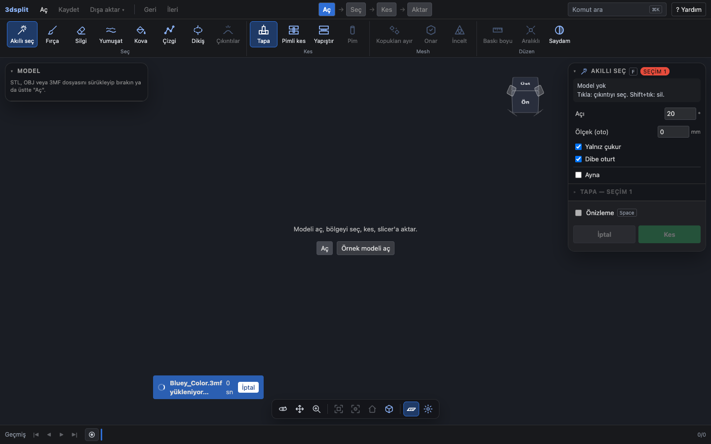 |
| 3 | Yüklenen sahneye bakar | 0 | — | Model renkli geldi. "Boyalı 3MF: 5 filament rengi slotlara aktarıldı." Şerit doğrudan **Kes** adımına atladı. Sağda **Pimli kes — Seçim 1** açık, öneri "Pimli kes — kalın çıkıntı (~17,5 mm)", yeşil **Kes** etkin, Önizleme işaretli | Evet | "Seçim 1 hangisi? Kes'e basarsam ne kesilir? Ben göz istiyordum, neden Pimli kes önerildi?" | − |  |
| 4 | Gözü istediği için "Tapa"ya basar | 1 | <0,1 s | Önizleme: bütün beyaz alanlar (göz akı, kaş, ağız, karın) sarı tapa oldu. Öneri hâlâ Pimli kes. Sarı uyarılar: "18 çok küçük boyalı kırıntı atlandı", "24 boyanmamış delik kesime dahil edildi" | Evet | "Yalnız gözü nasıl seçerim? Bu uyarılar sorun mu?" | − | 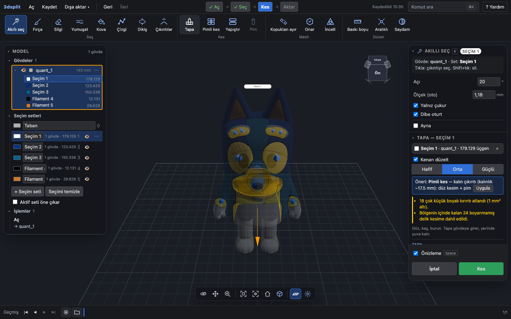 |
| 5 | Soldaki "+ Seçim seti"ne basar | 1 | 0,3–0,4 s | Yeni "Seçim 6" (boş). Sağ panel "Seçim yok: önce bir bölge boyayın (Seçim 6)." Panel tolerans ve "Deneme parçası üret"i gösterir | Az | "Şimdi göze tıklamam yeterli mi?" | 0 | 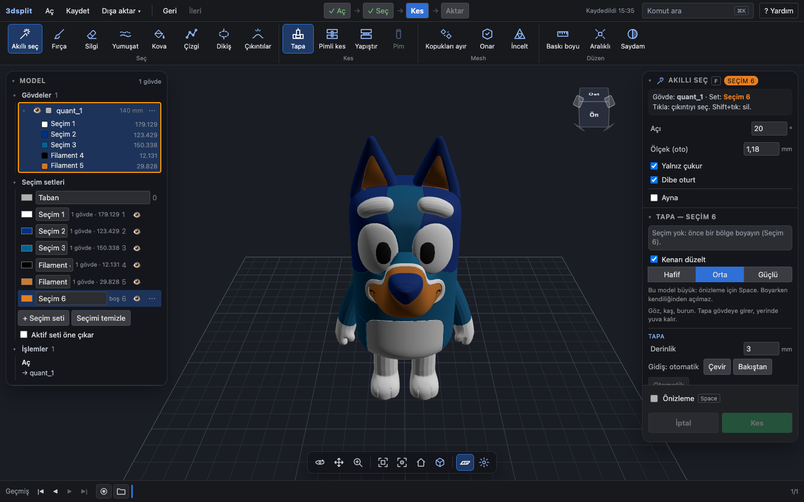 |
| 6 | Akıllı seç açıkken sol göze tıklar | 1 | <1 s | Göz bebeği seçildi: "Seçim 6 · 3.126 üçgen", öneri "✓ Tapa — yüzeysel bölge (~0,8 mm)". Seçim 6'nın rengi turuncu (`#e67e22`), yan satırdaki Filament 5 de turuncu (`#cf7929`) | Evet | "Göz bebeğini mi göz akını mı seçtim? Turuncu olan bebek mi, ağız mı?" | 0 | 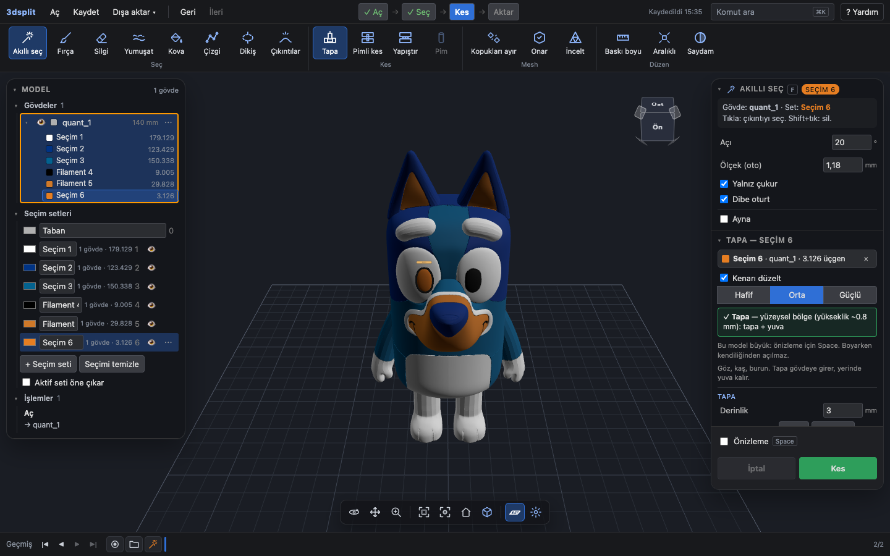 |
| 7 | Space ile önizler | 1 | 0,8–1,7 s | "3 mm" etiketi, turuncu ok gözden aşağı doğru; "Gidiş: otomatik · Çevir · Bakıştan" | Evet | "Ok doğru yöne mi bakıyor, tapa kafanın içine mi giriyor?" | 0 | 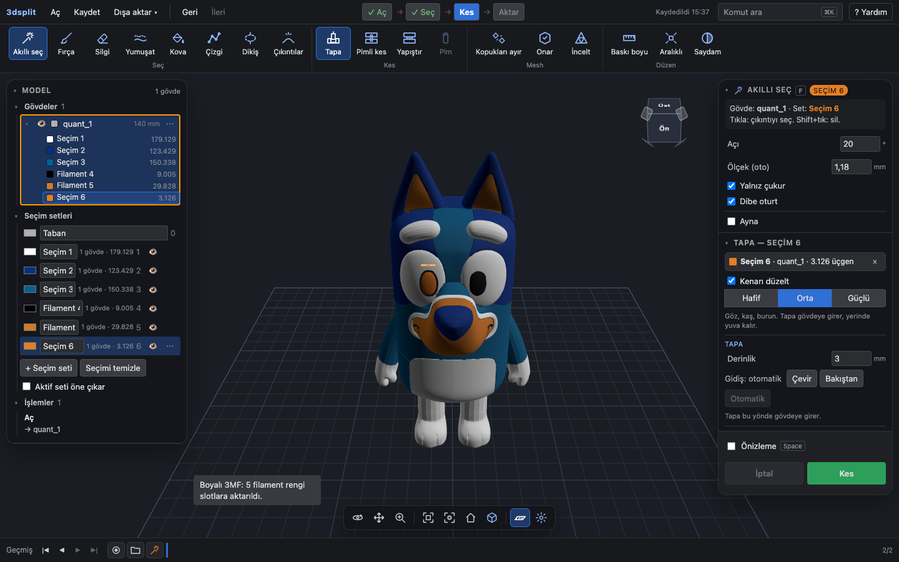 |
| 8 | Yeşil "Kes"e basar | 1 | 3,2 s (1. deneme), 11,5 s (2. deneme) | "Kesiliyor · Tapa · Seçim 6 · quant_1 · 0 sn · İptal", sonra "Kes 1: Gövde 1 ayrıldı. Kesilmeden önceki hal Önceki haller'de gizli." Şerit **Aktar**'a geçti | Az | "Tapa nerede, göremiyorum" | + | 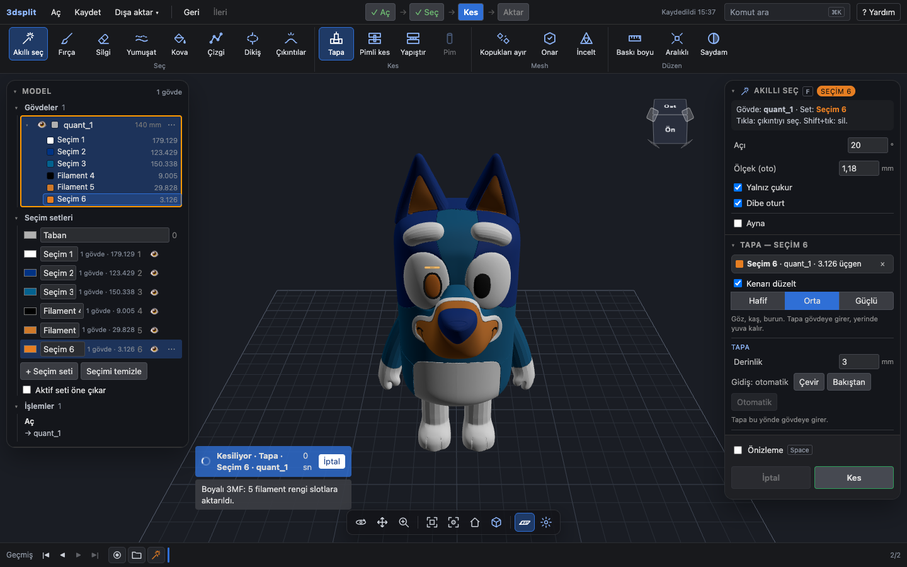 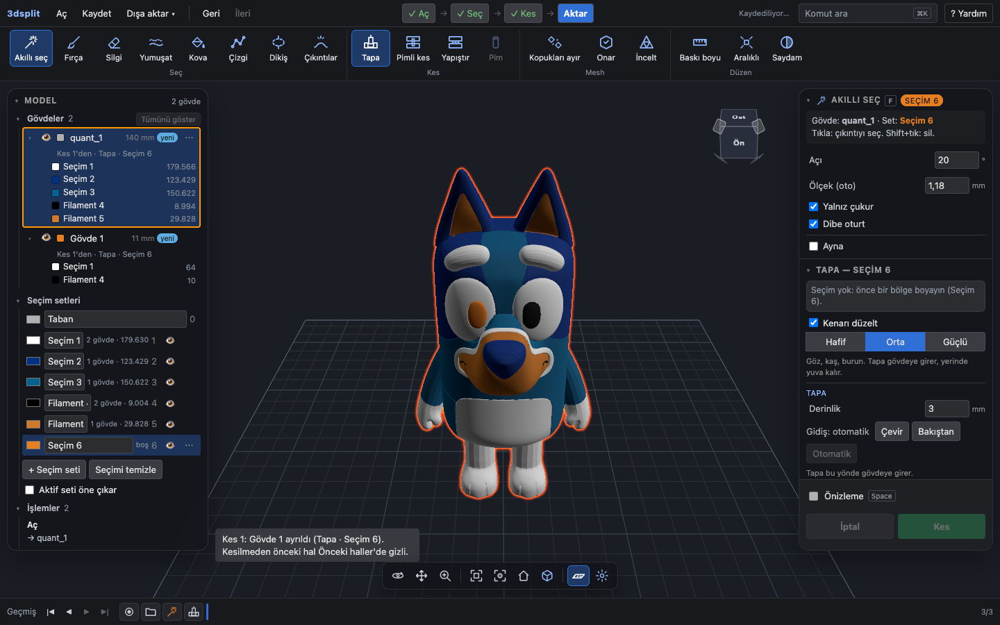 |
| 9 | Şeritte "Aktar"a basar | 1 | <0,1 s | Dışa aktar menüsü açılır: 3MF — Bambu/Orca, 3MF — genel, STL (ZIP), Seçili parça — STL; her birinin altında bir satır açıklama | Yok | — | + | 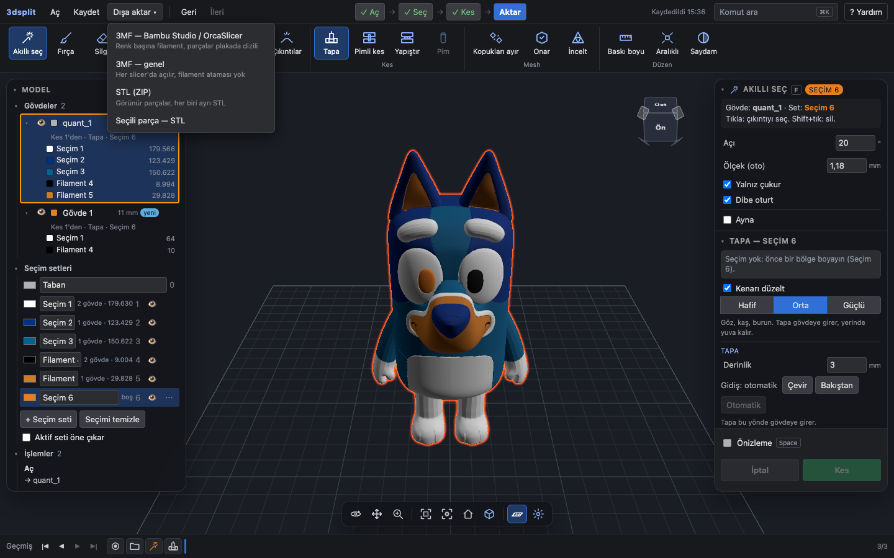 |
| 10 | "3MF — Bambu Studio / OrcaSlicer"ı seçer | 1 | 1,6 s | `quant_1.3mf` (6,46 MB) indi. "3MF hazır. Bambu/Orca'da filamentlere renk ata — Filament 1: Taban, Filament 2: Seçim 6." | Az | "Filament 2'nin göz olduğunu slicer'da nasıl anlayacağım? Adı 'Gövde 1'" | 0 | 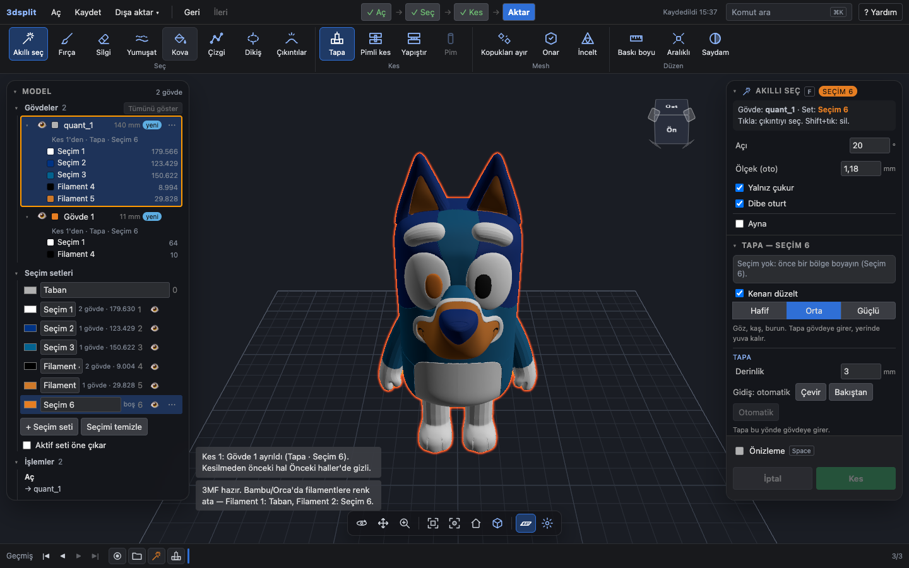 |

**Toplam:** 9 tık/tuş (dosya seçimi dahil). Ölçülen sistem beklemesi 9,1–18,5 s (yükleme 3,1–3,3 + önizleme 0,8–1,7 + kes 3,2–11,5 + indirme 1,6 + diğerleri <1). Oturumda 15:37:22 → 15:37:45 arası 23 s (ikinci, akıcı tekrar).

**Ayrı deneme: acemi kullanıcı yüklemeden hemen sonra yeşil Kes'e basarsa.** Tek tık, 20,3 s sürdü, model 9 gövdeye bölündü: bütün beyaz bölgeler (göz akları, kaşlar, ağız, karın, ayaklar) pimli kesildi. Ctrl+Z ile geri alınabiliyor, ama kullanıcı bunu istememişti. 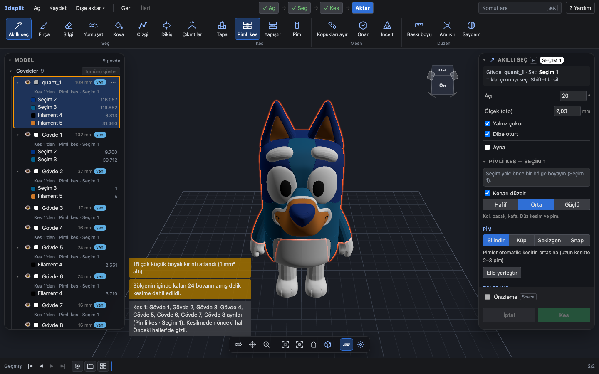

**En büyük 3 sürtünme (a1).**

1. **Yükleme sonrası hazır kurulmuş kesim.** İlk renk seti (beyaz, 179.129 üçgen) aktif, mod Pimli kes, Kes etkin. Kullanıcı hiçbir şey seçmeden tek tıkla 8 parçalık istemediği bir kesim yapabiliyor (20,3 s, a16). Dayanak: Nielsen #5 Hata önleme; ölçülebilir kayıp: 20 s + geri alma.
2. **Renk setleri ve adları göz ile eşleşmiyor.** İçe aktarılan renkler "Seçim 1/2/3" ve "Filament 4/5" diye karışık adlandırılmış; yeni set "Seçim 6" Filament 5 ile neredeyse aynı turuncu (`#e67e22` / `#cf7929`). Kesilen tapanın altında "Seçim 1 · 64, Filament 4 · 10" yazıyor, oysa tapa 6.360 üçgenli ve tek filamentli. Dayanak: Nielsen #2 Sistem ile gerçek dünyanın eşleşmesi, #4 Tutarlılık.
3. **Kes süresi tutarsız ve tapa görünmüyor.** Aynı göz kesimi 3,2 s ve 11,5 s sürdü. Kesimden sonra tapa yerinde durduğu için görünmüyor; "Aralıklı" düğmesi önerilmiyor. Dayanak: Nielsen #1 Sistem durumunun görünürlüğü.

---

## Görev (a2) — Grogu: gözü Tapa ile ayır, 3MF aktar

Sonuç: **görev bu dosyada yapılamadı; uygulama nedenini söylemedi.** Dosyada boya yok. Model zaten 12 ayrı nesne (kafa, gövde, 2 el, 2 göz, 6 tırnak) ve kaynak dosyada nesne başına filament atanmış (extruder 3, 6, 7; renkler `#F72323`, `#FFFFFF`, …). Gözler ayrı küreler, kafada boş göz yuvası var. Uygulama bunları gri ve dağınık gösteriyor; dışa aktarımda 12 nesnenin hepsi filament 1'e düşüyor.

| # | Eylem | Tık/tuş | Bekleme | Ekranda geri bildirim | Belirsizlik anı | Kullanıcının sorusu | Duygu | Kanıt |
| --- | --- | --- | --- | --- | --- | --- | --- | --- |
| 1 | Sayfayı yeniler | 0 | — | "Kaldığın yer: quant_1 · 2 gövde · 26 Ekim 15:37 · Devam et / Yok say" | Yok | — | + | 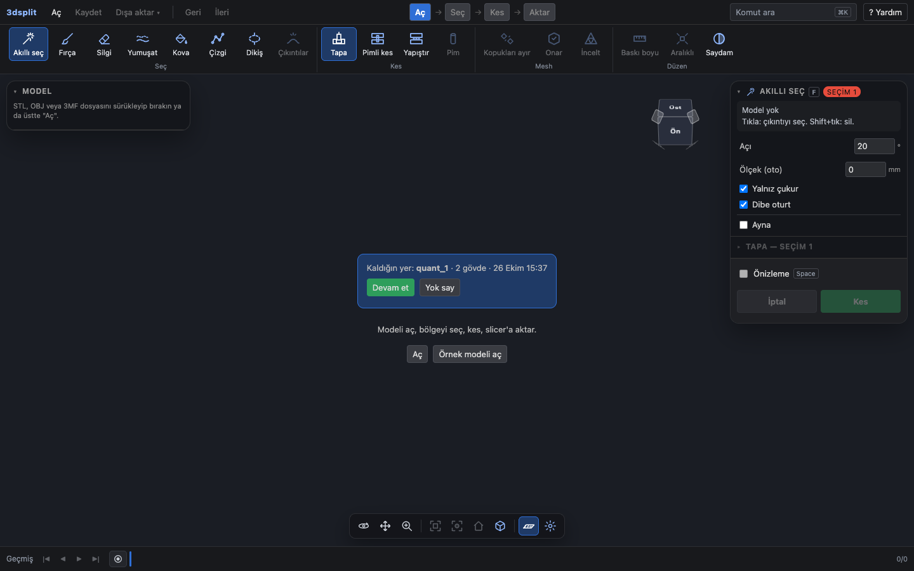 |
| 2 | "Yok say", sonra Aç ile Grogu'yu seçer | 3 | 6,8 s | 12 gövde listelendi, hepsi gri. Kafa plakanın dışında, gövde ve eller dağınık (kaynak dosyadaki 3 plakanın nesneleri tek sahnede). Üstte kart: "Bu model 1,09 milyon üçgen. 400 bin üçgene sadeleştirmek… Sadeleştir / Olduğu gibi kalsın" | Evet | "Renkler nereye gitti? Bu kadar parça neden dağınık? Sadeleştirmeli miyim?" | − | 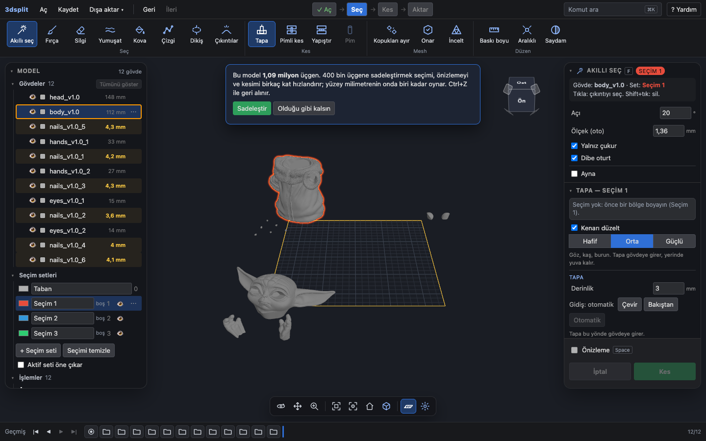 |
| 3 | Yeşil "Sadeleştir"e basar | 1 | 4,8 s | "Sadeleştirildi: 1.093.816 → 272.412 üçgen; yüzey en çok 0.14 mm oynadı. Ctrl+Z geri alır." | Az | — | 0 | 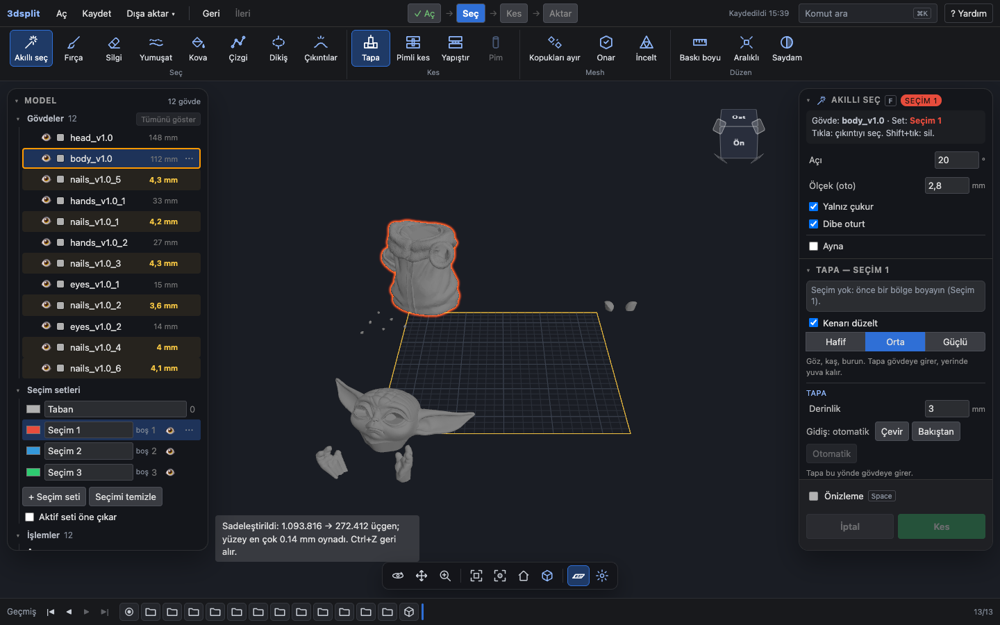 |
| 4 | Listede head_v1.0'a, sonra "Seçili parçayı sığdır"a basar | 2 | ~1 s | Kafa yakın planda; göz yuvaları boş delik | Evet | "Göz zaten ayrı parça mı? O halde ne kesmeliyim?" | − | 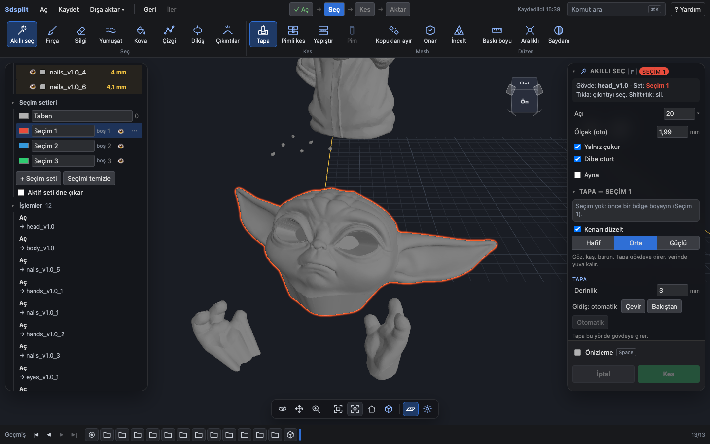 |
| 5 | Akıllı seç ile göz yuvasına tıklar | 1 | ~1 s | Göz kapağı/kaş bölgesi seçildi (6.383 üçgen). Önizleme kendiliğinden açıldı; turuncu ok kafadan dışarı, ele doğru. Aynı uyarı iki kez: "Tapa yuvası çevresinde duvar 0.8 mm'den ince (kırmızı)…". Sol tarafta modelden uzakta küçük kırmızı halka | Evet | "Yanlış yeri seçtim. Göz yuvası seçilemiyor mu?" | − | 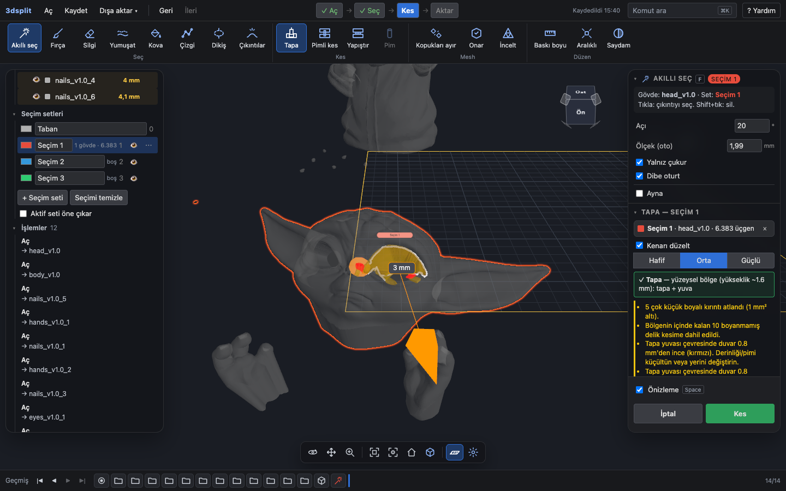 |
| 6 | Ctrl+Z, Dışa aktar → 3MF — Bambu | 3 | 1,2 s | `head_v1.0.3mf`; "3MF hazır… Filament 1: Taban." | Az | "Kaynakta 3 renk vardı, neden tek filament?" | − | 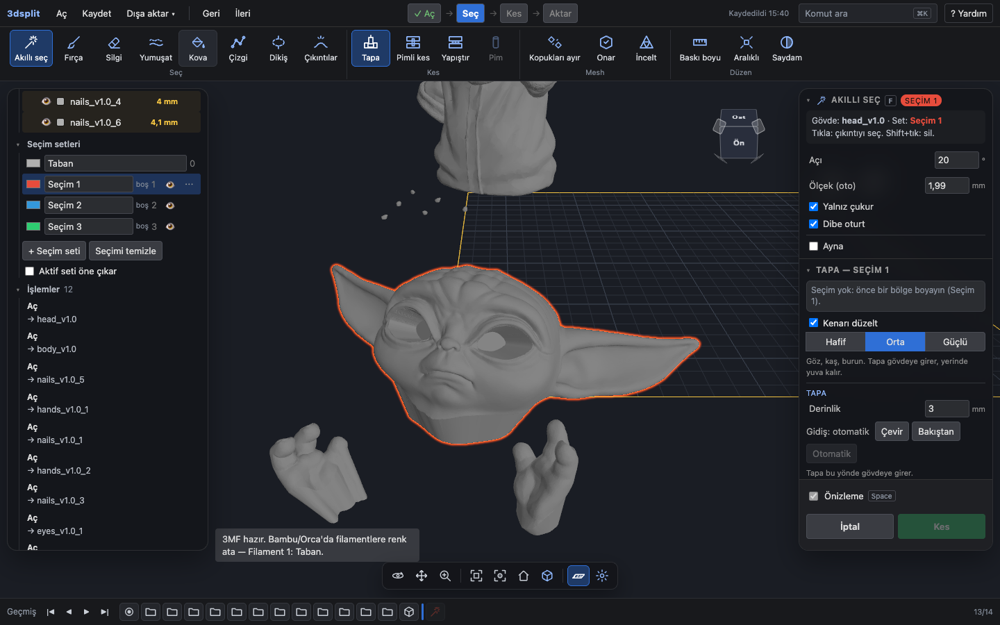 |

**Toplam:** 10 tık/tuş, görev hedefine ulaşılmadı. Ölçülen bekleme 13,8 s (yükleme 6,8 + sadeleştirme 4,8 + diğerleri). Oturum 15:39:12 → 15:41:43, 2 dk 31 s; 2 başarısız deneme (göz yuvasına tıklama, kafayı yakından inceleme).

**Dosya doğrulaması.** İndirilen 3MF'de 12 nesne var; `model_settings.config`'te 24 satırın hepsi `extruder="1"`. Kaynak dosyada 2 nesne extruder 3, 3 nesne extruder 6, 7 nesne extruder 7'ydi.

**En büyük 3 sürtünme (a2).**

1. **Nesne başına filament rengi içe aktarılmıyor ve dışa aktarımda kayboluyor.** Kaynakta 3 renk vardı; uygulamada her şey gri, çıktıda tek filament. Kullanıcı slicer'da 12 parçaya yeniden renk atamak zorunda. Dayanak: kaybolan iş (12 elle atama); Nielsen #1 (ekranda renk yok).
2. **Önceden bölünmüş model için yönlendirme yok.** Gözler zaten ayrı parça; uygulama "bu dosyada boya yok, parçalar zaten ayrı" gibi bir şey söylemiyor, şerit "Seç" adımında bekliyor. Dayanak: Nielsen #10 Yardım ve belgeleme, boş durum ilkesi.
3. **Çok plakalı 3MF tek sahneye yığılıyor.** Kafa plakanın dışında; kullanıcı neyin neyle birleştiğini göremiyor. Dayanak: Nielsen #2.

---

## Görev (b) — figure.stl: kolu Çizgi ile ayır, pim koy, aktar

Sonuç: **başarılı, ikinci denemede.** İndirilen `figure.3mf` iki nesne içeriyor: `figure` (63,5×32,4×75,6 mm, filament 1) ve `Gövde 1` (kol, 27,5×9,5×9,4 mm, pim dahil, filament 2). Aralıklı görünümde pimin kol parçasında olduğu görüldü.

| # | Eylem | Tık/tuş | Bekleme | Ekranda geri bildirim | Belirsizlik anı | Kullanıcının sorusu | Duygu | Kanıt |
| --- | --- | --- | --- | --- | --- | --- | --- | --- |
| 1 | Aç ile figure.stl'yi açar | 2 | 1,65 s | Figür yüklendi; şerit "Seç"; mod Tapa | Yok | — | + | 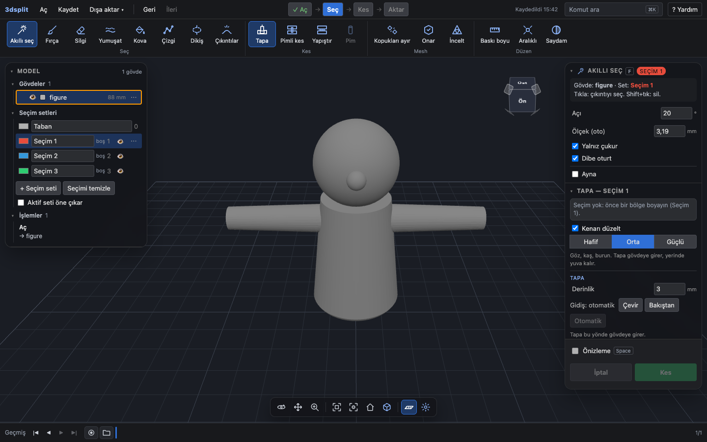 |
| 2 | "Çizgi"ye basar | 1 | <0,1 s | Panel: "Tıkla: nokta ekle. İlk noktaya tıkla ya da Enter: kapat ve boya. Backspace: son nokta, Esc: iptal." "Yüzeye tıklayarak başla" | Evet | "Çizgi mi Dikiş mi? İkisi de halka çiziyor. Mod hâlâ Tapa, kol için Pimli kes'i ayrıca mı seçeceğim?" | 0 | 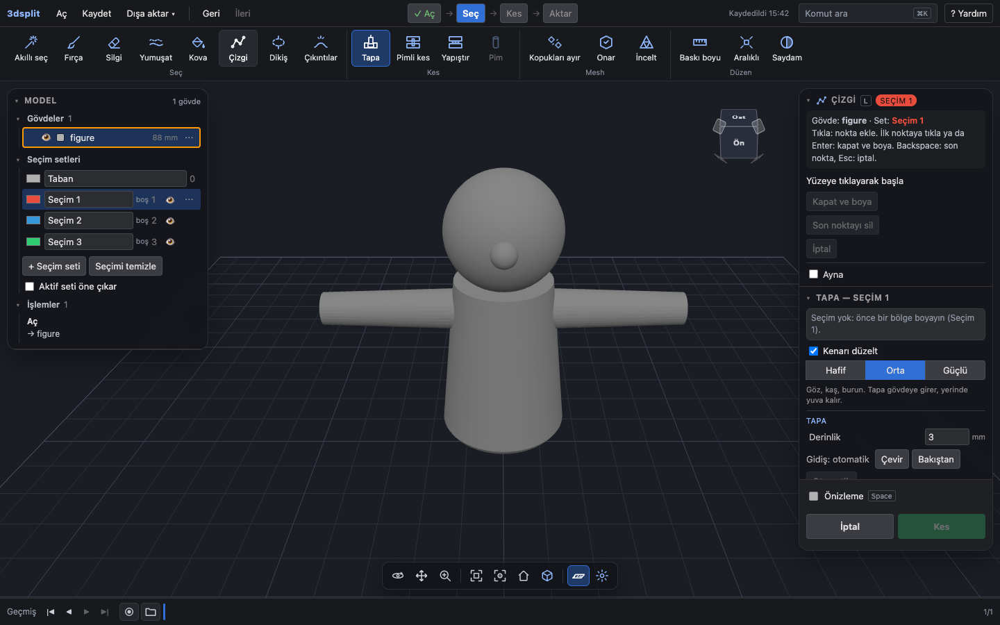 |
| 3 | Kolun önünde 4 nokta tıklar | 4 | — | Sarı noktalar ve yüzeye yapışan çizgi; "4 nokta" | Yok | — | + | 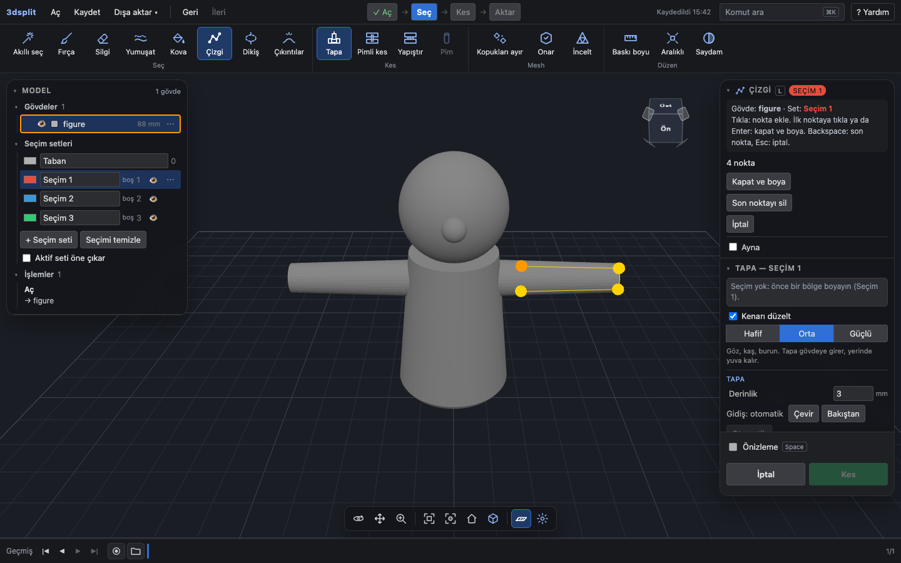 |
| 4 | Enter ile kapatır | 1 | <0,1 s | "Çizgi kapatıldı: 708 üçgen boyandı." Yalnız kolun ön yüzü boyandı; öneri "Tapa — yüzeysel bölge" | Evet | "Kolun tamamı neden seçilmedi?" | − | 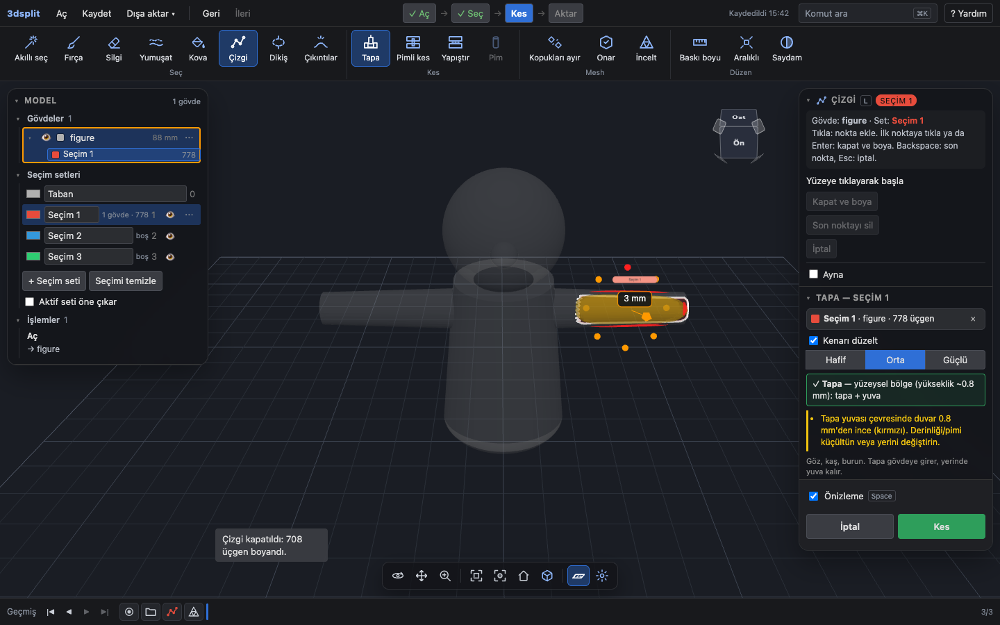 |
| 5 | "Pimli kes"e basar | 1 | ~0,5 s | "Öneri: Tapa" ve sarı uyarı "kesit pin için çok ince; pin konmadı" | Evet | "Pim neden konmuyor? Halkayı kolun etrafına mı çizmeliydim?" | − | 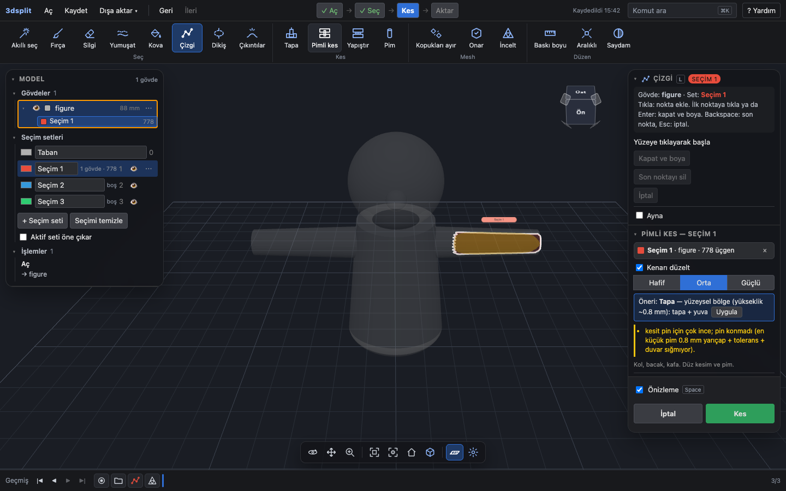 |
| 6 | **Takılma 1.** Seçimi temizler, öndeki ilk noktayı koyar, küpte "Üst"e basar, kolun üstüne nokta koyar | 4 | ~1 s / görünüş | Üstten görünüş; küpte yalnız "Üst" yüzü görünüyor | Evet | "Arkaya nasıl geçerim?" | 0 |  |
| 7 | **Takılma 2.** Küpün üst kenarına basar | 1 | — | Hiçbir şey değişmedi | Evet | "Küp arkayı göstermiyor" | − | 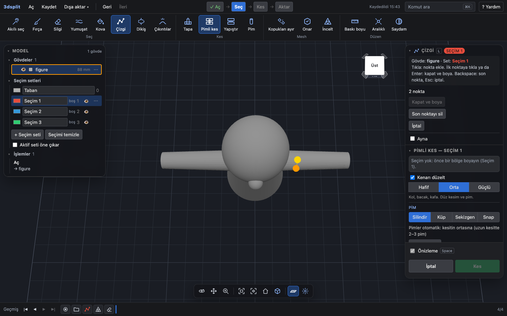 |
| 8 | Komut paletini açar (⌘K), "arka" yazar, Enter | 3 | ~1 s | "Görünüş: Arka" | Az | — | + | 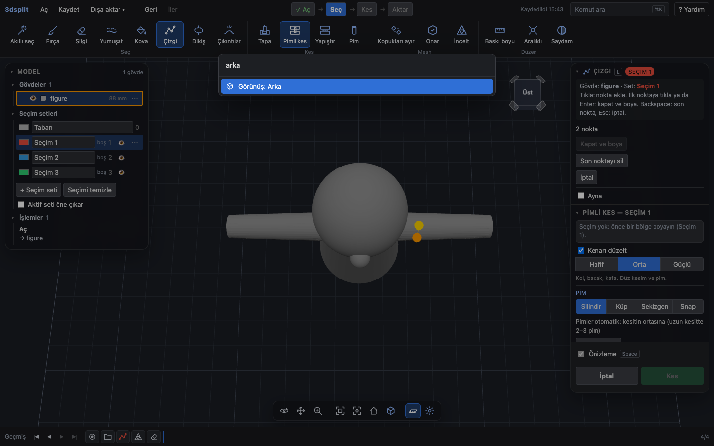 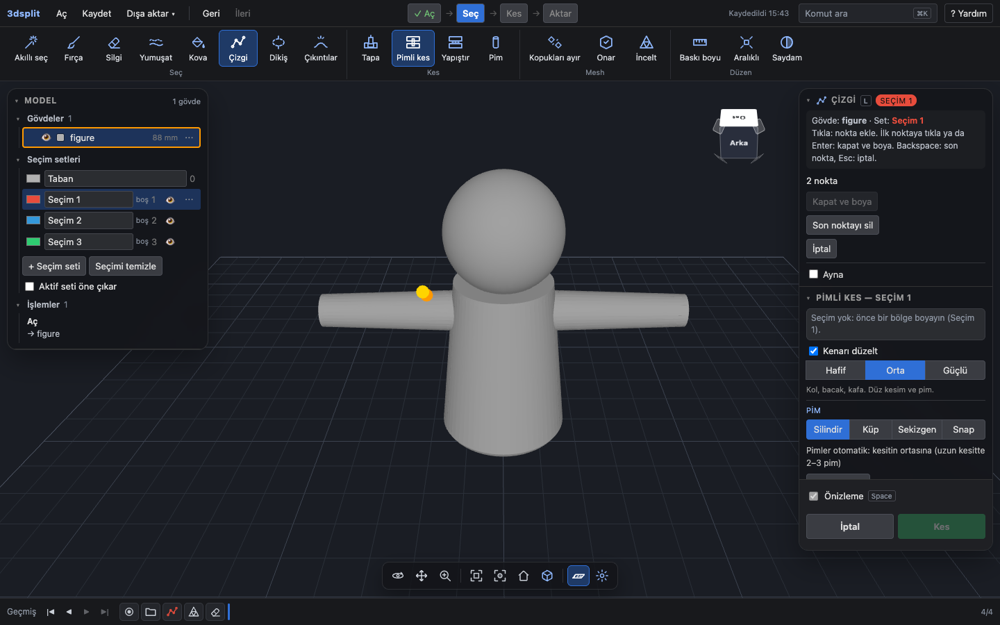 |
| 9 | Arkaya nokta koyar; ⌘K "alt" Enter; alta nokta koyar | 5 | ~1 s / görünüş | Alttan görünüş; önceki noktalar üstte çizili | Az | "Halka kolun etrafını sardı mı?" | 0 | 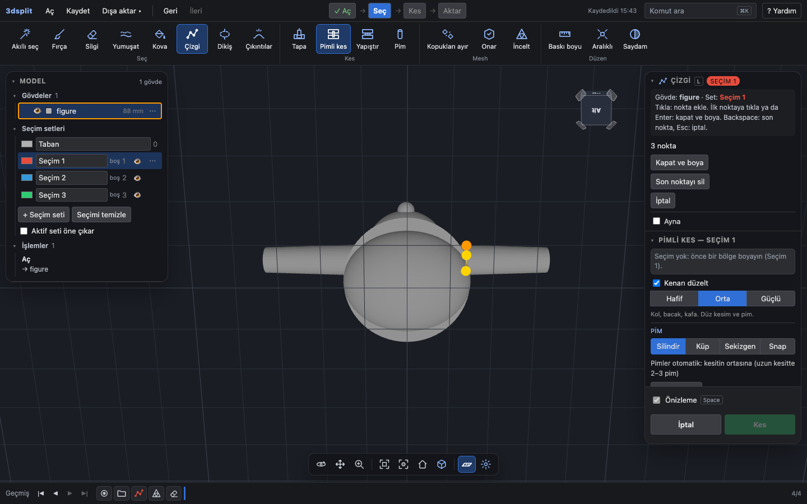 |
| 10 | Enter ile kapatır, Home ile öne döner | 2 | Enter→boya 0,005 s; öneri 0,5 s | "Çizgi kapatıldı: 2945 üçgen boyandı." Kolun tamamı kırmızı; "✓ Pimli kes — kalın çıkıntı (~6,1 mm): düz kesim + pim"; önizlemede omuzda mavi pim | Yok | — | + | 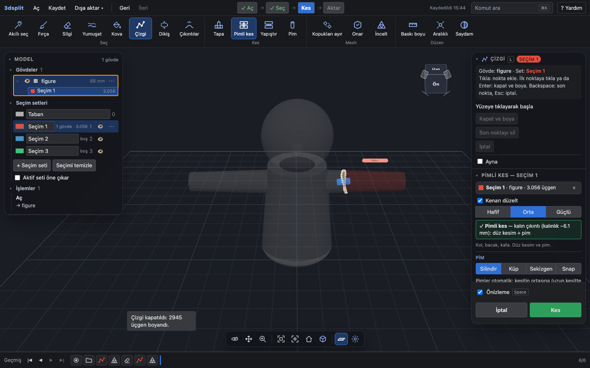 |
| 11 | "Kes"e basar | 1 | 1,1 s (tekrarda 0,26 s) | "Kes 1: Gövde 1 ayrıldı (Pimli kes · Seçim 1)." Kol kırmızı yeni gövde; pim görünmüyor | Az | "Pim nerede?" | + | 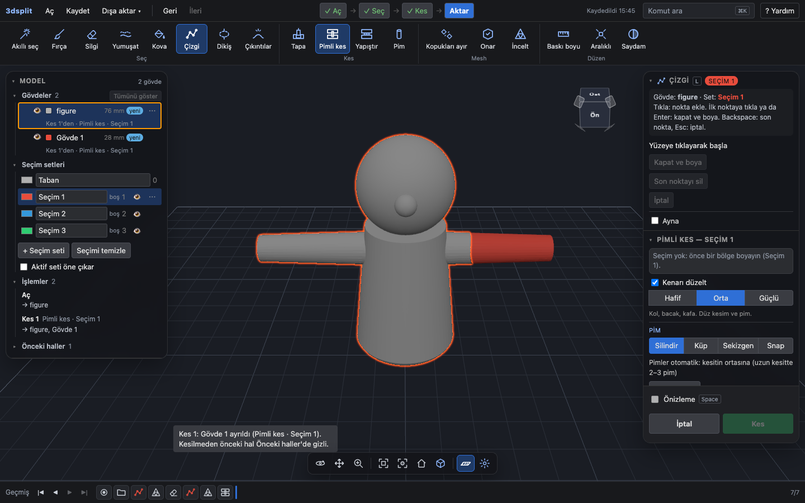 |
| 12 | "Aralıklı"ya basar | 1 | ~1 s | Kol ayrıldı, ucunda pim görünüyor | Yok | — | + | 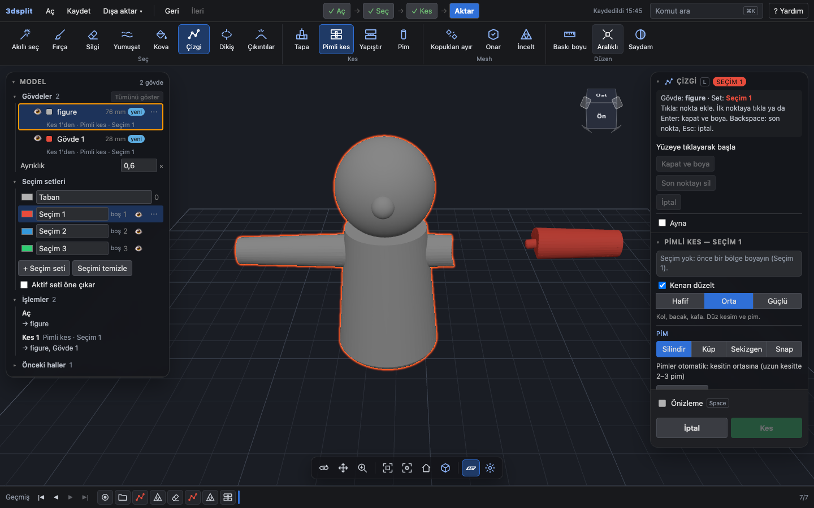 |
| 13 | Aktar → 3MF — Bambu | 2 | ~1 s | `figure.3mf`; "Filament 1: Taban, Filament 2: Seçim 1." | Az | — | + | 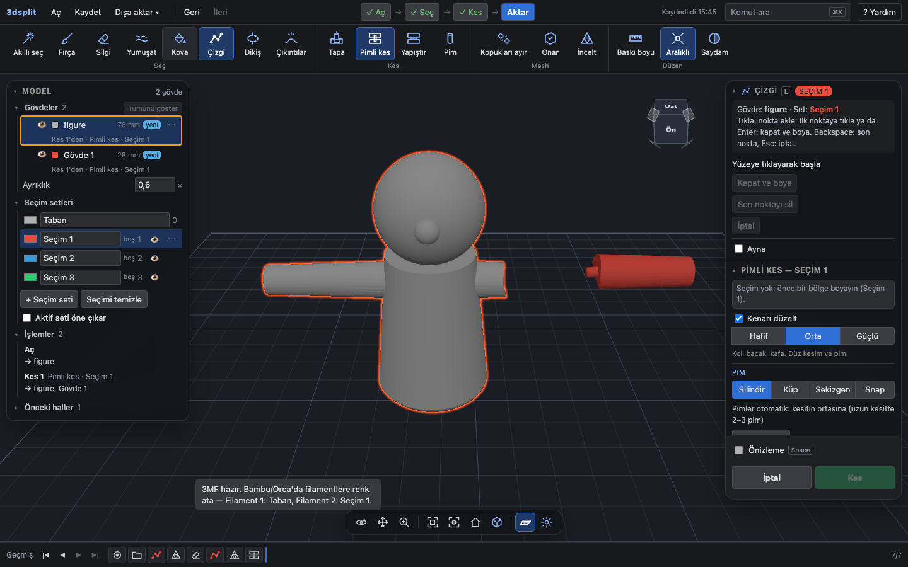 |

**Toplam:** 28 tık/tuş (başarısız 1. deneme 9 + başarılı 2. deneme 19). Ölçülen sistem beklemesi ~6 s (yükleme 1,65 + öneriler 0,5 + kes 1,1 + aktarım ~1 + görünüş geçişleri ~1×3). Oturum 15:42:04 → 15:45:24, 3 dk 20 s; bunun 15:42:19 → 15:44:52 arası 2 dk 33 s "kolu tümüyle nasıl seçerim" takılmasıydı (2 başarısız deneme: ön yüze halka, küpün kenarına tıklama).

**Belgeye bakılmadan bulunan yol.** Kolun dört yanına nokta koymak için kamerayı çevirmek gerekti; arka ve alt görünüşe yalnız komut paletinden geçilebildi. Görev Çizgi'yi istediği için Dikiş denenmedi; Dikiş'in ipucu ("Kapalı halka çizin. İçi boyanmaz; Kes, halkanın düzleminden ayırır") bu görev için daha uygun görünüyor ve kullanıcıya iki aracın farkı arayüzde açıklanmıyor.

**En büyük 3 sürtünme (b).**

1. **Görünen yüze çizilen halka kolu değil, yüzey yamasını seçiyor.** İlk deneme 708 üçgenlik ön yama verdi ve Pimli kes "kesit pin için çok ince" dedi. Uyarı, kolun etrafına halka çizmek gerektiğini söylemiyor. Ölçülebilir: 9 boşa eylem, ~37 s. Dayanak: Nielsen #9 Hataları tanıma ve düzeltme.
2. **Arkaya ve alta geçmek zor.** Üst görünüşte küpte yalnız "Üst" yüzü görünüyor, kenara tıklamak bir şey yapmadı; çözüm ⌘K (her geçiş 3 tuş). Görünüş küpü ön görünüşte arka yüzü gösteriyor ama başka açıdan göstermiyor. Dayanak: Fitts (hedef görünmüyor), Nielsen #7 Esneklik ve verim.
3. **Çizgi / Dikiş / mod seçimi ayrı ayrı.** Çizgi seçilince mod Tapa kalıyor; kol için Pimli kes'i kullanıcı ayrıca bulmalı. Dayanak: Hick (7 seçim aracı + 4 kesim modu arasında karar), Tesler (karmaşıklık kullanıcıya bırakılmış).

---

## Görev (c) — Tolerans deneme parçası

Sonuç: **başarılı, ama yalnızca model açıkken.** İndirilen 3MF'de 4 nesne var: `Tolerans plakası (0.1 / 0.2 / 0.3 mm)` 29×14×5,5 mm ve 3 adet `Tolerans pimi` 4×4×8 mm. Gizlenen figür ve kol dosyaya girmedi. Dosyanın adı `figure.3mf`.

| # | Eylem | Tık/tuş | Bekleme | Ekranda geri bildirim | Belirsizlik anı | Kullanıcının sorusu | Duygu | Kanıt |
| --- | --- | --- | --- | --- | --- | --- | --- | --- |
| 1 | Boş ekranda deneme parçasını arar: ⌘K "deneme", sonra "tolerans" | 4 | — | İkisinde de "Komut bulunamadı" | Evet | "Deneme parçası nerede?" | − |  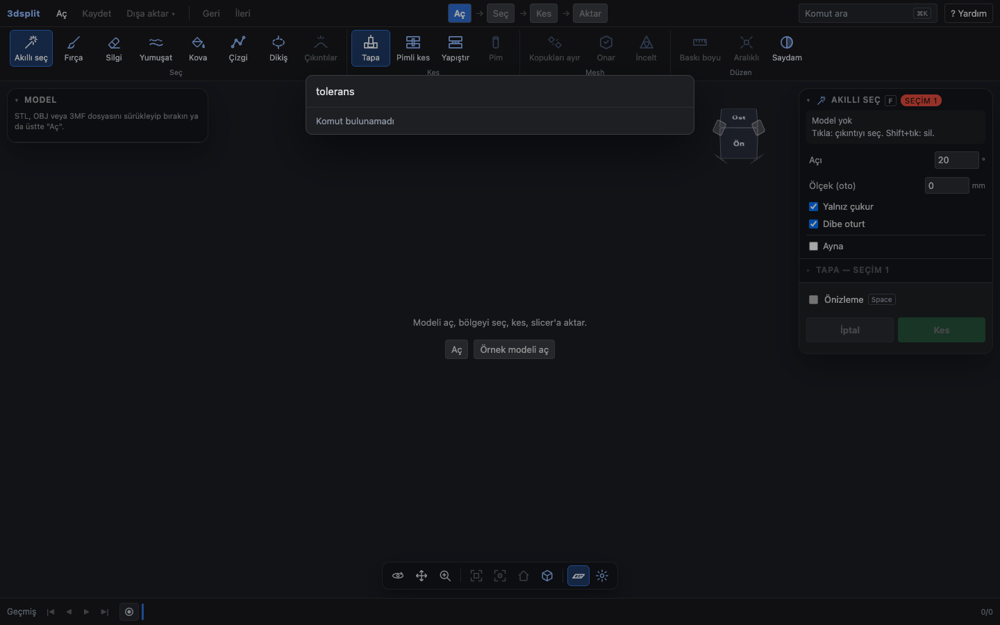 |
| 2 | Sağdaki kapalı "TAPA — SEÇİM 1" başlığına basar | 1 | — | Açılmıyor (model yok) | Evet | — | − | 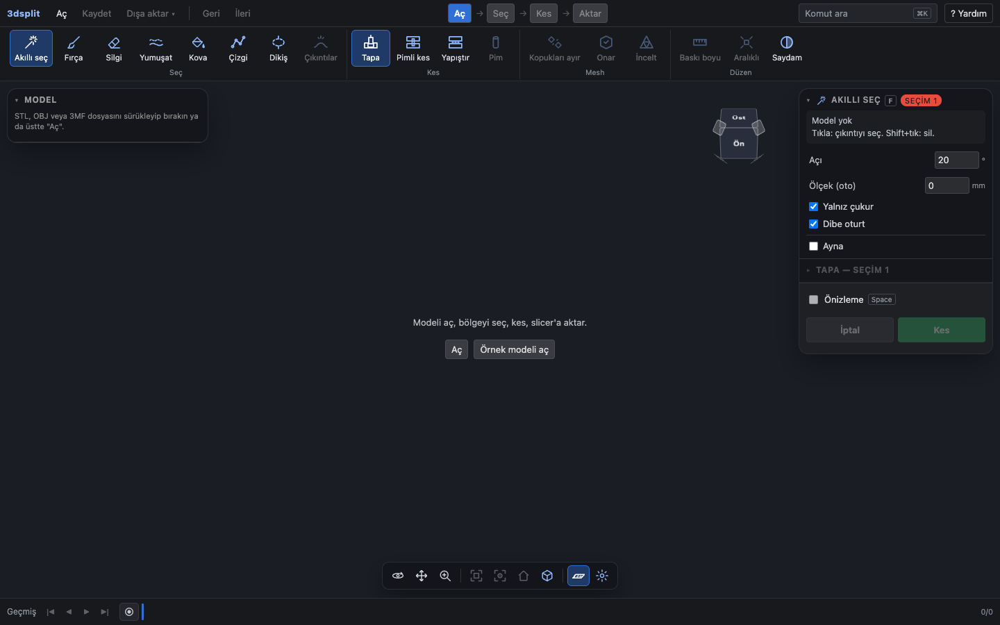 |
| 3 | "? Yardım"ı açar | 1 | <1 s | İş akışı sekmesi: 8 adım dar sütunlara sıkışmış, adım numaraları metnin üstüne biniyor. "Önce küçük bir deneme baskısı almak iyi olur" yazıyor, düğmenin yerini söylemiyor | Evet | "Bunu nasıl okuyacağım?" | − | 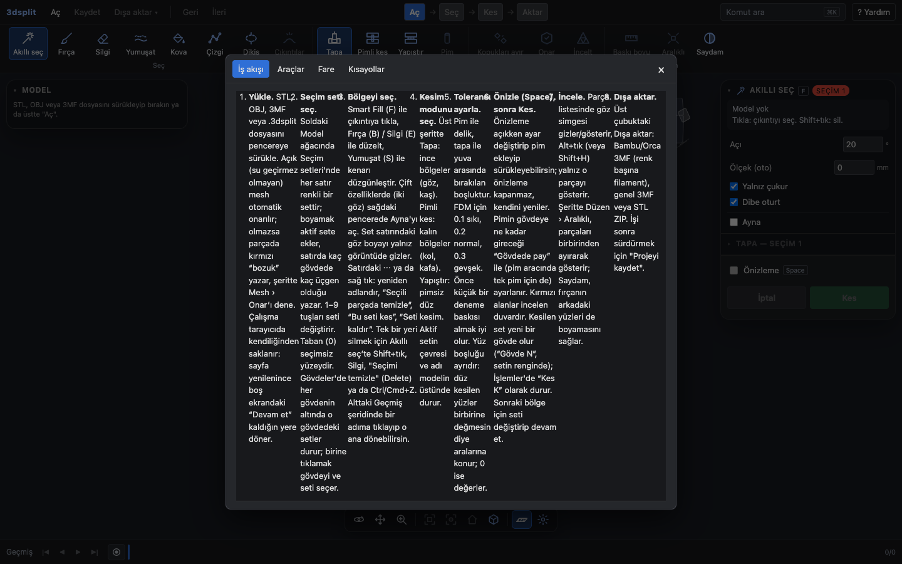 |
| 4 | (Model açıkken) kesim panelinde "Deneme parçası üret"e basar | 1 | ≤3 s | Bildirim: "boşluklar soldan sağa 0.1 / 0.2 / 0.3 mm (çentik sayısı: 1, 2, 3)… dışa aktarırken sadece onları görünür bırakın." 4 gövde mevcut sahneye eklendi; parça sağ panelin arkasında kalıyor | Evet | "Parça nereye çıktı?" | 0 | 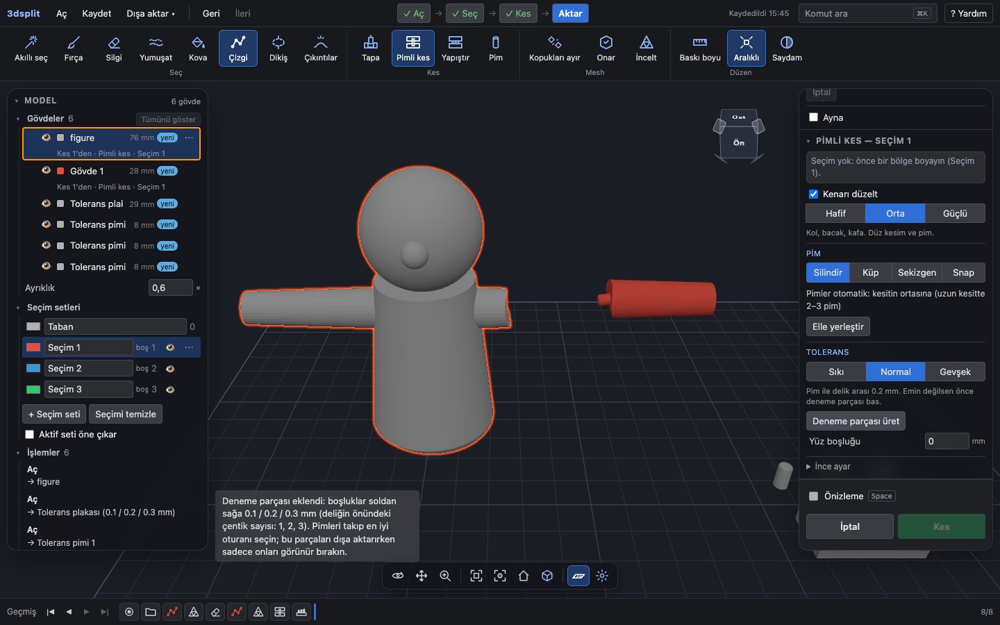 |
| 5 | Figür ve kolu göz simgesiyle gizler | 2 | <0,5 s | Satırlar soluk; deneme parçası hâlâ panelin arkasında | Az | — | 0 | 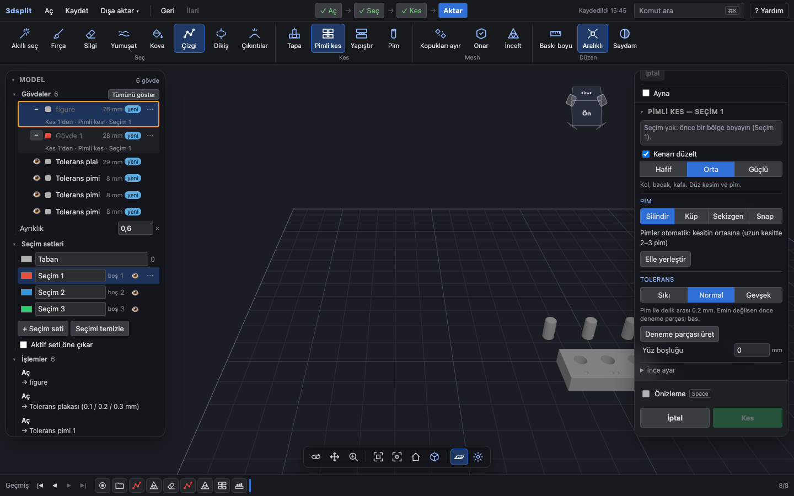 |
| 6 | "Görünenleri sığdır"a basar | 1 | ~1 s | Plaka ve 3 pim ekranda; deliklerin önünde 1, 2, 3 çentik | Yok | — | + | 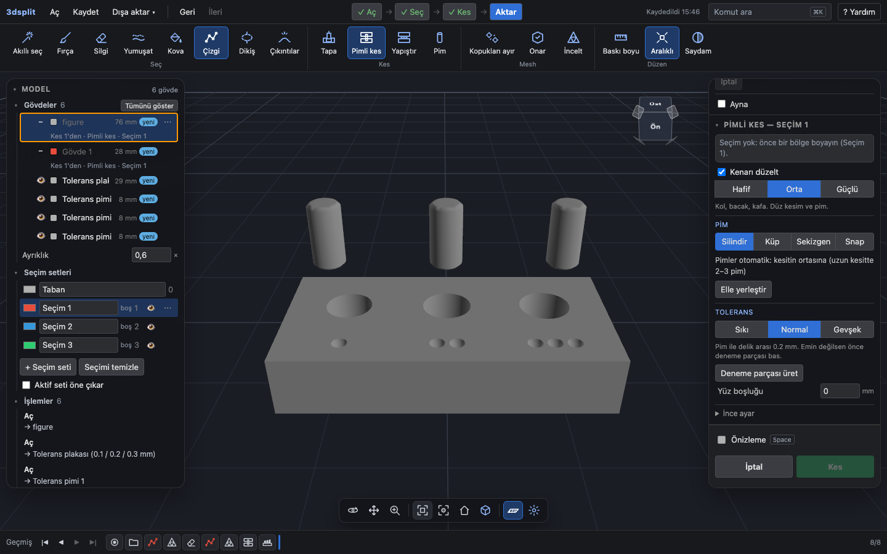 |
| 7 | Dışa aktar → 3MF — Bambu | 2 | ≤1 s | `figure.3mf`; "Filament 1: Taban." | Az | "Dosya neden figure adını aldı?" | 0 | 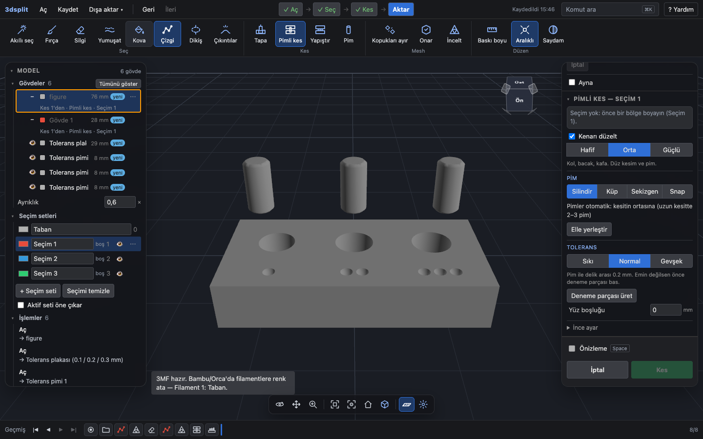 |
| 8 | Baskıdan sonra 3 çentikli (0.3 mm) delik en iyi oturdu varsayımıyla "Gevşek"e basar | 1 | <0,1 s | "Pim ile delik arası 0.3 mm." Düğmelerin üstünde mm yazmıyor; değer ancak tıklayınca görünüyor | Evet | "3 çentik Gevşek mi? Tapa için ayrıca girmem gerekir mi?" | 0 | 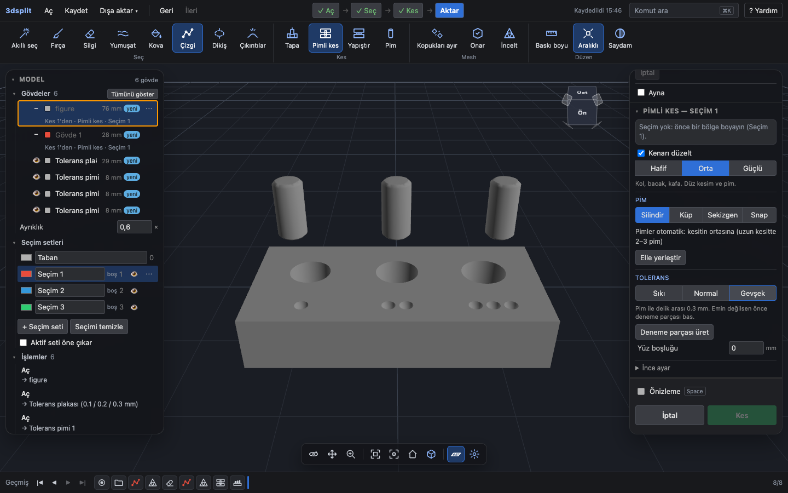 |
| 9 | Tapa moduna geçip kontrol eder | 1 | <0,1 s | "Tapa ile yuva arası 0.3 mm." Ayar iki modda ortak | Yok | — | + | 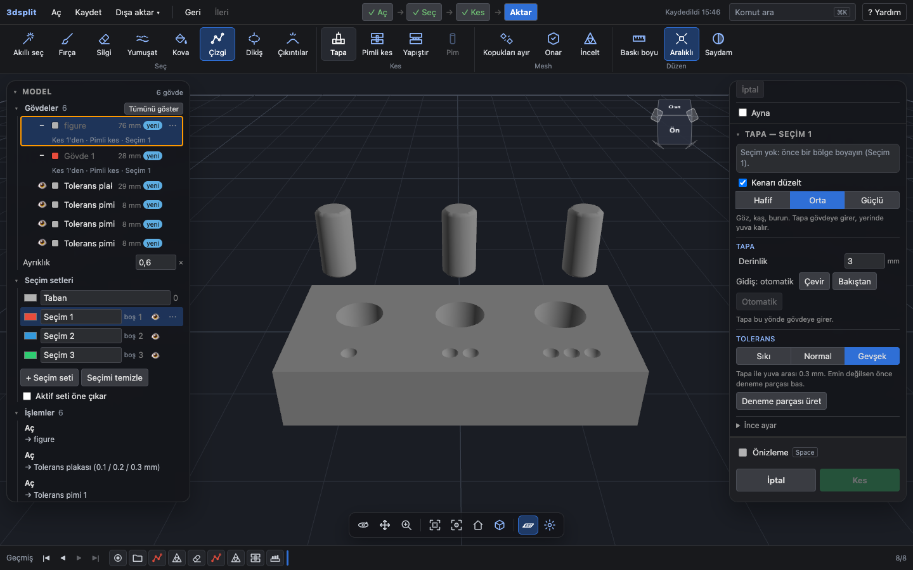 |
| 10 | Sayfayı yeniler, "Yok say", aynı dosyayı açar | 3 | — | Tolerans yeniden 0.2 mm (Normal) | Evet | "Seçtiğim ayar neden gitti?" | − | (adımlar aşağıda) |

**Toplam:** başarılı yol 8 tık (üret 1, gizle 2, sığdır 1, aktar 2, Gevşek 1, kontrol 1) + arama 6 tık (palet 4, kapalı panel 1, Yardım 1). Ölçülen bekleme ~5 s. Oturum 15:45:38 → 15:46:49 (üretimden ayara 71 s); arama denemeleri 15:48:03 → 15:48:45 (3 başarısız deneme: palet ×2, kapalı panel).

**Tekrar üretme adımları (10. adım):** Gevşek seç → sayfayı yenile → "Yok say" → `samples/figure.stl` aç → Pimli kes veya Tapa panelinde "Pim/Tapa … arası 0.2 mm". Sayfa yenilenmeden ikinci dosya açılınca 0.3 mm kalıyor.

**En büyük 3 sürtünme (c).**

1. **Deneme parçasına model olmadan ulaşılamıyor, komut paletinde de yok.** "deneme" ve "tolerans" aramaları boş döndü; düğme yalnız bölge seçilince açılan kesim panelinin içinde. Dayanak: Nielsen #6 Hatırlamak yerine tanıma; 6 boşa eylem.
2. **Çentik ↔ ayar eşlemesi kullanıcıya bırakılmış ve ayar kalıcı değil.** Parça "çentik 1, 2, 3 = 0.1/0.2/0.3 mm" diyor, düğmeler "Sıkı / Normal / Gevşek" diyor; mm değeri düğmede yok. Sayfa yenilenince seçim 0.2'ye dönüyor. Dayanak: Nielsen #6; kaybolan iş (her oturumda yeniden seçmek).
3. **Deneme parçası mevcut projeye karışıyor.** 4 gövde figürün sahnesine eklendi, panelin arkasında çıktı, aktarmadan önce diğer parçaları elle gizlemek gerekti (2 tık + sığdır), dosya adı `figure.3mf`. Dayanak: Nielsen #1 ve #5; 3 ek eylem.

---

## Duygu eğrisi (özet)

| Görev | Başlangıç | En düşük an | Bitiş |
| --- | --- | --- | --- |
| (a1) Bluey | + boş ekran net | − yüklenince hazır kurulmuş Pimli kes ve "Seçim 1"in ne olduğu belirsiz (a01) | 0 dosya iniyor, filament adı "Seçim 6" |
| (a2) Grogu | + "Devam et" kartı | − renkler yok, parçalar dağınık, gözü kesmek anlamsız (a10, a12) | − tek filamentli çıktı |
| (b) figure | + yükleme hızlı | − "kesit pin için çok ince" ve küpün arkayı göstermemesi (b05, b07) | + Aralıklı'da pim görünüyor |
| (c) Deneme | − bulunamıyor | − yardım okunmuyor (c12) | − ayar yenileyince kayboluyor |

**Belirleyici anlar (moments of truth).** (1) Boyalı 3MF yüklendiği an: ekran kullanıcıya "hazır, Kes'e bas" diyor ve bu tek tık 20 s'lik istenmeyen bir kesim. (2) Çizgiyle ilk halka: sonuç beklenenin tersi ve hata metni nedeni söylemiyor. (3) Dışa aktarma bildirimi: başarı anı, ama filament adları ("Taban", "Seçim 6") slicer'da hangi parçanın ne olduğunu anlatmıyor.

---

## Görevler arası ortak acı noktaları

| # | Acı noktası | Görüldüğü yer | Kanıt | Dayanak |
| --- | --- | --- | --- | --- |
| O1 | **Renk setlerinin adı anlam taşımıyor.** "Seçim 1/6", "Filament 4", "Taban"; dışa aktarma bildirimi de bu adları kullanıyor. Kullanıcı "göz", "kol" diye düşünüyor | a1, b |   | Nielsen #2 |
| O2 | **Mod (Tapa/Pimli kes) ile seçim aracı ayrı yerde, varsayılan mod çoğu zaman yanlış.** Bluey'de göz için Pimli kes, figürde kol için Tapa hazır geliyor | a1, b |   | Tesler, Hick |
| O3 | **Kesilen parça kesimden sonra görünmüyor.** Tapa yuvasında, pim kolun içinde; "Aralıklı" kendiliğinden önerilmiyor | a1, b |   | Nielsen #1 |
| O4 | **Sahne birikiyor.** İkinci "Aç" dosyayı mevcut sahnenin üstüne ekliyor (iki figür üst üste, "2 gövde"); deneme parçası da aynı sahneye giriyor; Grogu'nun 3 plakası tek sahnede | a2, c | 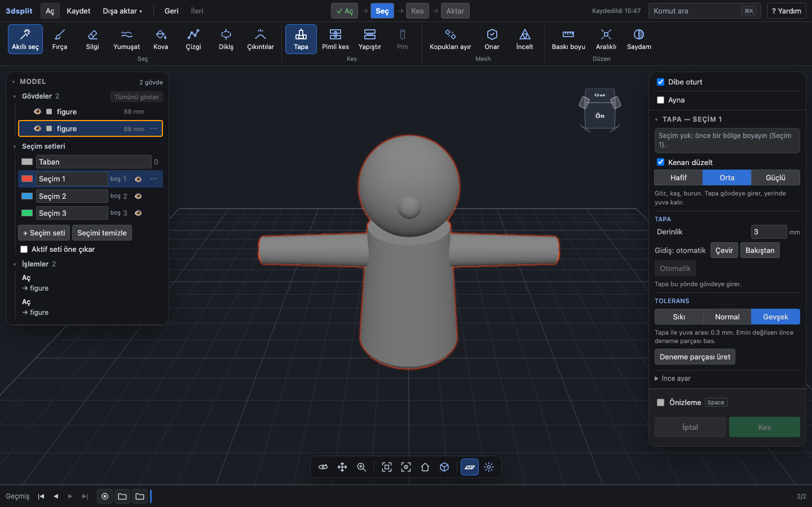   | Nielsen #5; dışa aktarımda fazladan nesne riski |
| O5 | **Uyarılar ne yapılacağını söylemiyor veya tekrarlanıyor.** "18 çok küçük boyalı kırıntı atlandı", "kesit pin için çok ince", aynı ince duvar uyarısı iki kez | a1, a2, b |    | Nielsen #9 |
| O6 | **Yardım okunamıyor.** İş akışı sekmesinde 8 adım dar sütunlara bölünmüş, numaralar metnin üstüne biniyor. Yer: `src/ui/HelpDialog.tsx:69` `<ol className="steps">` ile `src/ui/styles.css:370` `.steps { display: flex }` aynı sınıf adını paylaşıyor (üst adım şeridi için yazılmış kural yardım listesine de uygulanıyor) | c |  | Nielsen #10; WCAG 2.2 SC 1.4.10 Reflow ve 1.3.1 ile ilgili okunabilirlik |
| O7 | **Filament bilgisi yolda kayboluyor.** Grogu'nun 3 nesne rengi tek filamente iniyor; Bluey'nin 5 rengi 2 filamente (gövde + tapa) iniyor ve bu bildirimde değil, ancak dosya açılınca anlaşılıyor | a1, a2 | Grogu çıktısı: 24 satırın hepsi `extruder="1"`; Bluey: extruder 1 ve 2 | Kaybolan iş: slicer'da elle renk atama |

**Olumlu ve korunmalı olanlar** (kanıtlı): boş ekran ve adım şeridi sıradaki adımı söylüyor (a00); şerit kesimden sonra "Aktar"a geçiyor ve Aktar menüyü açıyor (a07); her menü öğesinin altında ne yaptığı yazıyor (a07); yenileyince "Devam et" kartı (a09); Sadeleştir kartı ne kazanılıp ne kaybedileceğini sayıyla söylüyor (a10, a11); deneme parçası bildirimi çentik anlamını açıklıyor (c01); kesim sonrası bildirim kaynağın nerede gizlendiğini söylüyor (a06).

## Fırsatlar

Etki × kolaylık sırasıyla; her biri yukarıdaki kanıta bağlı.

1. **Yüklemeden sonra Kes'i boş seçimle başlat** veya boyalı 3MF'de "Hangi rengi ayırmak istiyorsun?" diye sor; tüm beyaz bölgeyi tek tıkla kesmeyi engelle. (a1 sürtünme 1, a16: 20,3 s istenmeyen kesim)
2. **Yardım listesinin sınıf adını ayır** (`ol.steps` ↔ `.steps`). Tek satırlık CSS düzeltmesi; yardım bugün okunamıyor. (O6)
3. **Deneme parçasını görünür yap:** komut paletine "Deneme parçası" ve "Tolerans" komutları; boş ekranda ikinci düğme; üretince ayrı sahne veya otomatik "yalnız bunu göster + sığdır"; dosya adı `tolerans-deneme.3mf`. (c sürtünme 1 ve 3)
4. **Tolerans düğmelerinde mm göster** (Sıkı 0.1 · Normal 0.2 · Gevşek 0.3) ve seçimi tarayıcıda hatırla, baskı tablası gibi. (c sürtünme 2; baskı tablası ipucu "tarayıcıda hatırlanır" diyor, tolerans hatırlanmıyor)
5. **Çizgi ilk halkası yama verdiğinde nedeni söyle:** "Halka kolun yalnız bir yüzünü sardı. Kolu ayırmak için halkayı kolun etrafından geçir ya da Dikiş'i kullan." (b sürtünme 1)
6. **Görünüş küpünde her açıdan 6 yüze erişim** (ör. küpün yanında küçük ön/arka/üst/alt düğmeleri). (b sürtünme 2: arka/alt yalnız ⌘K ile)
7. **Kesimden sonra parçayı göster:** kısa süre Aralıklı görünüm veya kesilen parçayı vurgulama. (O3)
8. **Nesne başına filament atamasını içe ve dışa aktar; çok plakalı dosyada plakaları ayrı göster.** (a2 sürtünme 1 ve 3, O7)
9. **Renk setine anlamlı ad öner** (içe aktarılan renk adı veya "Göz 1") ve yeni sete mevcut renklerden ayırt edilebilir renk ver. (O1; `#e67e22` ile `#cf7929`)
10. **İkinci "Aç"ta sor:** "Mevcut sahneye ekle / yeni proje". (O4)

---

## Doğrulanamadı

- **Baskı ve geçme.** Tapa yuvaya, pim deliğe ve deneme pimleri plakaya gerçekten oturuyor mu: baskı yapılamadı. Yalnız dosyadaki nesne sayısı, boyut ve filament ataması doğrulandı.
- **Pim deliğinin gövdede açıldığı.** Aralıklı görünümde pim kol parçasında görüldü; gövdedeki deliğin varlığı ve derinliği dosyada ölçülmedi.
- **Bambu Studio / OrcaSlicer'da açılış.** 3MF'ler slicer'da açılmadı; plakaya dizilim ve filament eşlemesi yalnız XML'den okundu.
- **Space önizlemesinin tutarlılığı.** Bluey'nin ilk akışında Space önizlemeyi açtı (a05); ikinci akışta aynı tuşa basıldıktan sonra kesim anında Önizleme kutusu işaretsiz görünüyor (a06-bekle). Nedeni ayrıştırılamadı.
- **Kes süresindeki fark.** Aynı Bluey göz kesimi 3,2 s ve 11,5 s ölçüldü; önbellek mi, ölçüm yöntemi mi (meşgul kartı metni) ayrıştırılamadı.
- **Grogu'da sol tarafta beliren küçük kırmızı halka** (a13): neyi işaret ettiği anlaşılamadı.
- **Kullanıcı düşünme süresi.** Gerçek kullanıcı yok; düşünme ve okuma süreleri ölçülmedi. Takılma süreleri oturum saatinden alındı ve ajan gecikmesini içeriyor.
- **Dar ekran ve dokunmatik.** Yalnız 1440×900 masaüstü denendi.
