# 02 — Akış hataları denetimi (UX)

26 Ekim 2026. Review'un 2. aşaması. Yalnızca inceleme yapıldı; kod değişmedi.

## Kapsam ve yöntem

- İstenen: `/audit ux`. `audit` skill'i model tarafından çağrılamıyor (yalnızca kullanıcı çağırabilir) ve iş akışının taklit edilmemesi isteniyor. Bu yüzden skill'in yöntemi kopyalanmadı. Denetim, görevde verilen odak listesine göre yapıldı: yanlış sıra, çıkmaz durum, kaybolan iş, geri alınamayan adım, beklenmedik sonuç, eksik uyarı, sessiz başarısızlık, yanlış varsayılan, kesim sonrası belirsizlik, dışa aktarılan dosyanın beklentiye uymaması. Dayanak olarak Nielsen'in 10 sezgisi ve ölçülen sürtünme kullanıldı.
- Ortam: http://localhost:5173 (dev), Google Chrome 155, Playwright `channel: 'chrome'`, headless, 1440×900. Dosyalar `setInputFiles` ile yüklendi. Düğmeler rol/metinle, tuval `page.mouse` ile kullanıldı. Durum `window.app.store` ile okundu, indirilen dosyalar açılıp doğrulandı. Scriptler: `/private/tmp/claude-501/-Users-yunuskorkmaz-Projects-3dsplit/3b196ea1-5eea-459e-a40e-7aaa8e9d15e4/scratchpad/s2/`.
- Görevler:
  - (a) Boyalı 3MF'den (Bluey_Color.3mf, Grogu_Bambu_Colour.3mf) gözü Tapa ile ayırıp 3MF almak.
  - (b) figure.stl'de kolu Çizgi aracıyla ayırıp Pimli kes ile pim koymak.
  - (c) Tolerans deneme parçası üretmek, ayarı seçmek.
- Bilerek yapılan hatalar: seçim yokken kes, çok küçük (1 üçgen) ve çok büyük (bütün model) seçim, kesimden sonra geri al, yarım çizgi, model yokken araç, bozuk dosyalar (`samples/broken.stl`, rastgele bayt, yarıda kesilmiş STL, zip olmayan .3mf).

## Görevlerde ölçülenler

| Görev | Tık / adım | Süre | Sonuç |
| --- | --- | --- | --- |
| (a) Bluey, göz → Tapa → 3MF | 6 tık: + Seçim seti, göze tık, Tapa, Kes, Dışa aktar, 3MF | açılış 2,4 s; kes 13,9 s (ilk), 3,8 s (iptalden sonra ikinci); 3MF 1,2 s | Kesildi. Dosyada boya yok, iki filament (bkz. Y2, O6) |
| (a) Grogu | açıp hiçbir şey yapmadan 3MF | açılış 4,1 s; 3MF 2,5 s | Kaynaktaki parça başına filament (3/6/7) kayboldu (bkz. Y1). Gözler zaten ayrı nesne olduğu için Tapa kesimi bu dosyada anlamsız |
| (b) figure, kol → Çizgi → Pimli kes → 3MF/STL | ~19 tık: araç 1, nokta 6, görünüş değişimi 4×2, Pimli kes 1, Kes 1, Dışa aktar 2 | önizleme 0,33 s, kes 0,85 s, dışa aktarma 0,1 s | Doğru halkayla kesildi; iki parça da kapalı (açık kenar 0). İlk denemedeki 4 noktalı halka sessizce boşa gitti (Y3) |
| (c) Deneme parçası | Pimli kes, sağ paneli kaydır, Deneme parçası üret (2 tık + kaydırma); yalnız deneme parçasını almak için +1 tık/parça gizleme | üretim 0,8 s | Plaka ve 3 pim kapalı. Bulmak, ayırmak ve sonucu hatırlatmak zor (O7, O8, O9) |

## Özet tablo

| # | Başlık | Görev | Önem |
| --- | --- | --- | --- |
| K1 | Geri al, dosyayı açmayı da geri alıyor; otomatik kayıt boş sahneyi yazıyor, sayfa yenilenince bütün iş gidiyor | b (genel) | Kritik |
| Y1 | Grogu'nun parça başına filament ataması açılışta okunmuyor; dışa aktarınca bütün parçalar Filament 1 | a | Yüksek |
| Y2 | Kesimden sonra gövde ekranda 5 renkli, 3MF'te tek filament ve boyasız; uyarı yok | a | Yüksek |
| Y3 | Çizgi "16 üçgen boyandı" diyor, modelde hiç boya kalmıyor | b | Yüksek |
| O1 | Göz seçimine eski bölgenin öneri kartı "✓ Pimli kes, kalınlık ~17,5 mm" olarak kalıyor | a | Orta |
| O2 | Açılışta beyaz set (179 bin üçgen: göz, karın, ayaklar) Pimli kes ile kesime hazır, Kes yeşil | a | Orta |
| O3 | Siyah göz bebeği "boyanmamış delik" diye tapaya katılıyor | a | Orta |
| O4 | Yeni setin rengi mevcut turuncuyla neredeyse aynı; kesilen beyaz göz turuncu görünüyor ve turuncu filamente atanıyor | a | Orta |
| O5 | Delete, ipucunda "seçili pimi sil" yazarken pim seçili değilse bütün seti siliyor, bildirim yok | b | Orta |
| O6 | Bütün modeli kaplayan seçimde Kes açık; aynı hata üç kez çıkıyor | hata | Orta |
| O7 | Deneme parçası komut aramada yok, model açmadan üretilemiyor, sağ panelde kaydırma altında | c | Orta |
| O8 | Deneme parçası modelin yanına karışıyor; dışa aktarma modeli de alıyor, adım çubuğu "Aktar"a atlıyor, İşlemler'de 4 kez "Aç" | c | Orta |
| O9 | Seçilen tolerans hatırlanmıyor: yeni modelde yine 0,2 mm | c | Orta |
| O10 | 1 üçgenlik seçimden 2,6 mm'lik tapa sessizce üretiliyor; Pimli kes'te hata metni teknik | hata | Orta |
| O11 | Bozuk dosya hataları ham İngilizce JavaScript metni | hata | Orta |
| D1 | Çizgi, ilk noktaya ~3 kenar yakın tıklamada kendiliğinden kapanıyor | b | Düşük |
| D2 | Çizgi noktaları modelin arkasından da çiziliyor; hangi yüzde olduğu belirsiz | b | Düşük |
| D3 | Model yokken araçlar açık; Space "Önce bir parça seçin" diyor; boyasız modelde Space hiçbir şey söylemiyor | hata | Düşük |
| D4 | Dışa aktarılan dosyanın adı ilk gövdenin adı (head_v1.0.3mf, quant_1.3mf, parts.zip) | a, b | Düşük |
| D5 | Çizgi ve Dikiş'in ipucunda hangisinin kol için olduğu yazmıyor | b | Düşük |

## Bulgular

### K1 — Geri al, dosyayı açmayı da geri alıyor; sayfa yenilenince iş kalıcı gidiyor

- **Görev:** (b), genel.
- **Ne oluyor:** Geçmişin ilk adımı "Aç: figure". Ctrl/Cmd+Z en başa kadar inince model sahneden kalkıyor, ekran boş duruma dönüyor. Çizgi aracında 2 nokta koyup Cmd+Z'ye basmak (son noktayı silmeyi beklerken; doğru tuş Backspace) doğrudan modeli kaldırıyor. Noktalar boş sahnede havada kalıyor, panel "Model yok · 2 nokta" diyor. Ardından otomatik kayıt (1,5 s) boş durumu IndexedDB'ye yazıyor. Sayfa yenilenince "Kaldığın yer · Devam et" kartı çıkmıyor. Kesim, boya ve ayarlar kalıcı olarak gidiyor. İleri (Cmd+Shift+Z) aynı sekmede geri getiriyor, ama sekme kapandıysa ya da yenilendiyse bu yol da yok.
- **Tekrar:**
  1. figure.stl aç, Çizgi (L), kola 2 nokta koy, Cmd+Z. Model kayboluyor.
  2. Ya da: figure aç, kolu kes (4 geçmiş adımı), Cmd+Z'ye 4 kez bas, 3 s bekle, sayfayı yenile. Boş ekran geliyor, "Devam et" yok. Karşılaştırma: kesimden sonra doğrudan yenileyince "Kaldığın yer: figure · 2 gövde" kartı çıkıyor.
- **Kanıt:** 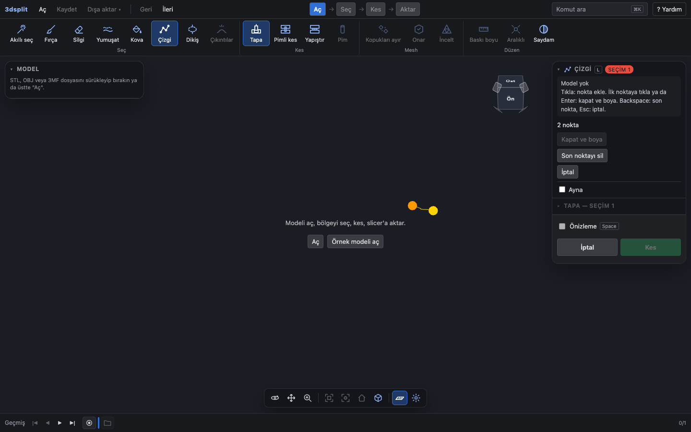 
- **Dayanak:** Nielsen #3 (kullanıcı denetimi ve özgürlük: geri al, dosya açmayı geri almamalı) ve #5 (hata önleme). Kaybolan iş: bütün oturum. Kodda yer: `src/state/actionsFile.ts:128` (açılış geçmişe adım olarak giriyor).
- **Önem:** Kritik.
- **Önerilen yön:** Açılışı geçmişin tabanı yap, geri alınamasın. Boş sahneyi oturum kaydının üstüne yazma. Çizgi/Dikiş açıkken Cmd+Z son noktayı silsin.

### Y1 — Grogu'nun parça başına filament ataması kayboluyor

- **Görev:** (a).
- **Ne oluyor:** Grogu_Bambu_Colour.3mf'te 12 nesne var. `Metadata/model_settings.config` her nesneye filament atıyor: gözler 3, baş ve eller 6, gövde ve tırnaklar 7. Uygulama açınca bütün parçalar gri, seçim setleri varsayılan (Seçim 1–3), "Boyalı 3MF" bildirimi yok. Hiçbir şey değiştirmeden "3MF — Bambu Studio / OrcaSlicer" alınınca 12 nesnenin hepsi `extruder="1"`. Bildirim: "Filament 1: Taban". Dosya adındaki "Colour" bilgisi, açıp kaydetmekle siliniyor.
- **Tekrar:** Grogu_Bambu_Colour.3mf aç, Sadeleştirme kartında "Olduğu gibi kalsın", Dışa aktar → 3MF Bambu. İndirilen dosyada `model_settings.config` içindeki extruder değerlerine bak.
- **Kanıt:** 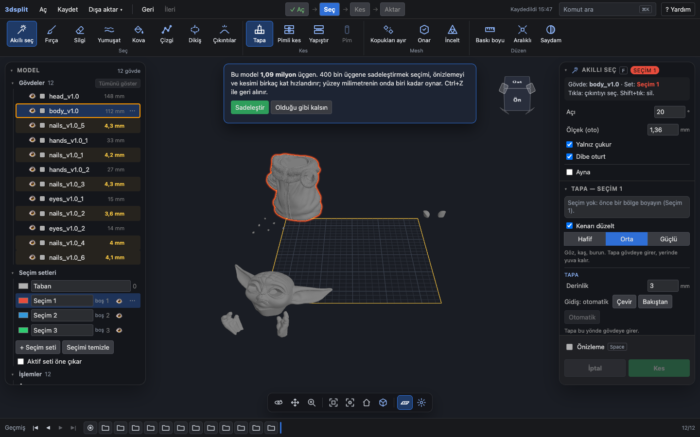. Kaynak: `key="extruder" value="3|6|7"`; çıktı: 12 nesnede `value="1"`.
- **Dayanak:** Nielsen #1 (sistem durumu: renk kaybolurken söylenmiyor). Kaybolan iş: kullanıcının slicer'da yaptığı renk ataması. Kodda yer: `src/io/threeMf.ts` yalnızca üçgen boyasını (`paint_color`, `mmu_segmentation`) okuyor, nesne extruder'ını okumuyor.
- **Önem:** Yüksek.
- **Önerilen yön:** Nesne başına extruder'ı gövde rengi olarak al. Alamıyorsan açılışta "Bu dosyadaki parça renkleri aktarılamadı" de.

### Y2 — Kesimden sonra ekran ile 3MF uyuşmuyor

- **Görev:** (a).
- **Ne oluyor:** Bluey'de göz Tapa ile kesildikten sonra kalan gövde ekranda hâlâ mavi, açık mavi, beyaz, siyah ve turuncu. Ağaçta altında 5 set sayılıyor. 3MF Bambu çıktısında gövde tek nesne, `extruder=1`, üçgenlerde boya özniteliği yok. Bildirim: "Filament 1: Taban, Filament 2: Seçim 6". Ekranda 5 renkli görünen gövde dosyada tek renk ve gri "Taban" adıyla geliyor. Boyanın atılacağı ne dışa aktarmadan önce ne sonra söyleniyor.
- **Tekrar:** Bluey aç, + Seçim seti, sol göze Akıllı seç, Tapa, Kes, Dışa aktar → 3MF Bambu. Dosyayı aç: `3D/Objects/object_1.model` üçgenlerinde öznitelik yok, `model_settings.config` iki extruder.
- **Kanıt:** 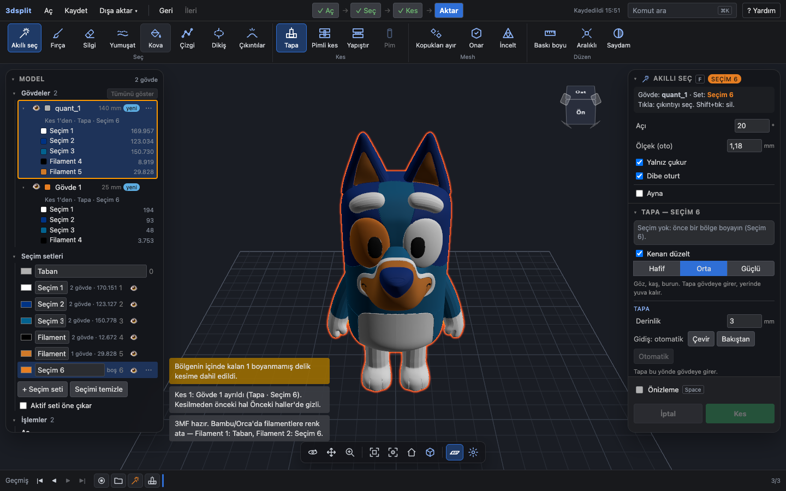
- **Dayanak:** Nielsen #1 ve #2 (sistem ile gerçek dünyanın uyumu: ekranda gördüğün dosyada yok). Ürünün amacı AMS'siz baskı olduğu için gövdenin tek filament olması doğru olabilir. Sorun, kalan boyanın sessizce düşmesi ve dosyadaki adın "Taban" olması.
- **Önem:** Yüksek.
- **Önerilen yön:** Dışa aktarmadan önce "Gövdede kesilmemiş 4 renk var; dosyada tek renk olacak" uyarısı ve "kesilmemiş renkleri boya olarak koru" seçeneği. En azından gövde filament adı ekrandaki baskın renk olsun.

### Y3 — Çizgi "16 üçgen boyandı" diyor, boya kalmıyor

- **Görev:** (b).
- **Ne oluyor:** Kolun çevresine 4 noktalı halka (önden 2, arkadan 2, sonra ilk noktaya tık). Bildirim "Çizgi kapatıldı: 16 üçgen boyandı." Modelde boya görünmüyor, Seçim 1 "boş", Kes kapalı, panel "Seçim yok: önce bir bölge boyayın". Geçmişe iki adım ekleniyor (Çizgi, Kenarı üçgenlere işle). Store'da boyalı üçgen sayısı 0. Halkanın köşeleri kolun önünde ve arkasında: (22.3, −2.1, 46.1), (22, −4.6, 42.9), (20.5, 4.4, 43.6), (20.9, 1.3, 46.5). Yani halka kolu sarıyor. Aynı kol 6 noktayla denenince 2.630 üçgen boyanıyor, kesim çalışıyor. Kullanıcı neyin yanlış olduğunu öğrenemiyor.
- **Tekrar:** figure aç, Çizgi, Ön görünüş: (860,428) ve (860,452); Görünüşler → Arka: (597,452) ve (597,428); Ön: (860,428) tık.
- **Kanıt:** 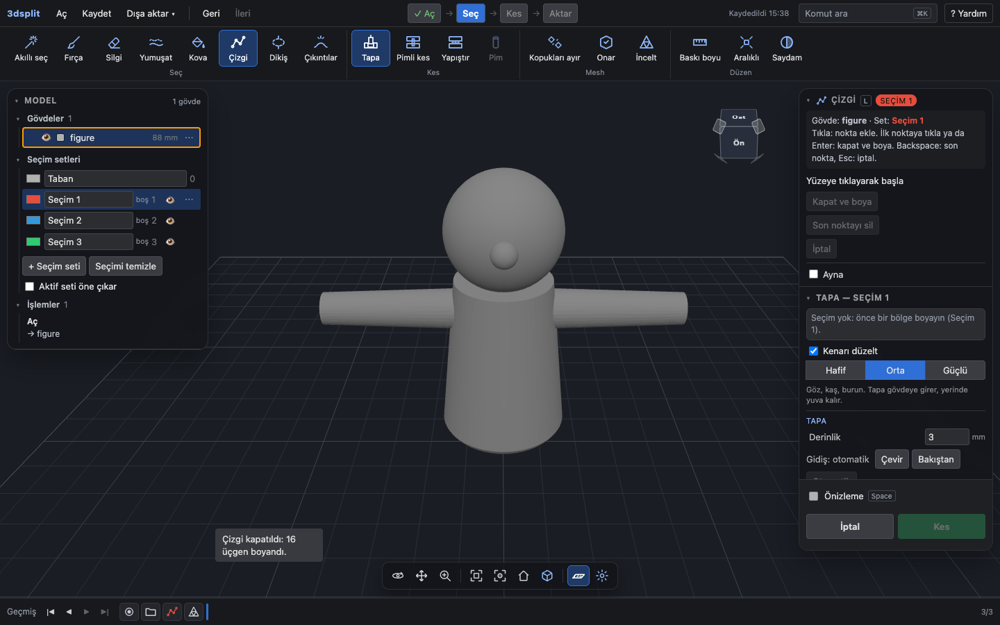 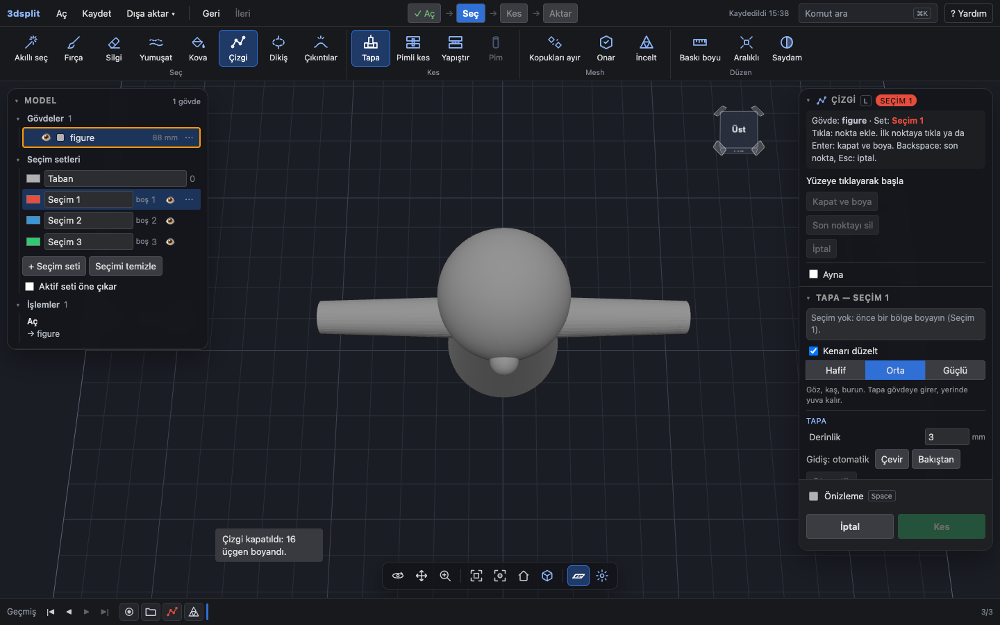
- **Dayanak:** Nielsen #1 ve #9 (hatayı tanıma ve düzeltme). Sessiz başarısızlık: bildirim başarı diyor. Kodda yer: `src/core/lasso.ts:92-102` halkaya değen en küçük bileşeni seçiyor. Yol kendine değince 16 üçgenlik cep seçiliyor, ardından `src/state/actionsLine.ts:178-189` yumuşatma bu cebi siliyor.
- **Önem:** Yüksek.
- **Önerilen yön:** Boyanan alan çok küçük ya da yumuşatmadan sonra sıfırsa başarı bildirimi verme. "Halka kendine değiyor, bir nokta ekleyin" de, halkayı kırmızı göster.

### O1 — Öneri kartı eski seçimden kalıyor

- **Görev:** (a).
- **Ne oluyor:** Bluey açılışta beyaz set için öneri hesaplıyor: "✓ Pimli kes — kalın çıkıntı (kalınlık ~17,5 mm)". Yeni set açıp göze Akıllı seç ile tıklayınca (9.009 üçgen) kart en az 3,5 s aynı kalıyor. `suggestion` nesnesi aynı (`capRadius 22,78`, `thickness 17,47`). Mod Pimli kes, Kes yeşil. Kullanıcı karta güvenip Kes'e basarsa göz düz kesimle ayrılıyor. Tapa'ya elle geçince kart güncelleniyor ("✓ Tapa — yüzeysel bölge ~2,0 mm").
- **Tekrar:** Bluey aç, + Seçim seti, sol göze tık, 3 s bekle; sağ paneldeki yeşil kart.
- **Kanıt:**  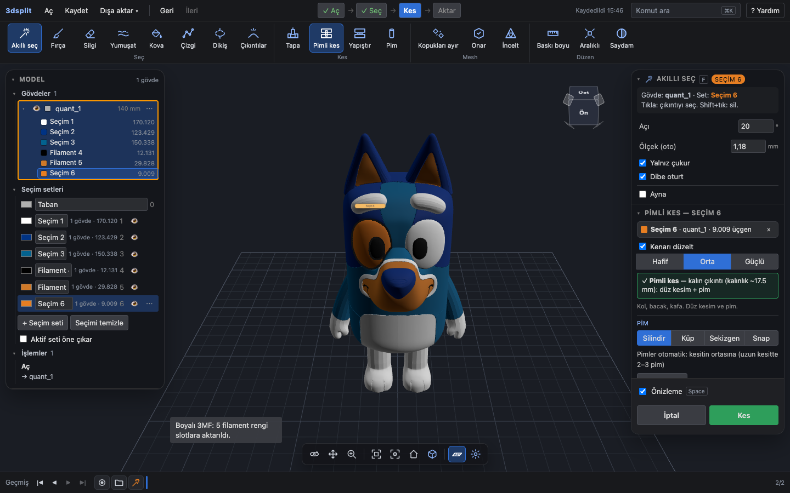
- **Dayanak:** Nielsen #1 (bayat durum). HEDEF.md: "göz ve kaş gibi detayda Socket akışı kalmalı". Kodda yer: `src/state/actionsCut.ts:118-150` (`scheduleSuggestion`).
- **Önem:** Orta.
- **Önerilen yön:** Set ya da boya değişince kartı hemen kaldır ya da "hesaplanıyor" göster. Öneri gelene kadar modu değiştirme.

### O2 — Açılışta büyük bir kesim tek tık uzakta

- **Görev:** (a).
- **Ne oluyor:** Bluey açılınca aktif set "Seçim 1" (beyaz). Bu set gözlerin beyazını, karnı, ayakları ve ağız çevresini kapsıyor: 179.129 üçgen. Mod kendiliğinden Pimli kes, Önizleme işaretli, Kes yeşil ve açık. Adım çubuğu doğrudan "Kes"te. Kullanıcı daha hiçbir şey seçmeden ilk yeşil düğmeye basarsa bütün beyaz bölgeler pimle kesilir.
- **Tekrar:** Bluey_Color.3mf aç, sağ panele bak.
- **Kanıt:** 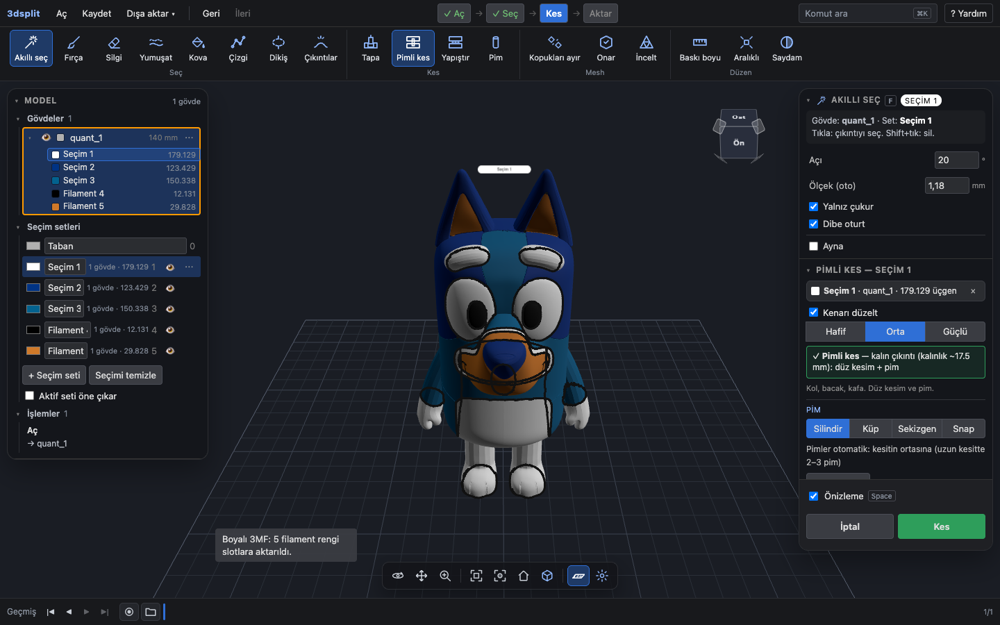
- **Dayanak:** Nielsen #5 (hata önleme); yanlış varsayılan. 3MF'ten gelen filament setleri kullanıcının seçimi değil.
- **Önem:** Orta.
- **Önerilen yön:** 3MF'ten gelen setlerle açılışta aktif set Taban olsun, Kes kapalı kalsın. Adım "Seç"te dursun.

### O3 — Göz bebeği "boyanmamış delik" diye tapaya katılıyor

- **Görev:** (a).
- **Ne oluyor:** Akıllı seç gözün beyazını seçiyor. Önizleme ve kesim "Bölgenin içinde kalan 1 boyanmamış delik kesime dahil edildi" diyor. Kesimden sonra Gövde 1'de 3.753 siyah (Filament 4) üçgen var; gövdedeki siyah 12.131'den 8.919'a iniyor. Delik boyanmamış değil, siyah boyalı göz bebeği. Tapa tek filamentle basılacağı için bebek o filamentin renginde çıkar. Hariç tutma seçeneği yok. Tapa üzerinde bebek ayrıca kesilebilir, ama bunu söyleyen bir şey yok.
- **Tekrar:** Bluey aç, + Seçim seti, sol göze tık, Tapa, Kes. Ağaçta Gövde 1 altındaki Filament 4 satırı.
- **Kanıt:** 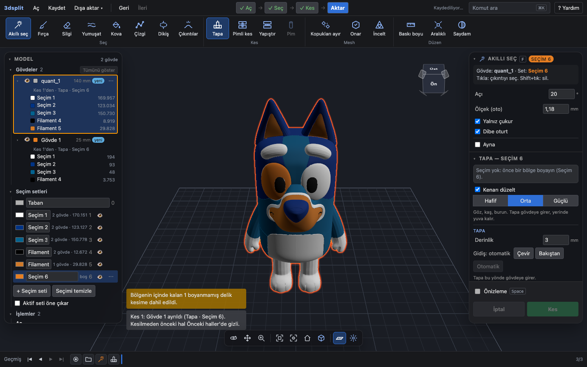 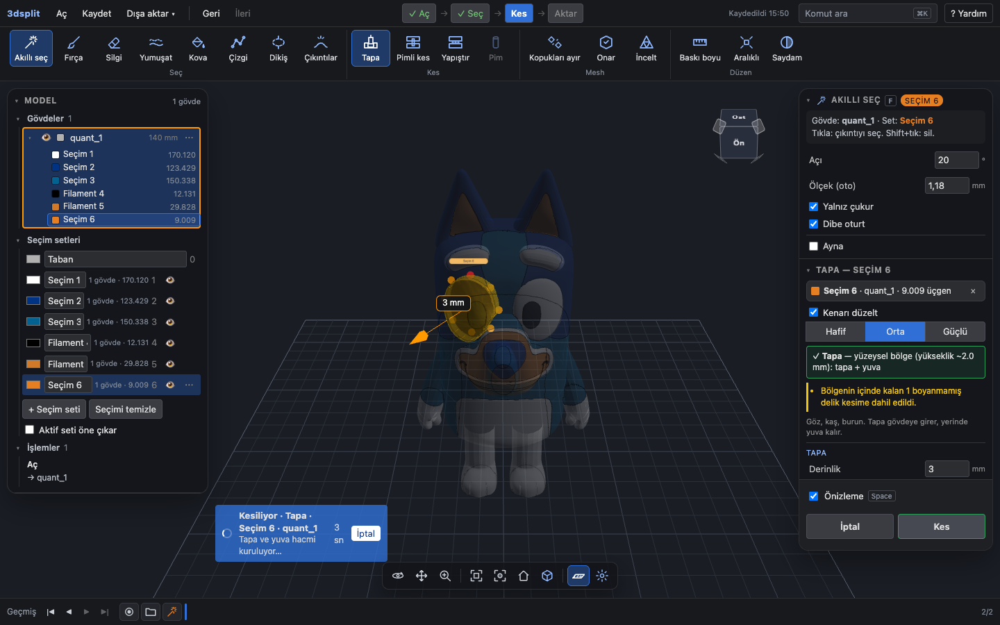
- **Dayanak:** Nielsen #2 (yanlış terim) ve #1. Beklenmedik sonuç: rengi farklı bölge sessizce başka parçaya geçiyor.
- **Önem:** Orta.
- **Önerilen yön:** Uyarıyı doğru yaz ("içinde başka renkli 1 bölge var: Filament 4"). "Kesime kat / ayrı bırak" seçeneği ekle, ya da kesimden sonra "Tapanın üstünde Filament 4 var; ayrıca kes" öner.

### O4 — Yeni set rengi mevcut renkle çakışıyor; beyaz göz turuncu oluyor

- **Görev:** (a).
- **Ne oluyor:** Bluey'de "+ Seçim seti" yeni sete #e67e22 veriyor. Dosyanın turuncusu (Filament 5) #cf7929. Göz seçimi ekranda Bluey'nin turuncu lekeleriyle aynı renkte görünüyor. Kesimden sonra (X98) set rengi gövde rengi oluyor. Beyaz gözden kesilen tapa ekranda turuncu görünüyor, 3MF'te "Filament 2: Seçim 6" (turuncu) olarak atanıyor.
- **Tekrar:** Bluey aç, + Seçim seti, göze tık, Tapa, Kes, Aralıklı.
- **Kanıt:**  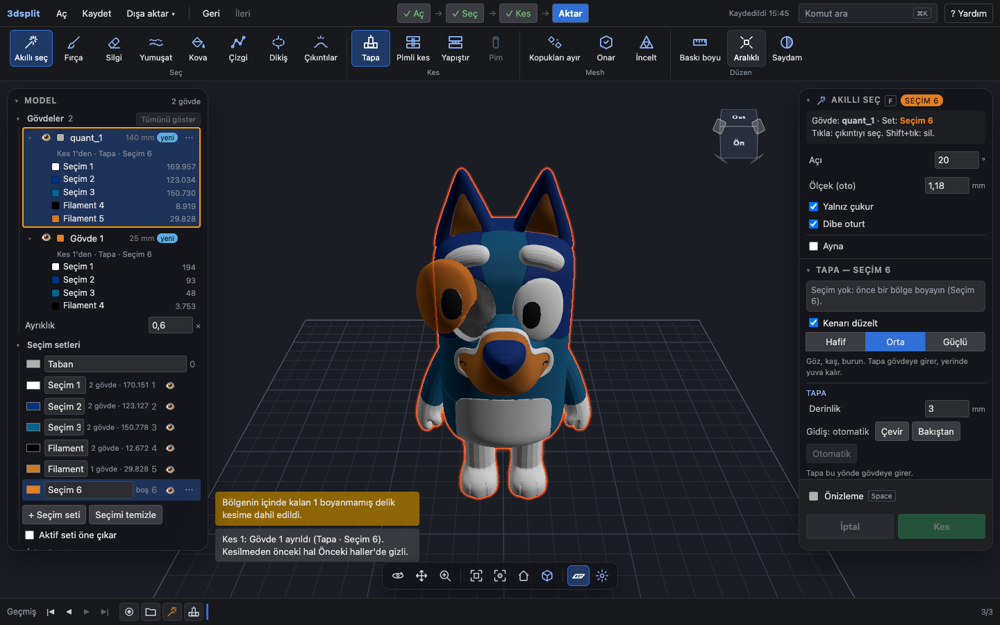
- **Dayanak:** Nielsen #2 ve #4 (tutarlılık): set rengi, baskı rengi anlamına geliyor, ama otomatik verilen renk modeldeki renklerden ayırt edilemiyor.
- **Önem:** Orta.
- **Önerilen yön:** Yeni set, modelde olmayan bir renk alsın. Boyalı bölgeden seçim yapılınca set rengi o bölgenin rengi olsun (beyaz gözden beyaz tapa).

### O5 — Delete, ipucunun dediğini yapmıyor

- **Görev:** (b).
- **Ne oluyor:** Pimli kes önizlemesinde ipucu "Pimi tutup sürükle: taşı · Delete: seçili pimi sil". Pimler otomatik, seçili pim yok (`selectedPin -1`). Delete'e basınca kolun bütün boyası (2.738 üçgen) siliniyor. Bildirim yok, yalnız geçmiş şeridine silgi simgesi ekleniyor. Cmd+Z geri getiriyor.
- **Tekrar:** figure aç, kolu Çizgi ile boya, Pimli kes, Delete.
- **Kanıt:** 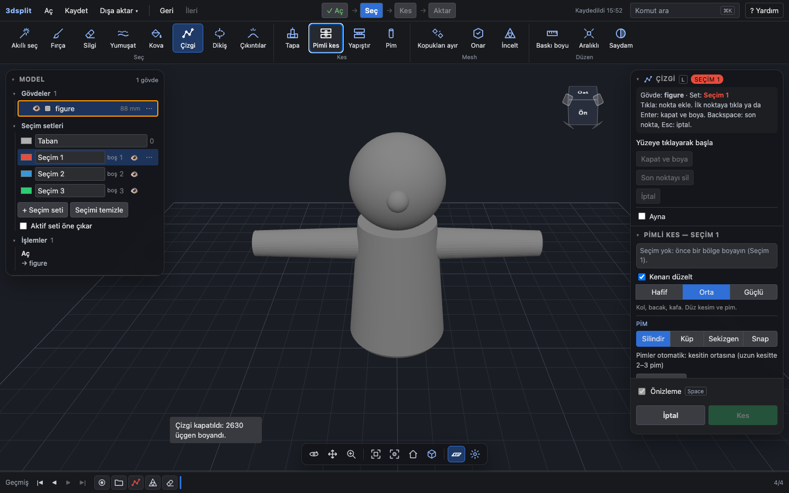
- **Dayanak:** Nielsen #4 (tutarlılık: ipucu ile davranış farklı), #1 (bildirim yok). Kodda yer: `src/state/keymap.ts:67` (`slot.clear: 'Delete'`), `src/ui/App.tsx:142`.
- **Önem:** Orta.
- **Önerilen yön:** Pim seçili değilken Delete hiçbir şey yapmasın ya da seti silerken "Seçim 1 temizlendi · Geri al" bildirimi göstersin.

### O6 — Bütün modeli kaplayan seçimde Kes açık, hata üç kez

- **Görev:** hata denemesi.
- **Ne oluyor:** Kova ile boyasız modele tık bütün modeli (28.280 üçgen) boyuyor. Önizleme hemen "Bölge parçanın tamamını kaplıyor; kesilecek sınır yok" diyor (iki kez). Kes yine açık; basınca aynı hata üçüncü kez çıkıyor. Tapa ve Pimli kes'te aynı. Adım çubuğu "Kes"i gösteriyor.
- **Tekrar:** figure aç, Kova, gövdeye tık, Pimli kes, Kes.
- **Kanıt:** 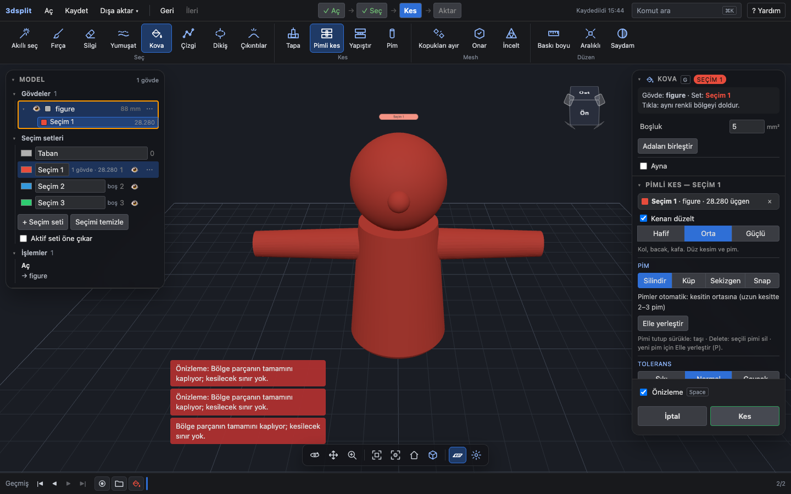
- **Dayanak:** Nielsen #5 (hata önleme: sistem kesimin olmayacağını biliyor ama izin veriyor), #8 (gereksiz tekrar).
- **Önem:** Orta.
- **Önerilen yön:** Önizleme bu hatayı verince Kes'i kapat, nedeni seçim satırında yaz. Aynı bildirimi tekrarlama.

### O7 — Deneme parçası bulunamıyor

- **Görev:** (c).
- **Ne oluyor:** "Deneme parçası üret" yalnızca kesim bölümünde, Tolerans grubunun altında. 1440×900 ekranda sağ panel kaydırılmadan görünmüyor. Komut aramada "deneme" yazınca "Komut bulunamadı" çıkıyor. Model açılmadan kesim bölümü kapalı, düğme görünmüyor. Oysa deneme parçası, model hazırlanmadan önce basılacak bir şey ("Emin değilsen önce deneme parçası bas").
- **Tekrar:** Boş ekranda Cmd+K, "deneme". Model açıkken Pimli kes'e geçip düğmeyi ara.
- **Kanıt:** 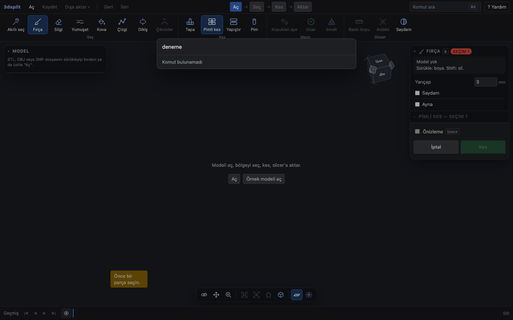 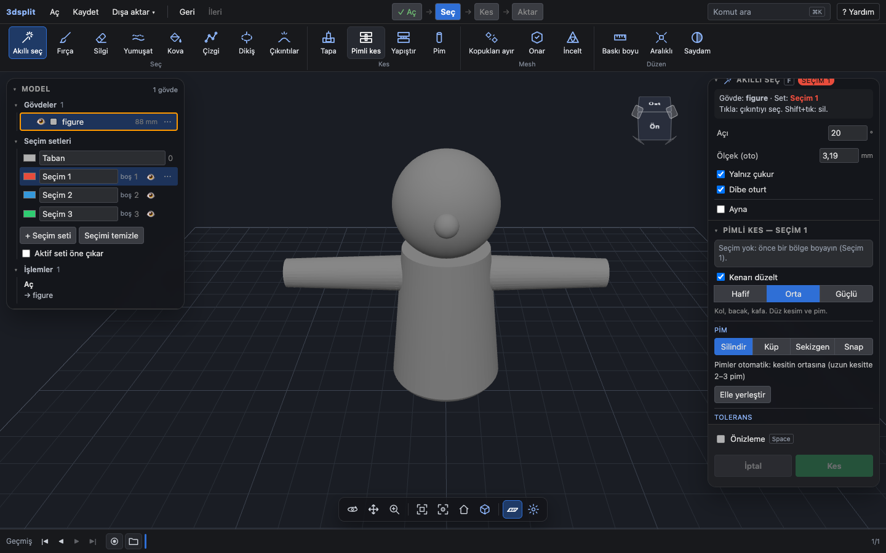
- **Dayanak:** Nielsen #6 (hatırlamak yerine tanıma) ve #7 (esneklik). Ölçülen: 2 tık + kaydırma, modelsiz yol yok.
- **Önem:** Orta.
- **Önerilen yön:** Komut aramaya ve Dosya/Yardım menüsüne "Tolerans deneme parçası" ekle. Model olmadan da çalışsın.

### O8 — Deneme parçası modele karışıyor, dışa aktarma ayıramıyor

- **Görev:** (c).
- **Ne oluyor:** Plaka ve 3 pim modelin sağına 4 ayrı gövde olarak ekleniyor. Bir kısmı sağ panelin altında kalıyor. Adım çubuğu "Aktar"a atlıyor, oysa kesim yapılmadı. İşlemler klasöründe 4 ayrı "Aç → Tolerans …" satırı var; "Deneme parçası" diye bir işlem yok. Bildirim "dışa aktarırken sadece onları görünür bırakın" diyor. Bunu atlayan kullanıcı STL ZIP'te figure.stl'yi de alıyor (doğrulandı: 5 dosya). Yalnız deneme parçasını almak için her diğer gövde için bir gizleme tıkı gerekiyor; 12 parçalı Grogu'da 12 tık.
- **Tekrar:** figure aç, Pimli kes, Deneme parçası üret, Dışa aktar → STL (ZIP).
- **Kanıt:** 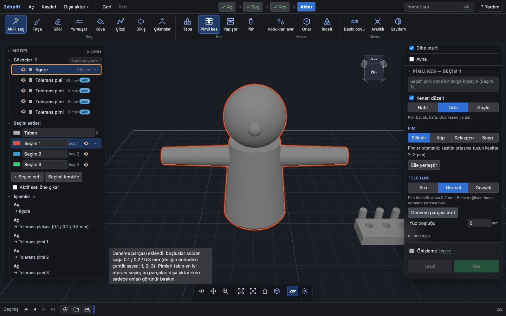
- **Dayanak:** Nielsen #1 (adım çubuğu yanlış adımı gösteriyor), #5 (yanlış dosyayı göndermeyi önlemiyor). Kodda yer: `src/state/actionsCut.ts:537-600`.
- **Önem:** Orta.
- **Önerilen yön:** Deneme parçasını doğrudan indir ("tolerans-deneme.3mf") ya da ayrı bir sahnede göster. İşlem adı "Deneme parçası" olsun, adım çubuğunu etkilemesin.

### O9 — Seçilen tolerans hatırlanmıyor

- **Görev:** (c).
- **Ne oluyor:** Deneme parçası basılıp en iyi oturan seçildikten sonra kullanıcı Gevşek'e (0,3 mm) basıyor. Sayfa yenilenip yeni model açılınca (Yok say → Aç) boşluk yine 0,2. Deneme parçasının sonucu bir sonraki modele taşınmıyor. Ayrıca düğmeler Sıkı/Normal/Gevşek; mm değeri ve çentik sayısı düğmede yazmıyor. Bildirimdeki "çentik 1, 2, 3 = 0,1 / 0,2 / 0,3" eşlemesini kullanıcının aklında tutması gerekiyor. Bildirim kaybolduktan sonra bu bilgi yalnız plaka adında var.
- **Tekrar:** figure aç, Pimli kes, Gevşek, 3 s bekle, yenile, Yok say, figure'ü yeniden aç: `cut.clearance` 0,2.
- **Kanıt:** Tekrar üretilebilir adım (store değeri: 0,3 → yenileme sonrası 0,2). Varsayılan: `src/state/store.ts:255`.
- **Dayanak:** Nielsen #6 (hatırlamak yerine tanıma). Kaybolan iş: deneme baskısının sonucu (bir baskı süresi).
- **Önem:** Orta.
- **Önerilen yön:** Tolerans, pim ve derinlik seçimini tarayıcıda kalıcı tut (Tabla ayarı gibi). Düğmelerde mm ve çentik sayısını göster ("Sıkı · 0,1 · 1 çentik").

### O10 — Çok küçük seçim

- **Görev:** hata denemesi.
- **Ne oluyor:** Fırça yarıçapı 0,3 mm, kola tek tık: 1 üçgen.
  - Tapa: kesim sorunsuz geçiyor, 26 üçgenlik "Gövde 1" (2,6 mm) çıkıyor. Tek işaret ağaçtaki sarı "2,6 mm" yazısı. Bildirim "Gövde 1 ayrıldı" diyor. Bu boyutta tapa 0,2 mm boşlukla basılamaz.
  - Pimli kes: önizleme "pin konmadı" uyarısı ve "Öneri: Tapa" veriyor, Kes açık. Basınca: "Düzlem kesimi bölgeyi içeren bir parça üretmedi (düzlem bölgenin arkasında kalıyor olabilir)". Kullanıcının bu cümleyle yapabileceği bir şey yok.
- **Tekrar:** figure aç, Fırça, Yarıçap 0.3, kola tık, Tapa (ya da Pimli kes), Kes.
- **Kanıt:** 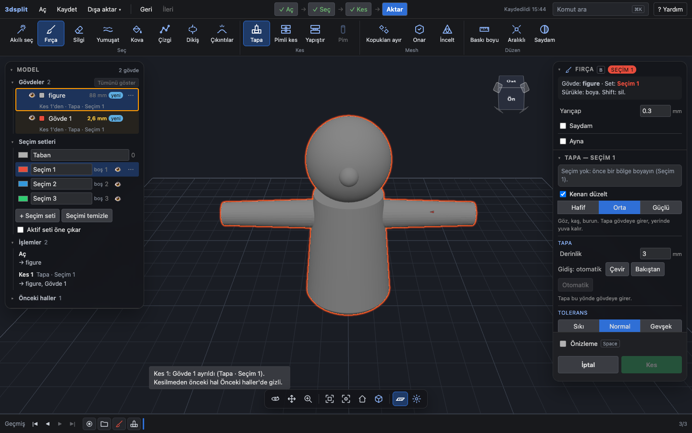 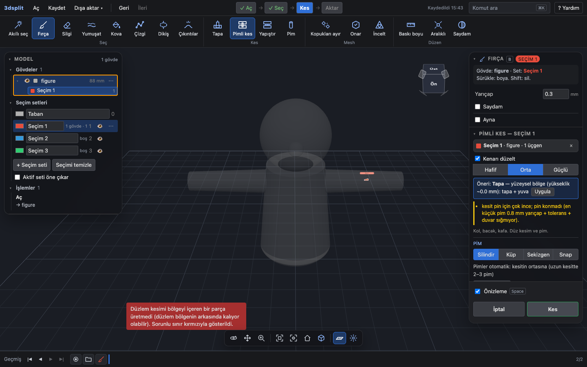
- **Dayanak:** Nielsen #5 ve #9 (hata mesajı sade dilde, çözüm önermeli).
- **Önem:** Orta.
- **Önerilen yön:** Seçim, en küçük basılabilir boyutun (ör. 3 mm) altındaysa Kes'ten önce uyar. Pimli kes hatasında "Seçim çok küçük; Tapa deneyin ya da seçimi büyütün" de.

### O11 — Bozuk dosya hataları ham metin

- **Görev:** hata denemesi.
- **Ne oluyor:**
  - Rastgele baytlı .stl: "Invalid typed array length: 30919247766".
  - Yarıda kesilmiş .stl: "Offset is outside the bounds of the DataView".
  - Zip olmayan .3mf: "THREE.ThreeMFLoader: Cannot find relationship file `rels` in 3MF archive."
  - Uygulama çökmüyor, boş duruma dönüyor. Bu iyi. `samples/broken.stl` (delikli, ters üçgenli) sorunsuz onarılıyor: "3953 üçgenin yönü düzeltildi, 2 delik kapatıldı."
- **Tekrar:** Boş ekranda bu dosyaları aç.
- **Kanıt:** 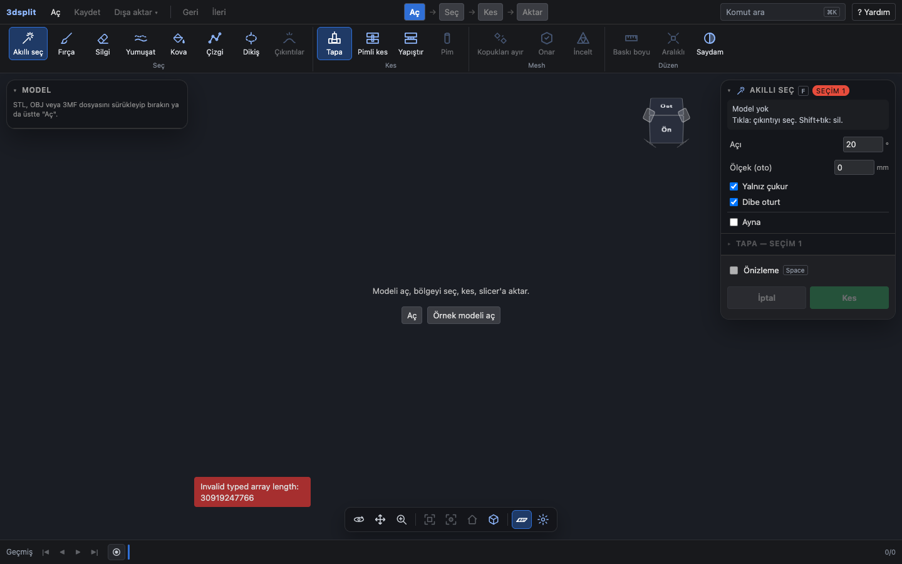 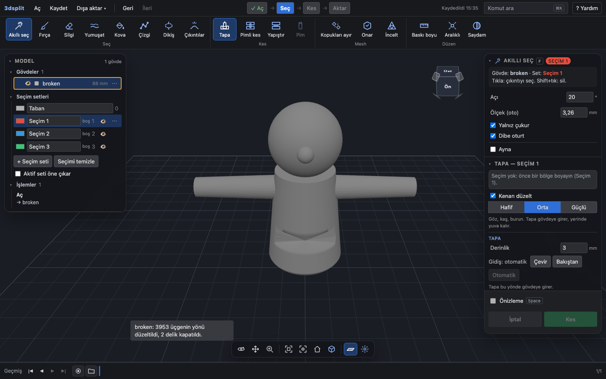
- **Dayanak:** Nielsen #9 (hata mesajı kullanıcının dilinde, nedeni ve çözümü söylemeli).
- **Önem:** Orta.
- **Önerilen yön:** "Dosya okunamadı: STL bozuk ya da eksik indirilmiş. Dosyayı slicer'da açıp yeniden kaydedin." Teknik ayrıntı katlanır alanda kalsın.

### D1 — Çizgi kendiliğinden kapanıyor

- **Görev:** (b).
- **Ne oluyor:** Halka, ilk noktaya `max(3 × ortalama kenar, fırça/2)` mesafede yapılan tıklamada kapanıyor. İnce kolda arka üst nokta, ön üst noktaya bu mesafede kaldığı için 7 noktalık planın 6. tıklamasında halka kapandı ve boyandı. Bu seferki sonuç doğru çıktı, ama kullanıcı nokta eklediğini sanıyordu.
- **Tekrar:** figure, Çizgi, Ön (860,424/444/464), Arka (597,464/444/424). 6. tıkta "Çizgi kapatıldı" bildirimi.
- **Kanıt:** Tekrar üretilebilir adım. Kodda yer: `src/state/actionsLine.ts:51-60`.
- **Dayanak:** Nielsen #3 (beklenmedik kip değişimi).
- **Önem:** Düşük.
- **Önerilen yön:** Yakın tıkta ilk noktayı vurgula ("kapatmak için tıkla"), kapatmayı yalnız ilk noktanın üstünde yap.

### D2 — Çizgi noktaları modelin arkasından görünüyor

- **Görev:** (b).
- **Ne oluyor:** Önden konan noktalar arkadan bakınca da aynı yerde, modelin üstünde çiziliyor. Arka yüze nokta koyarken önceki noktaların hangi yüzde olduğu belirsiz.
- **Kanıt:** 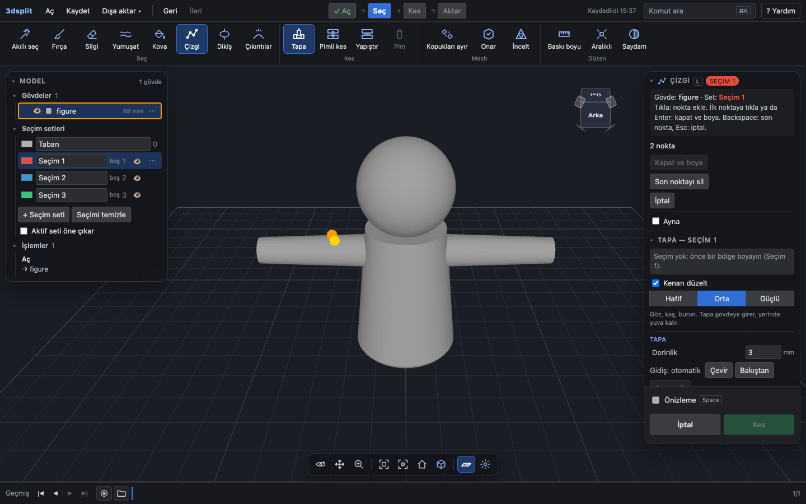
- **Dayanak:** Nielsen #1.
- **Önem:** Düşük.
- **Önerilen yön:** Örtülen noktaları soluk ya da kesik çizgiyle göster.

### D3 — Model yokken araçlar açık, mesajlar yanlış

- **Görev:** hata denemesi.
- **Ne oluyor:** Boş ekranda şeritteki Seç ve Kes araçları açık, Tapa vurgulu. Fırçayla tuvalde sürükleme hiçbir şey yapmıyor. Space "Önce bir parça seçin." diyor; seçilecek parça yok. Model açık ama boyasızken Space hiçbir bildirim vermiyor. X83'te "Model yokken Renkler ve Kesim panelleri soluk ve kapalı" kararı var; araç şeridi bunun dışında kalmış.
- **Kanıt:** 
- **Dayanak:** Nielsen #1, #5.
- **Önem:** Düşük.
- **Önerilen yön:** Model yokken araçları soluk göster, Space "Önce bir model açın" desin. Boyasız modelde Space "Önce bir bölge seçin" desin.

### D4 — Dışa aktarılan dosyanın adı

- **Görev:** (a), (b).
- **Ne oluyor:** Grogu_Bambu_Colour.3mf'ten çıkan dosya `head_v1.0.3mf`, Bluey'den çıkan `quant_1.3mf`, STL `parts.zip`. Kaynak dosyanın adı kullanılmıyor; indirilenler klasöründe hangi modele ait olduğu anlaşılmıyor.
- **Kanıt:** İndirilen dosya adları (Playwright `suggestedFilename`).
- **Dayanak:** Nielsen #2.
- **Önem:** Düşük.
- **Önerilen yön:** `<kaynak adı>-parcalar.3mf`.

### D5 — Çizgi ile Dikiş arasındaki fark

- **Görev:** (b).
- **Ne oluyor:** Görev "kolu Çizgi ile ayır" idi. Çizgi + Pimli kes, 6 noktalı halkayla çalıştı. Ama HEDEF.md'ye göre kol için araç Dikiş. İpuçları ne yaptıklarını söylüyor ("içini boya" / "düzlemden ayırır"), hangi iş için olduklarını söylemiyor. Kullanıcı hangisini seçeceğini bilemiyor.
- **Kanıt:** `src/ui/Toolbar.tsx:48-61` ipucu metinleri.
- **Dayanak:** Hick yasası (iki benzer seçenek, ayırt edici bilgi yok), Nielsen #10.
- **Önem:** Düşük.
- **Önerilen yön:** İpucuna kullanım ekle: "Çizgi: göz, desen gibi bölgeyi çizerek seç", "Dikiş: kolu, bacağı halkadan ayır".

## Çalışan ve doğrulanan

Bulgu değil; ileride aynı şeyin yeniden denenmemesi için:

- figure kol kesimi (Çizgi + Pimli kes): 3MF ve STL'de 2 nesne, ikisi de kapalı (açık kenar 0, tek bileşen). Pim kesilen parçada. Gizli "önceki hal" dışa aktarılmıyor. 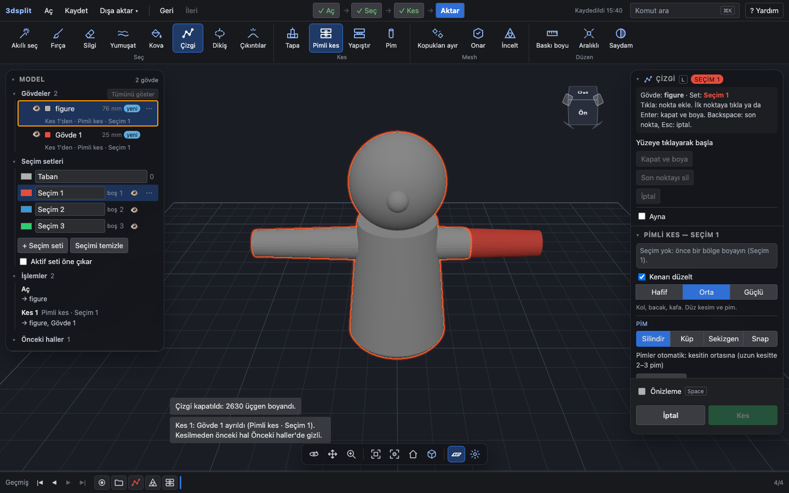 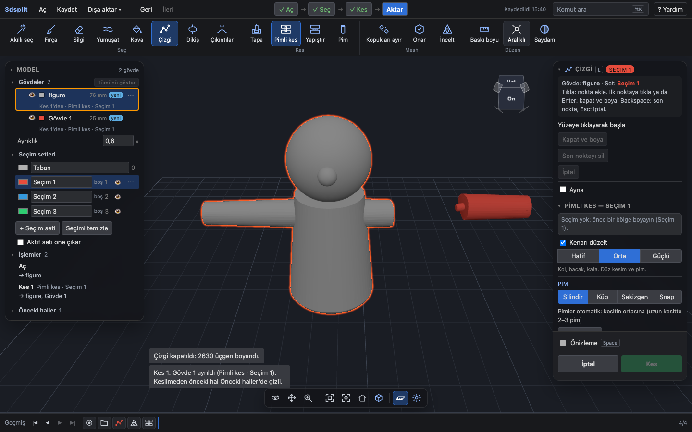
- Bluey göz Tapa 3MF'i: iki nesne de indeksli kenar sayımında kapalı (açık 0, non-manifold 0).
- Kesimden sonra geri al ve yinele: tek adımda kesim geri geliyor, boya ve önizleme yerinde.
- Uzun kesimde meşgul kartındaki İptal 0,34 s'de durduruyor, "Model değişmedi" diyor; ardından yeniden kesim çalışıyor.
- Seçim yokken Kes kapalı. 2 noktalı Çizgi'de Enter "Halka için en az 3 nokta gerekli" diyor. Model yokken Dışa aktar menüsü açılmıyor.
- Deneme parçası STL'leri kapalı; plaka 29×14×5,5 mm, pimler 4×4×8 mm.

## Doğrulanamadı

- **Slicer'da açma:** Bambu Studio / OrcaSlicer çalıştırılmadı. 3MF'ler yalnız XML ve geometri olarak incelendi. Göz tapasında dosyaya yazılan koordinat yuvarlaması sonrası 756 dejenere üçgen sayıldı; slicer'ın bunu nasıl karşıladığı bilinmiyor.
- **Fiziksel baskı:** Tolerans ve pim oturması basılmadı. Pimin yatay basılacak yönde plakaya konması (kol parçası yan yatırılmış) baskı kalitesi konusu, denenmedi.
- **Gerçek dosya penceresi ve sürükle-bırak:** Dosyalar `setInputFiles` ile verildi; işletim sistemi penceresi ve sürükle-bırak davranışı görülmedi.
- **Öneri kartının ne kadar bayat kaldığı (O1):** En az 3,5 s ölçüldü. Sonunda güncellenip güncellenmediği Pimli kes modunda beklenmedi. Tapa'ya geçince güncellendiği görüldü.
- **Grogu'da göz kesimi:** Gözler kaynak dosyada zaten ayrı nesne (eyes_v1.0_1/2). 1,09 M üçgenli modelde Tapa kesimi denenmedi; görev bu dosyada anlamsız kaldı.
- **Headless çizim farkı:** Ekran görüntüleri headless Chrome (Metal ANGLE) ile alındı. Tam ekran tarayıcıda renk ve kenar çizgisi farkı olabilir.
- **ZIP içindeki Türkçe dosya adları:** `unzip` listesinde "Gövde 1.stl" bozuk göründü, ama ZIP girdisinde UTF-8 bayrağı açık. Sorun komut satırı aracında; Finder'da açılış denenmedi.
