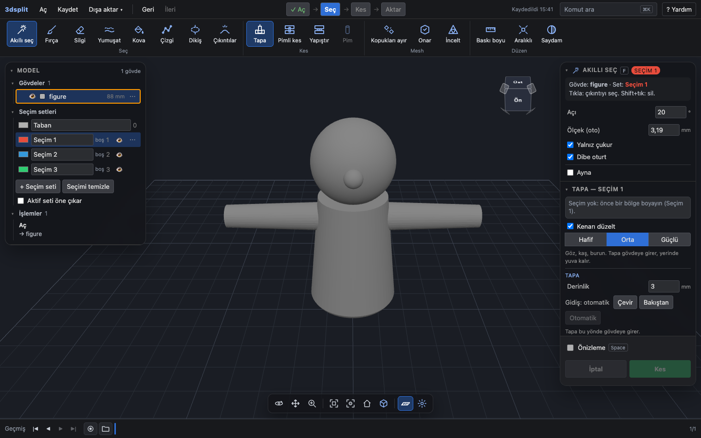
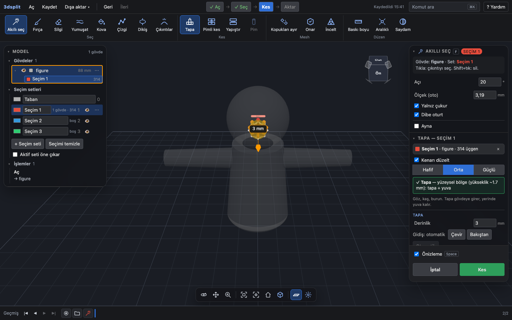
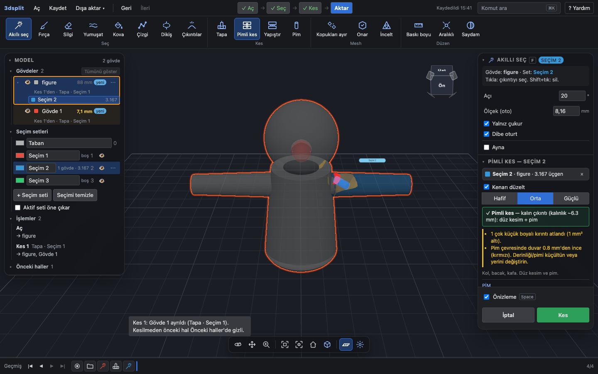
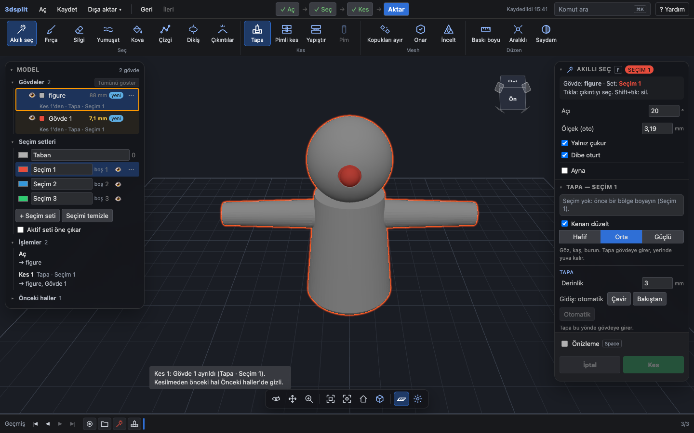
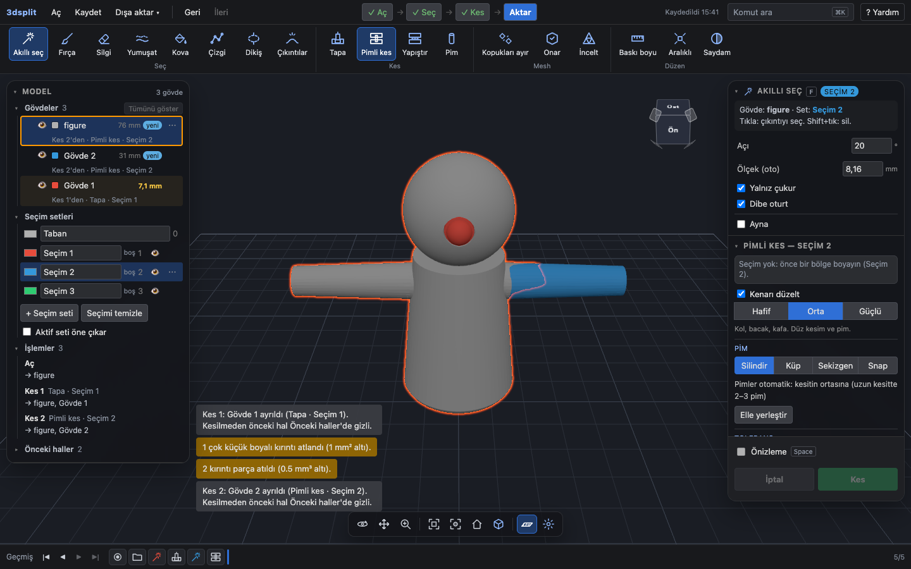
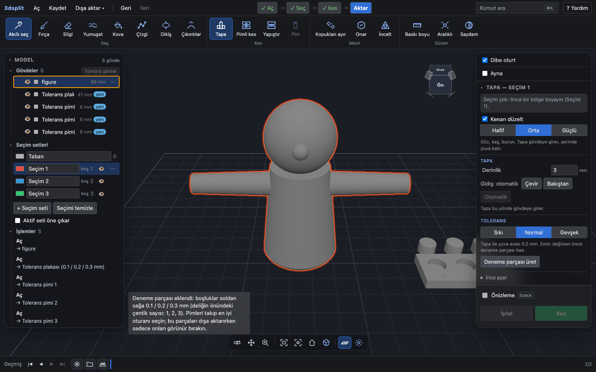
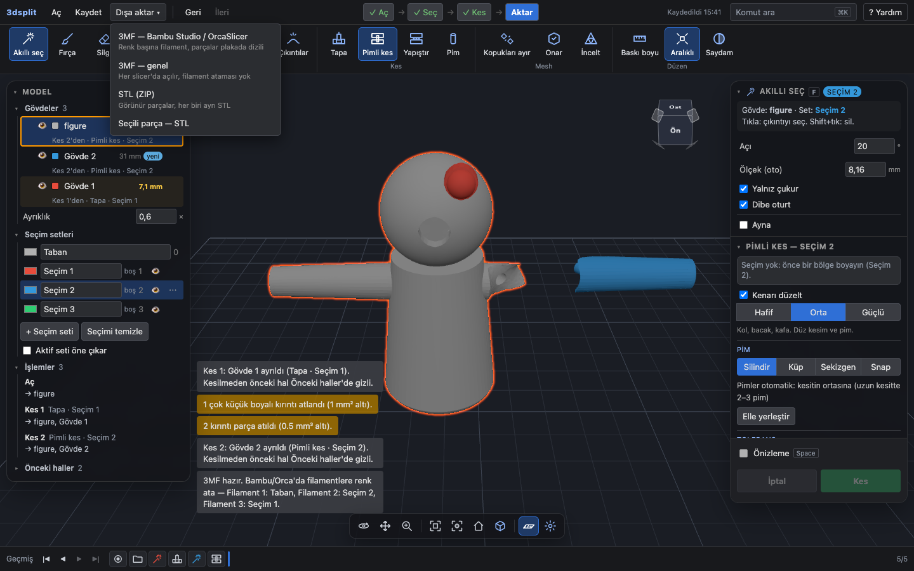
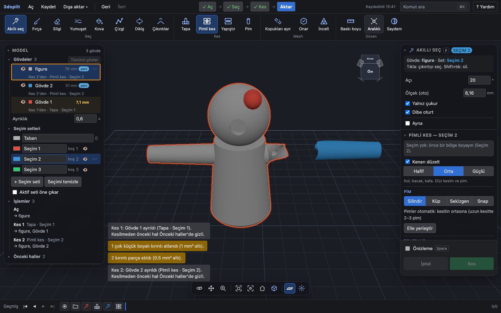

# 04 — Pazar araştırması

26 Ekim 2026. Kapsam: AMS'i olmayan, figür basan, boyama ve CAD bilmeyen kullanıcının modeli slicer'dan önce birleşebilir parçalara ayırma işi. Kullanılan skill'ler: `competitive-brief` (rakip seti, özellik matrisi, konumlanma), `ux-strategy` (JTBD, istenen sonuçlar, fırsat haritası).

Yöntem:

- Rakip bilgisi resmî sayfalardan alındı. Audja ve PaintLab sayfaları JavaScript ile çizildiği için metinler sayfanın kendi paketinden (`audja.com/assets/index-*.js`, `jointlab3d.com/paintlab/index.html`) okundu. Rakip uygulamalar çalıştırılmadı; matristeki rakip sütunları **üreticinin kendi anlatımına** dayanır.
- Kullanıcı şikâyetleri Bambu Lab forumu, Prusa forumu, Bambu Studio GitHub, Superhive yorumları ve rehber sayfalarından toplandı. Reddit'e erişilemedi (ayrıntı: "Doğrulanamadı").
- 3dsplit'in karşıladığı özellikler `http://localhost:5173` üzerinde Playwright + Google Chrome ile gerçek tık ve fare hareketiyle denendi. Betikler: `scratchpad/s4/scripts/verify.mjs`, `verify2.mjs`. Denenmeyen satırlar "docs'a göre, doğrulanmadı" diye işaretli.

---

## 1. Rakip özetleri

Rakip seti üç katmanda:

- **Doğrudan:** aynı işi (boyalı bölgeyi bağlantılı parçaya çevirmek) yapanlar. Bunlar Audja, PaintLab ve Multipart3D.
- **Dolaylı:** kesim ve bağlantı yapıp boyalı bölgeyle çalışmayanlar. Bunlar CatPin, Bambu Studio, OrcaSlicer ve Meshmixer.
- **İş rakibi (JTBD):** hiç bölmeden elle filament değiştirmek ya da hazır "no-AMS" sürümü olan model indirmek.

Görevde adı geçmeyen PaintLab ile Multipart3D aramada çıktı. İkisi de tarayıcıda, yerelde çalışıyor ve boyalı bölgeyi parçaya çeviriyor. 3dsplit'in en yakın rakipleri bunlar.

### Audja Pro (Fluid Prints)

- **Ne yapar:** Masaüstü "print-prep" stüdyosu. Sayfadaki anlatım: *"Auto-paint, Smart Fill, circle/sphere/triangle brushes, mirror paint, height range, gap fill, box/lasso selection."* Separate by Color ile *"Clean Cap vs Smooth vs Socket"* modlarını sunuyor. Socket ayarları: *"depth, taper, slide, mouth gap"*. Yüklerken onarım yapıyor: *"Holes, flipped normals, non-manifold edges, and self-intersections are handled when the file loads."* Smart Key-Cut (düz veya eğri kesim + anahtar) ve Articulate (oynar eklem) araçları da var. Bağlantı ailesi 12 şekil; yeni Snap mandalı ve *"an amber ghost now shows the exact envelope your clearance setting will carve"*.
- **Fiyat:** Public beta süresince ücretsiz. Kurucu ömür boyu lisans kademeleri $49 / $79 / $99 / $129. Çıkış fiyatı $149 ömür boyu ya da $8.99/ay. Sayfaya göre *"after that, one-time payment is gone for good and Audja is subscription only."*
- **Platform:** Windows 10/11 x64 ve Apple Silicon macOS 15+. Linux "soon". Intel Mac ve ARM Windows desteklenmiyor. Hesapla giriş gerekiyor; lisans en çok 3 bilgisayarda geçerli. 25 dil, Türkçe dahil (paketteki dil listesinde `tr` var).
- **Güçlü:** 3dsplit'in kapsamının tamamı ve fazlası tek uygulamada (boyama, onarım, Socket, Keys, eğri kesim, eklem, kalıp, AR önizleme). Boyalı 3MF ile Bambu/Orca/Prusa'ya doğrudan geçiş var.
- **Zayıf:** Kurulum ve hesap gerekiyor. Beta sürümde. Mac sürümü notarize edilmemiş; sayfa *"If macOS says the app is damaged or can't be opened, click Cancel"* diyor. Çıkıştan sonra yalnız abonelikle satılacak. Kendi sürüm notunda eski sürümün sorunlarını sayıyor: *"laggy painting on heavy models, saves that forgot your cuts, and slow socket separations."* Bağımsız bir inceleme bulunamadı.
- **Kaynak:** https://audja.com/ (paket metni), YouTube eğitim kanalı (ör. https://www.youtube.com/watch?v=x_0s_muN5bw).

### PaintLab (JointLab)

- **Ne yapar:** Tarayıcıda boyama ve AMS'siz renk ayırma. Arayüz metinlerine göre kesim yöntemleri *"Encaixe (Socket) / Rápido (colagem) / Conectores (Keys)"*. Bunlar Audja'nın Socket / Fast / Keys üçlüsünün aynısı. Diğer ayarlar ve araçlar:
  - Derinlik, afunilamento (daralma açısı), bağlantı sayısı, çapı, boyu ve folga (boşluk, mm).
  - "Visualizar corte real" (gerçek kesimi önizle) ve "Afastar / montar as peças" (ayrık görünüm).
  - Akıllı dolgu. Arayüzde kendisi şöyle yazıyor: *"Seleção conectada por curvatura, inspirada na lógica observada no Audja."*
  - Simetri, yükseklikle boyama, damga ve doku.
  - Dışa aktarma: renkli 3MF ("Para Bambu Studio"), renk başına STL ve "Peças por cor" (renk başına parça).
- **Fiyat:** JointLab Free (reklamlı) ve Pro $9.99/ay. Hangi PaintLab özelliğinin Pro'ya bağlı olduğu sayfada yazmıyor.
- **Platform:** Tarayıcı, kurulum gerektirmiyor. *"Models opened in the editors are processed on your device and do not need to be uploaded."* Diller: pt, en, es, zh, ko, ru, ja. Türkçe yok.
- **Güçlü:** 3dsplit ile aynı dağıtım modeli: tarayıcıda, dosya cihazda kalıyor. Socket / Fast / Keys üçü de var.
- **Zayıf:** Onarım yapmıyor: *"painting doesn't repair invalid meshes"*. Tolerans için yalnız tavsiye veriyor (küçük bir örnekle dene); araç sunmuyor. Bağımsız kullanıcı yorumu bulunamadı.
- **Kaynak:** https://jointlab3d.com/en/, https://jointlab3d.com/en/guides/paint-stl-online/, https://jointlab3d.com/ai/plans.md

### Multipart3D

- **Ne yapar:** Ücretsiz, tarayıcıda STL/3MF bölücü. Araçlar: düzlem kesim, alan kesimi (dikdörtgen ya da daire), kırlangıç kuyruğu ve Smart Detach (tıklanan çıkıntıyı kıvrımından koparır). **Color split (beta):** *"Paint a model in Bambu Studio, OrcaSlicer or PrusaSlicer, save it as 3MF, and open it here. Separate by Color (beta) detaches the painted region you click as its own part."* Bağlantılar: plug, dowel, snap, pim deliği, mıknatıs cebi. FDM tolerans ön ayarları 0,15 / 0,20 / 0,30 mm.
- **Fiyat:** Ücretsiz (*"free for personal and commercial use"*).
- **Platform:** Tarayıcı, en çok 200 MB. *"Your files are never uploaded."* Kesim araçları yalnız PC/laptop'ta.
- **Güçlü:** Sıfır sürtünme: hesap yok, kurulum yok, ücret yok. Mıknatıs cebi var.
- **Zayıf:** Kendi boyama aracı yok; boyama için slicer gerekiyor. Renk ayırma beta. Göz gibi sığ bölge için tapa/yuva olup olmadığı sayfada yazmıyor.
- **Kaynak:** https://multipart3d.com/

### CatPin (Blender eklentisi, Alex Sokol)

- **Ne yapar:** Kesim türleri: Straight, Curved, Manual/Polygonal (Line ve Cylinder modu; Cylinder göz ve pencere gibi bölgeleri çıkarmak için). İki kesim aynı anda yapılabiliyor. Pin ve yuva otomatik geliyor. Bağlantı şekilleri silindir, trapez ve özel rijit. Ayarlar: Connector Clearance ve Cut Gap. Draft modu kesimleri düzenlenebilir tutuyor (Build Draft, Return to Draft, Skip Problem Cuts, Explode/Collapse); Easy modu tek adımda bitiriyor. Dışa aktarma STL/OBJ/FBX.
- **Fiyat:** Basic $24 (liste $30), Supporter $36, Business $80. 12 ay güncelleme dahil.
- **Platform:** Blender 4.2/4.5–5.2; Windows, macOS, Linux. Arayüz İngilizce.
- **Güçlü:** Kesim ve bağlantı denetimi derin; Draft modu kesimleri geri alınabilir tutuyor. Superhive'da 4 oy, ortalama 5 yıldız.
- **Zayıf:** Blender bilmek gerekiyor. Boyama ve seçim aracı yok. *"CatPin works best with closed, manifold meshes"*; onarım yok. Basılabilirlik analizi yapmıyor. Bir kullanıcı yorumu: *"Straight cuts work flawlessly, when you try some crazy stuff can break the addon."* Projenin kendi denemesinde de (`docs/catpin-flow.md`, Blender eklentisi) Face Set fırçası üç darbede dört ayrı bölge üretti.
- **Kaynak:** https://superhivemarket.com/products/catpin, https://superhivemarket.com/products/catpin/faq, https://superhivemarket.com/products/catpin/ratings, https://digitalproduction.com/2026/10/09/catpin-blender-cuts-3d-printing/

### Bambu Studio

- **Ne yapar:**
  - **Kesim:** Düzlem kesimi ve Dovetail modu (Depth, Width, Flap Angle, Groove Angle). Bağlantılar *"Plug, Dowel and Snap"*. Kesim nesnelere ya da çok parçalı nesneye yapılabiliyor.
  - **Boyama:** 6 araç: Circle, Sphere, Triangle, Height range, Fill ("Edge detection" ile köşede durur), Gap Fill.
- **Fiyat:** Ücretsiz. **Platform:** Windows, macOS, Linux.
- **Güçlü:** Hedef kullanıcının elinde zaten var. Boyama ve kesim aynı yerde.
- **Zayıf:**
  - Boyalı bölge parçaya çevrilemiyor; bölünce boya kayboluyor (Bölüm 2, T2).
  - Kesim tek düzlem, tek seferlik.
  - Bağlantıları elle yerleştirmek gerekiyor ve döndürülemiyorlar.
  - Dovetail sonrası *"non-mainfold edges remain after cutting"* uyarısı çıkabiliyor (wiki).
- **Kaynak:** https://wiki.bambulab.com/en/software/bambu-studio/cut-tool, https://wiki.bambulab.com/en/software/bambu-studio/color-painting-tool

### OrcaSlicer

- **Ne yapar:** Bambu Studio'dan çatallanmış. Kesim ve bağlantı özelliği v1.6.3'te Bambu üzerinden geldi: *"Advanced cut with connectors: Thanks to @prusa3d for implementing this cool feature, and Bambu for porting it."* Boyamada Fill, Height Range ve Gap Fill var (Orca wiki ve Orca tabanlı üretici belgeleri). Kalibrasyon menüsünde genel bir tolerans testi var (Obico rehberi).
- **Fiyat:** Ücretsiz, AGPL-3.0. **Platform:** Windows, macOS, Linux.
- **Güçlü ve zayıf:** Bambu Studio ile aynı. Boyanın bölünce kaybolması Orca'da da tekrarlanmış (forumda icepicknz: *"I just tested latest orca slicer and it happens there too"*). Resmî wiki'nin kesim sayfası tek cümle.
- **Kaynak:** https://github.com/OrcaSlicer/OrcaSlicer/releases/tag/v1.6.3-beta, https://www.orcaslicer.com/wiki/print_prepare/prepare_color_painting, https://www.orcaslicer.com/wiki/print_prepare/prepare_cutting_tool.html

### Meshmixer (Autodesk)

- **Ne yapar:** Plane Cut (Slice/Cut türü), Separate Shells, Select fırçası + Extract (Shift+D, isteğe bağlı ofset). Hizalama pimi elle eklenir: silindir primitifi konur, "Create New Object" seçilir.
- **Fiyat:** Ücretsiz. **Platform:** Windows, macOS.
- **Güçlü:** Seçimle bölge ayırma mümkün. Eski rehberlerin çoğu Meshmixer üzerine kurulu.
- **Zayıf:** Geliştirme durdu. Autodesk forumuna göre araç *"no longer in development and will not be supported by Autodesk moving forward"*. Ayırma, kapatma, pim ve dışa aktarma ayrı ayrı elle yapılıyor; Prusa rehberinin uyarısı: *"Make sure you've selected Type: Slice before you press the Accept button, otherwise you'll lose one part of the object."*
- **Kaynak:** https://blog.prusa3d.com/cut-stl-models-3d-printing-meshmixer_7652/, https://formlabs.com/latam/blog/meshmixer-tutorial-tips-to-edit-stl-files-for-3d-printing/, https://forums.autodesk.com/t5/meshmixer/meshmixers-future/m-p/9469034

### Konum haritası

| | Kurulum yok, tarayıcı | Kurulum gerekli |
| --- | --- | --- |
| **Boyalı bölgeden parça** | 3dsplit, PaintLab, Multipart3D (beta, boyası slicer'da) | Audja |
| **Yalnız kesim/bağlantı** | — | CatPin, Bambu Studio, OrcaSlicer, Meshmixer |

Sol üst hücre artık boş değil. 3dsplit'in "tarayıcıda, dosya sunucuya gitmez" ifadesi tek başına ayırt edici değil; PaintLab ve Multipart3D da aynısını söylüyor.

---

## 2. Kullanıcı şikâyetleri (temalara göre)

Sıra, bulunan bağımsız kaynak sayısına göredir. Alıntılar kaynaktaki gibi bırakıldı; yazım hataları da korunmuştur.

### T1. Pim ve geçme oturmuyor; tolerans ayarı tahmin işi (en sık)

- Bambu forumu, "Don't know how to setup connectors" — sikoprint: *"What can I do if the parts don't fit together?"* Olias: *"you will have to dial in the dowel - or hole - tolerances to make them fit."* Aynı başlıkta Olias, varsayılanlara güvenilirse dübellerin deliklere çoğu zaman oturmadığını ve dübeli ayrı ölçeklemenin engelli olduğunu yazıyor. https://forum.bambulab.com/t/don-t-know-how-to-setup-connectors-in-bambu-studio/35745
- Bambu forumu, "Dovetails in Bambu Studio" — user_1419251669: *"Every dovetail is to tight to get together."* https://forum.bambulab.com/t/dovetails-in-bambu-studio/123308
- Bambu Studio GitHub #11148, "Dowel generated by the cut feature don't have tolerances in the depth direction": *"The generated connector depth is 10.0 mm instead of 9.8 mm"*. Kapatıldı, etiketi "not-bug". Bakımcıya göre tolerans karşı parçaya uygulanıyor; yani davranış kullanıcının beklentisiyle örtüşmüyor. https://github.com/bambulab/BambuStudio/issues/11148
- Bambu forumu, "Need Help With Dowels" — just4memike: *"I think the dowels will be too big, so you may have to cut them down."* gnocchiNinja: *"the post that the dowel goes into is going all the way through"*. https://forum.bambulab.com/t/need-help-with-dowels/69223
- CatPin SSS: *"Connector clearance must be adjusted for your printer, material and print settings."* ve *"A small test print is recommended before producing a large final model."* https://superhivemarket.com/products/catpin/faq
- Obico tolerans rehberi: *"Every filament type has its own shrinkage coefficient"*, *"Different printers, with their unique mechanics and settings, can also produce varied results."* https://www.obico.io/blog/tolerance-test-in-orcaslicer-a-comprehensive-guide/

Sonuç: Tek bir doğru tolerans yok. Kullanıcı deneme baskısı yapmak zorunda kalıyor ve araçların çoğu bu denemeyi kullanıcıya bırakıyor.

### T2. Boyalı bölgeyi ayrı parçaya çevirmek mümkün değil ya da boya kayboluyor

- Bambu forumu, "How do I select or convert painted sections into separate objects?" — Auzland15: *"If I right-click the object, the "Split" option is grayed out."* Bullocks: *"If it is not a seperate object, you're probably going to need to edit vertices in blender etc."* matijasever55: *"If Split is grayed out it means the model is one solid piece you need to use the Cut tool or edit the STL in CAD"*. https://forum.bambulab.com/t/how-do-i-select-or-convert-painted-sections-into-separate-objects/215607
- Bambu forumu, "Loosing colors when splitting to parts or objects" — Alkerion: *"Will be nice not to loose the parts colorized when we split to parts or split to objects"*. icepicknz: *"same, been like this with Bambu and I just tested latest orca slicer and it happens there too"*. En az 4 kişi aynı sorunu bildirmiş. https://forum.bambulab.com/t/loosing-colors-when-splitting-to-parts-or-objects/55213
- Bambu forumu, "Multi Color splitted from the Model how to" — KikoLobo: *"just have them separated on the design phase and then insert them into the job already splitted in colors."* https://forum.bambulab.com/t/multi-color-splitted-from-the-model-how-to/3467
- Bambu forumu, "What's the best design software for multi-colour objects?" — Dr_Operator: *"I split every different colour into a separate object."* Gerekçesi slicer boyamasının dolguya taşması: *"the colouring goes all over the place during the infill."* https://forum.bambulab.com/t/whats-the-best-design-software-for-multi-colour-objects/75361

### T3. Yapıştırma ve görünür dikiş

- Bambu forumu, "Is multicolor printing possible without AMS?" — Jeff_S_NYC: *"I HATE glueing."* WK1: *"I'm not keen on gluing them because I'm worried it won't look good afterward."* MalcTheOracle, yapıştırmayı *"the only solution for the problem though given the circumstances"* diye niteliyor. https://forum.bambulab.com/t/is-multicolor-printing-possible-without-ams/185523
- Bambu forumu, "Do I need tolerance for gluing 2 parts that fit perfectly?" — RocketSled: *"The problem you're going to have is that the two printed surfaces aren't going to mate perfectly."* https://forum.bambulab.com/t/do-i-need-tolerance-for-gluing-2-parts-that-fit-perfectly/196831
- Bambu forumu, "Using Dowels and Connectors for large prints" — h3li0: *"That creates very pronounced seams"*. https://forum.bambulab.com/t/using-dowels-and-connectors-for-large-prints/128276

### T4. Bağlantı yerleştirme elle, zahmetli ya da hatalı

- Bambu forumu, "Cut/Connectors/Place on Cut not working" — polylawman: *"It will place the connecters on the plate but not on the piece you want it on."* https://forum.bambulab.com/t/cut-connectors-place-on-cut-not-working/40402
- Bambu forumu, 35745 — Olias: *"they don't let you rotate the connectors but I was able to rotate the object before laying down the connectors."* https://forum.bambulab.com/t/don-t-know-how-to-setup-connectors-in-bambu-studio/35745
- Bambu forumu, "Is it possible to make more than a single cut" — Olias: *"The cut tool is a single-action item."* EnoTheThracian: *"Tedious, but possible."* https://forum.bambulab.com/t/is-it-possible-to-make-more-than-a-single-cut/209660
- Bambu forumu, 128276 — KYZ_Design (dübel yerleştirme adımları için): *"BTW I would love for these two steps to be automated."* https://forum.bambulab.com/t/using-dowels-and-connectors-for-large-prints/128276
- Bambu forumu, "How to maintain cut after splitting back into objects?" — user_3425465121: *"Any time I split assembly back into objects it removes the connectors"*. https://forum.bambulab.com/t/how-to-maintain-cut-after-splitting-back-into-objects/114816

### T5. Alternatif yol olan elle filament değişimi bıktırıcı

Bu tema bölmenin neden gerektiğini gösteriyor.

- Prusa forumu, "Print Eyes Different Color?" — FoxRun3D: *"the constant manual color swaps get really tedious the more layers you print that require swaps."* Konuyu açan lnjustin: *"Ah. I was afraid of that. Way too impractical then."* https://forum.prusa3d.com/forum/how-do-i-print-this-printing-help/print-eyes-different-color/
- Bambu forumu, 185523 — EnoTheThracian: *"That can become tiresome quickly."* https://forum.bambulab.com/t/is-multicolor-printing-possible-without-ams/185523
- Bambu forumu, 114816 — Highpersonic: *"very very cumbersome if you have a lot of layers with multiple color"*. https://forum.bambulab.com/t/how-to-maintain-cut-after-splitting-back-into-objects/114816
- Bambu forumu, "Multicolor prints without AMS, the easy(ish) way" — iangreenleaf yöntemi anlatıyor ve şunları sayıyor: katman ortasında değişim yok, önizleme yanıltıcı, değişim sayısı çoğaldıkça iş bıktırıcı. https://forum.bambulab.com/t/multicolor-prints-without-ams-the-easy-ish-way/242386

### T6. Boyama araçlarında hata ve belirsizlik

- Bambu forumu, "Gap Fill in Color Painter – Execute Button Grayed Out" — Karoup: *"It seems that the gap fill works only as a temporary preview and cannot be applied permanently."* Neiljt: *"i have no idea why it works that way"*. https://forum.bambulab.com/t/gap-fill-in-color-painter-execute-button-grayed-out/190283
- Bambu forumu, "Color painting tool - Height Range" — jetpad: *"the transition from one color to the next color happens in the middle of a layer."* Sonra kendisi çözüyor: *"this problem is only happening if you paint layers that don't match up with the exact layers the slicer made."* https://forum.bambulab.com/t/color-painting-tool-height-range/143221
- CatPin yorumu — r00tdownx: *"when you try some crazy stuff can break the addon."* https://superhivemarket.com/products/catpin/ratings

---

## 3. Özellik matrisi

İşaretler: ✓ var, kısmi (sınırlı ya da elle), ✗ yok, ? bilinmiyor.

3dsplit sütununda:

- **D** = bu çalışmada uygulamada denendi, kanıtı Bölüm 4'te.
- **G** = arayüzde görüldü ama çalıştırılmadı.
- **docs** = docs'a göre, doğrulanmadı.

Rakip sütunları üreticinin anlatımıdır; rakip uygulamalar çalıştırılmadı.

| Özellik | Sınıf | 3dsplit | Audja | PaintLab | Multipart3D | CatPin | Bambu Studio | OrcaSlicer | Meshmixer |
| --- | --- | --- | --- | --- | --- | --- | --- | --- | --- |
| M1. STL ve boyalı 3MF içe aktarma | Olmazsa olmaz | ✓ D | ✓ | kısmi (STL/OBJ/FBX) | ✓ | kısmi (Blender üzerinden) | ✓ | ✓ | kısmi (STL/OBJ) |
| M2. Bölge seçimi: fırça + akıllı dolgu | Olmazsa olmaz | ✓ D | ✓ | ✓ | ✗ (slicer'da boya) | ✗ | ✓ | ✓ | kısmi (Select fırçası) |
| M3. Seçili bölgeyi kapalı, ayrı parçaya çevirme | Olmazsa olmaz | ✓ D | ✓ | ✓ | kısmi (beta) | kısmi (kesim çizgisiyle) | ✗ | ✗ | kısmi (Extract, elle) |
| M4. Otomatik hizalayan bağlantı (pim / tapa) | Olmazsa olmaz | ✓ D | ✓ | ✓ | ✓ | ✓ | kısmi (elle, yalnız düzlem kesimde) | kısmi (aynı) | ✗ (primitif ile elle) |
| M5. Ayarlanabilir tolerans / boşluk | Olmazsa olmaz | ✓ D | ✓ | ✓ | ✓ | ✓ | ✓ | ✓ | ✗ |
| M6. Slicer'a hazır dışa aktarma (parça başına STL, çok nesneli 3MF) | Olmazsa olmaz | ✓ D | ✓ | ✓ | ✓ | ✓ | ✓ | ✓ | kısmi (her kabuk tek tek) |
| B1. Sığ detay (göz, burun) için tapa + yuva | Beklenen | ✓ D | ✓ | ✓ | ? | kısmi (Cylinder modu) | ✗ | ✗ | kısmi (elle boolean) |
| B2. Kesimden önce önizleme (pim, boşluk görünür) | Beklenen | ✓ D (Space'siz) | ✓ | ✓ | ? | ✓ (Draft) | kısmi | kısmi | ✗ |
| B3. Düzlem kesimi | Beklenen | ✓ docs ("Düzlemle kes", Dikiş) | ✓ | ? | ✓ | ✓ | ✓ | ✓ | ✓ |
| B4. Birden çok bağlantı şekli (silindir, küp, snap, dovetail…) | Beklenen | ✓ G (Silindir/Küp/Sekizgen/Snap) | ✓ (12 şekil) | ? | ✓ | ✓ | ✓ | ✓ | ✗ |
| B5. Mesh onarımı | Beklenen | ✓ G ("Onar" düğmesi; çalıştırılmadı) | ✓ | ✗ | ? | ✗ | kısmi | kısmi | ? |
| B6. Boşluk / ada doldurma (gap fill) | Beklenen | ✓ docs (Kova › "Adaları birleştir") | ✓ | ✓ | ✗ | ✗ | ✓ | ✓ | ? |
| B7. Ayna boyama | Beklenen | ✓ G ("Ayna" kutusu) | ✓ | ✓ | ✗ | ✗ | ? | ? | ? |
| B8. Yükseklik aralığıyla boyama | Beklenen | ✗ (arayüzde yok) | ✓ | ✓ | ✗ | ✗ | ✓ | ✓ | ? |
| B9. Ayrık (exploded) görünüm | Beklenen | ✓ D | ✓ | ✓ | ? | ✓ | kısmi (Assembly View) | ? | ✗ |
| B10. Proje kaydetme | Beklenen | ✓ G ("Kaydedildi 15:41") | ✓ | ✓ | ? | ✓ (.blend) | ✓ | ✓ | ? |
| F1. Tek tıkla tolerans deneme parçası | Fark yaratan | ✓ D | ? | ✗ (yalnız tavsiye) | ✗ (ön ayar) | ✗ (tavsiye) | ✗ | kısmi (genel kalibrasyon testi) | ✗ |
| F2. Bölgeye göre mod önerisi (tapa mı pim mi) | Fark yaratan | ✓ D | ? | ? | ✗ | ✗ | ✗ | ✗ | ✗ |
| F3. İnce duvar / pim sığmıyor uyarısı | Fark yaratan | ✓ D | ? | ? | ? | ✗ (*"not a printability analyzer"*) | ✗ | ✗ | ✗ |
| F4. Kurulum ve hesap yok, dosya cihazda | Fark yaratan | ✓ D (0 dış istek) | ✗ | ✓ | ✓ | ✗ | ✗ | ✗ | ✗ |
| F5. Eğri / serbest çizgiyle kesim | Fark yaratan | ✓ G (Dikiş, Çizgi) | ✓ | ? | kısmi (Smart Detach) | ✓ | ✗ | ✗ | kısmi |
| F6. Türkçe arayüz | Fark yaratan (hedef kitle) | ✓ D | ✓ | ✗ | ? | ✗ | ? | ? | ? |
| F7. Oynar eklem | Fark yaratan (kapsam dışı) | ✗ (HEDEF.md: sonraya) | ✓ | ? (JointLab 3D'de var) | ✗ | ✗ | ✗ | ✗ | ✗ |
| F8. Mıknatıs cebi | Fark yaratan | ? (aranmadı) | ? | ? | ✓ | ✗ | ✗ | ✗ | ✗ |

### Sınıflama gerekçesi

- **M1–M6 olmazsa olmaz.** Bunlar ana işin zinciri: modeli aç → bölgeyi seç → ayır → hizala → oturt → slicer'a ver. Biri eksikse kullanıcı başka araca geçiyor.
  - M2 ve M3'ün eksikliği T2'nin konusu. Bambu/Orca'da boyalı bölge parçaya çevrilemediği için kullanıcı Blender'a ya da CAD'e yönlendiriliyor.
  - M4 ve M5 en sık şikâyetin (T1) karşılığı. 8 rakibin 7'sinde tolerans ayarı var.
  - M6 olmadan iş slicer'a ulaşmıyor.
- **B1–B10 beklenen.** Doğrudan rakiplerin (Audja, PaintLab) çoğunda veya yarıdan fazla rakipte var. Kullanıcı bunları arar ama yokluğu tek başına aracı bıraktırmaz.
  - B1 hedef kullanıcıya özgü: figürde göz ve burun en sık ayrılan detay. Audja ve PaintLab ikisinde de var.
  - B8 (yükseklik aralığı) 7 rakibin 4'ünde var. Bambu forumunda ayrıca bir hatası bildirilmiş (T6).
- **F1–F8 fark yaratan.** Rakiplerin çoğunda yok ve bir şikâyeti doğrudan hafifletiyor.
  - F1, T1'e cevap: üç rakip tavsiye ediyor, hiçbiri connector'a bağlı bir deneme parçası üretmiyor.
  - F2 ve F3, CAD bilmeyen kullanıcının "hangi bağlantı" ve "bu tutar mı" sorularını kaldırıyor.
  - F4 artık 3 araçta var; 3dsplit için ayırt edici olmaktan çıkıyor.

---

## 4. 3dsplit olmazsa olmazların yüzde kaçını karşılıyor

### Uygulamada doğrulama

Ortam: `http://localhost:5173`, Google Chrome (Playwright `channel: 'chrome'`), 1440×900. Model `samples/figure.stl` (28 280 üçgen) ve `~/Downloads/Bluey_Color.3mf` (500 000 üçgen). Tıklar gerçek fare olaylarıyla yapıldı. Ekran koordinatı, geliştirme kancası `window.viewport` ile dünya noktasından hesaplandı.

| # | Ne yapıldı | Ne oldu | Kanıt |
| --- | --- | --- | --- |
| M1 | figure.stl ve Bluey_Color.3mf dosya girişiyle açıldı | STL 235 ms'de açıldı. Boyalı 3MF 2,1 s'de açıldı ve mesaj *"Boyalı 3MF: 5 filament rengi slotlara aktarıldı."* çıktı; listede 5 seçim seti var |   |
| M2 | `1` tuşu, burna tek tık (Akıllı seç varsayılan); sonra `2`, sağ kola tek tık | Burunda 314, kolda 3 167 üçgen boyandı. Kolun yalnız dış yarısı seçildi, omuza kadar gitmedi |   |
| M3 | "Kes" | Tapa kesimi 0,3 s'de "Gövde 1"i (burun tapası) ayırdı; kaynak gizlendi. Pimli kesim 0,3 s'de "Gövde 2"yi (kol) ayırdı. Dışa aktarılan STL'lerde kenar sayımı yapıldı: figure 47 580, Gövde 2 10 299 kenarın hepsi tam iki yüze bağlı, yani kapalı. Gövde 1'de 94 sıfır alanlı üçgen var; bunlar atılınca 4 584 kenarın hepsi iki yüze bağlı |   |
| M4 | Burunda önizleme kendiliğinden geldi; kolda mod kendiliğinden "Pimli kes"e geçti | Tapa hacmi Space'e basmadan 1,06 s'de çizildi ("3 mm" derinlik etiketiyle). Kolda öneri *"✓ Pimli kes — kalın çıkıntı (kalınlık ~6.3 mm): düz kesim + pim"* çıktı, 1 pim 1,33 s'de geldi. Panelde uyarı: *"Pim çevresinde duvar 0.8 mm'den ince (kırmızı)."* Kesilen kolun pimi gözle ayrıca incelenmedi; kol 3 167 seçili üçgenden 6 866 üçgenlik parçaya çıktı (kapak + pim) | 04-02, 04-04, 04-05 |
| M5 | Tolerans düğmeleri sayıldı; "Deneme parçası üret"e tıklandı | Sıkı / Normal / Gevşek düğmeleri var, varsayılan 0,2 mm. Deneme parçası 0,1 / 0,2 / 0,3 mm delikli plaka ve 3 pim üretti; mesaj neyin ne olduğunu söylüyor. Plaka sağ panelin altında kısmen gizli doğdu. Fiziksel oturma basılarak denenmedi |  |
| M6 | Dışa aktar › "3MF — Bambu Studio / OrcaSlicer" ve "STL (ZIP)" | `figure.3mf` 505 556 bayt indi; içinde 3 nesne var (figure, Gövde 2, Gövde 1). `parts.zip` 751 201 bayt indi; içinde 3 STL var. Toplam 2 tık |  |
| F4 | Bütün akış boyunca `localhost` dışına giden istekler sayıldı | 0 istek | betik çıktısı |
| B9 | "Aralıklı" | Parçalar ayrıldı, "Ayrıklık 0,6" alanı çıktı |  |

Yeniden üretmek için: `node /private/tmp/claude-501/-Users-yunuskorkmaz-Projects-3dsplit/3b196ea1-5eea-459e-a40e-7aaa8e9d15e4/scratchpad/s4/scripts/verify.mjs` ve `verify2.mjs`. Dev sunucusu açık olmalı.

### Hesap

Formül: **Kapsama = (tam × 1 + kısmi × 0,5) / olmazsa olmaz sayısı × 100**

| Araç | M1 | M2 | M3 | M4 | M5 | M6 | Toplam | Kapsama |
| --- | --- | --- | --- | --- | --- | --- | --- | --- |
| **3dsplit** (uygulamada) | 1 | 1 | 1 | 1 | 1 | 1 | 6 / 6 | **%100** |
| Audja (üretici) | 1 | 1 | 1 | 1 | 1 | 1 | 6 / 6 | %100 |
| PaintLab (üretici) | 0,5 | 1 | 1 | 1 | 1 | 1 | 5,5 / 6 | %91,7 |
| Multipart3D | 1 | 0 | 0,5 | 1 | 1 | 1 | 4,5 / 6 | %75 |
| Bambu Studio | 1 | 1 | 0 | 0,5 | 1 | 1 | 4,5 / 6 | %75 |
| OrcaSlicer | 1 | 1 | 0 | 0,5 | 1 | 1 | 4,5 / 6 | %75 |
| CatPin | 0,5 | 0 | 0,5 | 1 | 1 | 1 | 4 / 6 | %66,7 |
| Meshmixer | 0,5 | 0,5 | 0,5 | 0 | 0 | 0,5 | 2 / 6 | %33,3 |

3dsplit: (6 × 1 + 0 × 0,5) / 6 × 100 = **%100**.

Okuma notları:

- %100, olmazsa olmazların **var ve bir örnek modelde çalışıyor** olduğu demek. Tutarlılık ve kalite değil. Baskıda oturma denenmedi. M2'de akıllı seç kolun yarısını aldı. M3'te tapa parçasında sıfır alanlı üçgenler var. M4'te ilk otomatik pim ince duvar uyarısı verdi.
- Audja ve PaintLab da bu listeyi karşılıyor. Olmazsa olmazlar doğrudan rakipler arasında eşitlik sağlıyor, fark yaratmıyor. Fark beklenen ve fark yaratan satırlarda.
- Beklenenlerde (B1–B10) 3dsplit'in bariz eksiği B8 (yükseklik aralığıyla boyama). Audja, PaintLab, Bambu ve Orca'da var.

---

## 5. Jobs to be Done

### Ana iş

> **Ne zaman:** AMS'im yokken çok renkli bir figür basmak istediğimde,
> **istediğim:** modeli slicer'a vermeden önce her parçası tek renk olan, birbirine kendiliğinden oturan parçalara ayırmak,
> **ki:** her rengi ayrı basıp birleştirerek tek renkli yazıcımla çok renkli, dikişi göze batmayan bir figür elde edebileyim.

### İş haritası ve alt işler

| Aşama | Alt iş |
| --- | --- |
| Tanımla | Hangi bölgelerin ayrı renk olacağına karar vermek (göz, burun, kol, kafa) |
| Bul | Modeli açmak; boyalı 3MF ise mevcut renkleri korumak |
| Hazırla | Bozuk mesh'i onarmak; modeli baskı boyuna ölçeklemek |
| Onayla | Bölgenin tam ve temiz seçildiğini görmek; bağlantının sığdığını kesimden önce görmek |
| Uygula | Bölgeyi kapalı parçaya ayırmak; pim veya tapa/yuva eklemek |
| İzle | Toleransın yazıcıya uyup uymadığını anlamak (deneme baskısı) |
| Değiştir | Kesimi geri almak, pimi taşımak, toleransı değiştirmek |
| Bitir | Parçaları slicer'a hazır biçimde dışa aktarmak, basıp birleştirmek |

İlgili işler: renk başına filament atamak (AMS'li yol için 3MF), parçaları plakaya dizmek, birleştirme sırasını hatırlamak.

### Boyutlar

- **İşlevsel:** Parçalar basılır, kendiliğinden hizalanır, yapıştırmasız ya da az yapıştırıcıyla tutar; renk sınırı modelin çizdiği yerde kalır.
- **Duygusal:** Saatlerce baskıdan sonra parçanın oturmayacağı kaygısını yaşamamak (T1). Blender/CAD karşısında yetersiz hissetmemek (T2: *"you're probably going to need to edit vertices in blender"*). Yapıştırıcı ve dikişle uğraşmamak (T3: *"I HATE glueing"*).
- **Sosyal:** AMS'i olanlarınkine yakın görünen bir figür göstermek (T3'te WK1: *"worried it won't look good"*); hediye ya da satış için temiz bir sonuç almak.

### İstenen sonuçlar (yön + ölçü + nesne + bağlam)

1. Bir bölgeyi seçmek için gereken tık sayısını **en aza indir**: akıllı seçim bölgeyi ilk tıkta tam aldığında.
2. Seçimin yanlış bölgeye taşma ya da eksik kalma olasılığını **en aza indir**: kol, kafa gibi kalın çıkıntılarda.
3. Bağlantının sığmadığını **baskıdan sonra** fark etme olasılığını **en aza indir**: kesimden önce önizlemede.
4. Doğru toleransı bulmak için harcanan filament ve süreyi **en aza indir**: yeni bir yazıcı ya da filamentle ilk baskıda.
5. Parçaların birleşince kayma ya da boşluk bırakma olasılığını **en aza indir**: yapıştırıcı kullanılmadan.
6. Birleşim çizgisinin görünürlüğünü **en aza indir**: göz, kaş gibi küçük detaylarda.
7. Slicer'a geçerken parça, renk veya bağlantı kaybı olasılığını **en aza indir**: 3MF ya da STL dışa aktarırken (T2, T4: bölünce boya ve connector kayboluyor).
8. Ek program (Blender, CAD) öğrenme ihtiyacını **en aza indir**: ilk kez parça ayırırken.
9. Bir kesimi geri alıp yeniden yapma süresini **en aza indir**: pim yeri ya da mod beğenilmediğinde.

### Geçiş güçleri (Moesta)

- **İtme:** Slicer'da boyalı bölge parçaya çevrilemiyor (T2). Elle filament değişimi bıktırıcı (T5). Bambu'da connector'lar oturmuyor (T1).
- **Çekme:** Tek tıkla bölge, kendiliğinden pim/tapa, kurulum yok.
- **Kaygı:** "Oturacak mı?" (T1). "Dosyam bir yere gidiyor mu?" 3dsplit'te 0 dış istek ölçüldü; bu bir cevap ama ekranda söylenmiyorsa kullanıcı bilmez (bu çalışmada arayüz metni ayrıca denetlenmedi).
- **Alışkanlık:** Bambu Studio'da boyamak ve kesmek zaten tanıdık; hazır "no-AMS" sürümü olan model indirmek de bir alternatif (MakerWorld ve Printables'ta bu tür modeller var, ör. https://makerworld.com/en/models/960578).

---

## 6. Strateji: konumlanma fırsatları ve boşluklar

### Durum

- Olmazsa olmazlarda 3dsplit, Audja ve PaintLab eşit. "Tarayıcıda, yerelde, boyalı bölgeden parça" konumu üç araç tarafından paylaşılıyor (3dsplit, PaintLab, Multipart3D). PaintLab arayüzde Audja'yı açıkça örnek aldığını yazıyor; aynı özellik setine yakınsayan bir pazar var.
- Audja kapsamda önde (eklem, kalıp, 12 bağlantı şekli, AR). Ama kurulum, hesap ve gelecekteki abonelik gerektiriyor, Mac'te notarize edilmemiş.
- Slicer'lar (Bambu, Orca) hedef kullanıcının elinde, ama boyalı bölgeyi parçaya çeviremiyorlar (T2). Bu boşluk hâlâ açık ve kanıtlı.

### Fırsatlar (kanıta göre sıralı)

1. **"İlk baskıda oturur" konumu.** En sık şikâyet T1 (6 kaynak). 3dsplit'te tek tıkla deneme parçası (F1), kesim öncesi pim önizlemesi (B2) ve ince duvar uyarısı (F3) var. Matristeki hiçbir rakip üçünü birlikte sunmuyor (Audja için F1 ve F3 bilinmiyor). Konumlanma cümlesi bu üçü üzerine kurulabilir. Açık iş: deneme parçasının seçilen toleransa nasıl geri bağlandığı bu çalışmada denenmedi.
2. **"Slicer'ın yapamadığı tek adım" konumu.** T2'deki kullanıcılar Bambu/Orca'da kalıyor ve tek bir adımda takılıyor. 3dsplit boyalı 3MF'i renkleriyle açıyor (M1, D) ve Bambu/Orca 3MF'i olarak geri veriyor (M6, D). Bu, Multipart3D'nin "slicer'da boya, burada ayır" akışına benziyor ama boyamayı da içeriyor. Fırsat: Bambu/Orca'dan gelen boyalı 3MF'i varsayılan giriş olarak öne çıkarmak.
3. **Karar yükünü almak (CAD bilmeyen kullanıcı).** 3dsplit bölgeye göre mod öneriyor (F2, D). Bu matriste yalnız 3dsplit'te doğrulanmış durumda. Audja kendi sayfasında modu kullanıcıya seçtiriyor (*"Pick the build mode that suits the object"*).
4. **Türkçe ve kurulumsuz.** Hedef kitle Türkçe konuşuyorsa: Türkçe arayüz Audja'da da var ama Audja kurulum ve hesap istiyor. PaintLab ve Multipart3D kurulumsuz ama PaintLab Türkçe değil, Multipart3D için bilinmiyor. "Türkçe + kurulumsuz + boyalı bölgeden parça" kesişiminde bu çalışmada başka araç bulunamadı.

### Boşluklar ve riskler

1. **Yükseklik aralığıyla boyama yok (B8).** Audja, PaintLab, Bambu ve Orca'da var. Figürde kemer, ayakkabı ve taban gibi yatay bantlar için beklenen bir araç. Eklemek için roadmap kuralı gereği kullanıcı onayı gerekir.
2. **Seçim kalitesi tek örnekte bile kısmi.** Akıllı seç kolun yarısını aldı (04-05). Kesim yeri kullanıcının beklediği omuz yerine kolun ortasına düştü. İstenen sonuç 1 ve 2 doğrudan buna bağlı.
3. **İlk otomatik pim uyarı verdi.** figure.stl kolunda ilk pim *"duvar 0.8 mm'den ince"* uyarısıyla geldi (04-04). Uyarı iyi (F3), ama "ilk baskıda oturur" konumu için otomatik yerleşimin uyarısız olması gerekiyor. `docs/catpin-flow.md` X73 hedefiyle aynı.
4. **Mıknatıs, kırlangıç kuyruğu, eklem.** Multipart3D (mıknatıs) ve Audja (eklem, dovetail) ilerde. HEDEF.md eklemi bilerek sonraya bırakmış; kapsam kararı olarak doğru, ama karşılaştırmada eksik görünecek.
5. **Tarayıcıda yerel çalışmak artık fark değil.** Bunu ana mesaj yapmak rakiplerden ayırmıyor. Ana mesaj 1. ve 3. fırsat olmalı; "dosya cihazda kalır" destekleyici kanıt olarak kalmalı.
6. **Fiyat konumu belirsiz.** Multipart3D ücretsiz, PaintLab freemium ($9.99/ay Pro), Audja $49–149 ömür boyu ya da $8.99/ay. 3dsplit'in iş modeli bu çalışmanın konusu değil; ama ücretsiz bir rakip varken ücretli olmak 1. fırsatın kanıtlanmasını gerektirir.

### Ölçülecek sonuçlar (HEART'tan seçilen iki kategori)

- **Görev başarısı:** İlk kesimde uyarısız pim yerleşimi oranı; akıllı seçimin bölgeyi tek tıkla tam alma oranı; açılıştan dışa aktarmaya kadar geçen süre ve tık sayısı (figure.stl'de tapa akışı: 1 tuş + 2 tık, dışa aktarma 2 tık).
- **Mutluluk:** Baskı sonrası "ilk denemede oturdu mu" sorusu (deneme parçasından sonra ve gerçek parçada).

---

## 7. Kaynaklar

Rakip ve ürün sayfaları:

- https://audja.com/ (metinler sayfa paketinden: https://audja.com/assets/index-Bp1hzWQK.js)
- https://www.youtube.com/watch?v=x_0s_muN5bw (Audja Tutorial #4; yalnız başlık arama sonucunda görüldü, video izlenmedi)
- https://jointlab3d.com/en/
- https://jointlab3d.com/paintlab/index.html?lang=EN
- https://jointlab3d.com/en/guides/paint-stl-online/
- https://jointlab3d.com/ai/plans.md
- https://jointlab3d.com/llms.txt
- https://multipart3d.com/
- https://superhivemarket.com/products/catpin
- https://superhivemarket.com/products/catpin/faq
- https://superhivemarket.com/products/catpin/ratings
- https://digitalproduction.com/2026/10/09/catpin-blender-cuts-3d-printing/
- https://wiki.bambulab.com/en/software/bambu-studio/cut-tool
- https://wiki.bambulab.com/en/software/bambu-studio/color-painting-tool
- https://github.com/OrcaSlicer/OrcaSlicer/releases/tag/v1.6.3-beta
- https://raw.githubusercontent.com/OrcaSlicer/OrcaSlicer/main/README.md
- https://www.orcaslicer.com/wiki/print_prepare/prepare_cutting_tool.html
- https://www.orcaslicer.com/wiki/print_prepare/prepare_color_painting (arama özetinden; sayfa ayrıca açılmadı)
- https://help.prusa3d.com/article/cut-tool_1779
- https://blog.prusa3d.com/cut-stl-models-3d-printing-meshmixer_7652/ (arama özetinden)
- https://formlabs.com/latam/blog/meshmixer-tutorial-tips-to-edit-stl-files-for-3d-printing/ (arama özetinden)
- https://forums.autodesk.com/t5/meshmixer/meshmixers-future/m-p/9469034 (arama özetinden)
- https://www.obico.io/blog/tolerance-test-in-orcaslicer-a-comprehensive-guide/

Kullanıcı şikâyetleri:

- https://forum.bambulab.com/t/is-multicolor-printing-possible-without-ams/185523
- https://forum.bambulab.com/t/don-t-know-how-to-setup-connectors-in-bambu-studio/35745
- https://forum.bambulab.com/t/cut-connectors-place-on-cut-not-working/40402
- https://forum.bambulab.com/t/dovetails-in-bambu-studio/123308
- https://forum.bambulab.com/t/need-help-with-dowels/69223
- https://forum.bambulab.com/t/using-dowels-and-connectors-for-large-prints/128276
- https://forum.bambulab.com/t/is-it-possible-to-make-more-than-a-single-cut/209660
- https://forum.bambulab.com/t/how-to-maintain-cut-after-splitting-back-into-objects/114816
- https://forum.bambulab.com/t/how-do-i-select-or-convert-painted-sections-into-separate-objects/215607
- https://forum.bambulab.com/t/loosing-colors-when-splitting-to-parts-or-objects/55213
- https://forum.bambulab.com/t/multi-color-splitted-from-the-model-how-to/3467
- https://forum.bambulab.com/t/whats-the-best-design-software-for-multi-colour-objects/75361
- https://forum.bambulab.com/t/do-i-need-tolerance-for-gluing-2-parts-that-fit-perfectly/196831
- https://forum.bambulab.com/t/multicolor-prints-without-ams-the-easy-ish-way/242386
- https://forum.bambulab.com/t/gap-fill-in-color-painter-execute-button-grayed-out/190283
- https://forum.bambulab.com/t/color-painting-tool-height-range/143221
- https://forum.prusa3d.com/forum/how-do-i-print-this-printing-help/print-eyes-different-color/
- https://github.com/bambulab/BambuStudio/issues/11148
- https://makerworld.com/en/models/960578 (no-AMS, press-fit model örneği; arama özetinden)

---

## Doğrulanamadı

- **Reddit (r/3Dprinting, r/BambuLab, r/functionalprint):** Erişilemedi. WebSearch `reddit.com` alan adını reddetti (*"The following domains are not accessible to our user agent: ['reddit.com']"*). `site:reddit.com` aramaları Reddit sonucu döndürmedi. Reddit JSON API 403 verdi. Chrome ile açma denemesi izin sistemi tarafından engellendi (bot kontrolünü aşma). Reddit'ten hiçbir alıntı yok; şikâyet temaları Bambu/Prusa forumu, GitHub ve Superhive'a dayanıyor. Reddit'in temaları değiştirip değiştirmeyeceği bilinmiyor.
- **Printables yorumları:** Model sayfaları WebFetch'e 403 döndü (ör. https://www.printables.com/model/98525-push-fit-tolerance-test). Printables'tan alıntı yok.
- **Audja "#Part2" videosu** (`docs/project-brief.md`'deki referans): Aramada bulunamadı, izlenmedi. Audja özellikleri yalnız sitenin kendi metninden.
- **Rakip uygulamalar çalıştırılmadı.** Audja (kurulum + hesap), PaintLab, Multipart3D, CatPin (Blender + lisans), Bambu Studio, OrcaSlicer ve Meshmixer'ın matristeki işaretleri üreticinin anlatımıdır. Özellikle PaintLab'ın Socket/Keys davranışı yalnız arayüz metinlerinden çıkarıldı.
- **Bambu Lab wiki ve Thangs/Patreon Audja gönderileri:** Wiki WebFetch'e 402 döndü, `curl` ile okundu. Thangs ve Patreon 403 döndü; bu gönderilerdeki fiyat iddiaları ($49 kurucu, $149 çıkış) Audja paketindeki fiyat tablosuyla doğrulandı.
- **3dsplit'te denenmeyenler:** B3 düzlem kesimi / Dikiş, B5 Onar, B6 ada birleştirme, B7 Ayna, B10 proje dosyası kaydet/aç, Yapıştır (Fast) modu, Snap pimi. Bunlar matriste "G" ya da "docs" olarak işaretli.
- **Baskıda oturma:** Hiçbir parça basılmadı. Tolerans ve pim uyumu yalnız geometri ve arayüz düzeyinde gözlendi.
- **Kesilen kolda pimin varlığı:** Önizlemede 1 pim görüldü; kesimden sonra pimin parçada durduğu ayrıca görüntülenmedi (dolaylı kanıt: üçgen sayısı 3 167 → 6 866).
